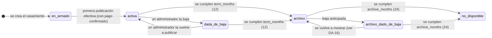

# Weda · Auditoría de arquitectura: preparación para escalar como plataforma

Fecha: 2026-11-01 · Base: `main` en `f1c37a1` (incluye #4–#9) y el diseño decidido en [`docs/data-architecture/`](../data-architecture/06-consolidation-report.md) · Inspección de solo lectura: este documento no cambia código, base de datos ni documentos anteriores.

**Estado del documento:** borrador para aprobación (revisión 11, 2026-11-01). Incorpora las decisiones DA-1 a DA-4 y el modelo multiusuario que definió la dueña. **Solo lo de §1 está decidido** (DA-1 a DA-6, DA-10, DA-13, DA-14, DA-19 y DA-MU). Todo lo marcado «propuesta», «recomendada» o «pendiente» (DA-8, DA-9, DA-11, DA-12 y DA-15 a DA-18 en §13, y los detalles abiertos de DA-13a en §9.5) **espera aprobación**. Las contradicciones con lo ya documentado están en §11.

## 0. Resumen

**En una línea:** la base técnica sirve para V1 y no hace falta rehacerla para crecer. Pero hoy **no se guardan datos que después no se pueden reconstruir**: el origen de cada pareja, quién la refirió, qué condiciones aceptó y dónde es el casamiento. Además, **el supuesto de «un usuario = un casamiento» está en todo el servidor**, y conviene sacarlo **antes** de tener clientes.

**Lo nuevo de esta versión:**
- Un ciclo de vida con **archivo público** (decisión DA-1, que reemplaza a P13, P31 y P34).
- Una vigencia de **12 meses desde la primera publicación**, guardada en cada compra (DA-2).
- **24 meses de archivo**, configurables, con baja anticipada (DA-3).
- Atribución desde el primer contacto (DA-4).
- Un **modelo multiusuario con dos roles visibles** (Administrador y Colaborador), con la titularidad comercial guardada internamente.

## 1. Decisiones de la dueña (2026-11-01)

| # | Decisión | Estado |
|---|---|---|
| **DA-1** | **Archivo público.** A los 12 meses el micrositio pasa a archivo: la URL sigue pública y compartible, y lo interactivo y lo financiero queda deshabilitado. | **Aprobada.** Reemplaza a P13, P31 y P34 (§11). |
| **DA-2** | **Vigencia de 12 meses desde la primera publicación efectiva**, no desde el registro ni desde la compra. El período queda guardado en cada compra. | **Aprobada.** Ver la duda DA-18 sobre la relación con «pagar = activar + publicar». |
| **DA-3** | **Archivo de 24 meses adicionales**, configurable. La pareja puede pedir la baja anticipada de su página. **No es una política irreversible.** | **Aprobada como propuesta inicial.** |
| **DA-4** | **Fuente de adquisición, UTM y códigos de referido** guardados desde el primer contacto, respetando consentimientos y normativa. | **Aprobada conceptualmente.** La base legal sigue a validar (P14, P16). |
| **DA-MU** | **Multiusuario:** varias personas administran un casamiento con su propia cuenta y correo, sin compartir credenciales. **Dos roles visibles:** Administrador (hasta 2 por casamiento, **acceso financiero completo**: total recibido, movimientos, aportes, comprobantes y datos de los medios de cobro) y Colaborador (micrositio, invitados y RSVP, lista de regalos e información general, **sin información financiera**). La **titularidad original** se conserva internamente (propiedad, pagos, control de la cuenta), sin un tercer rol visible. Los permisos financieros se aplican en el servidor. **Cambiar los medios de cobro no debe poder hacerlo un administrador solo y sin una protección adicional**: cuál, está pendiente (DA-13). | **Aprobada**, salvo lo marcado como pendiente. Detalle en §9. |
| **DA-13** | **Cambio de medios de cobro: inmediato, sin espera ni aprobación del otro administrador.** Se mantienen: **reautenticación** antes del cambio, **aviso inmediato a ambos administradores** e **historial auditable** (quién y cuándo). El segundo administrador puede **detectar y reportar** un cambio sospechoso, pero no bloquea preventivamente los cambios legítimos. **El destino nuevo se ve en la página pública en el momento, sin publicar los cambios** (DA-13b). **El reporte avisa y permite volver al destino anterior** (DA-13a). **Se mantienen 3 cambios por día por casamiento; volver atrás desde un reporte no cuenta** (DA-13c). | **Aprobada** (2026-11-01). Reemplaza la elección anterior de la combinación 2, del mismo día. Siguen abiertos los detalles de DA-13a marcados en §9.5. |
| **DA-5** | **El colaborador no ve nada de los regalos recibidos:** ni quién regaló, ni mensajes, ni conteos. La pestaña no aparece y el servidor responde `403`. | **Aprobada** (2026-11-01). |
| **DA-6** | **Alias, banco y CBU se ocultan en el panel y en la vista previa del colaborador** («Alias configurado»). En la página pública los ve como cualquier invitado, y el panel lo aclara. La página pública sigue mostrando alias, banco y CBU. | **Aprobada** (2026-11-01). |
| **DA-10** | **Revocaciones:** nadie revoca al titular; solo el titular revoca al otro administrador; cualquier administrador revoca colaboradores; cualquiera puede irse por sí mismo, salvo el titular (que primero transfiere, DA-9). | **Aprobada** (2026-11-01). |
| **DA-14** | **Una invitación solo la acepta una cuenta con el mismo correo invitado.** Aceptarla también verifica ese correo. | **Aprobada** (2026-11-01). |
| **DA-19** | **El colaborador** gestiona nombres, fecha, momentos, textos, fotos y secciones, y **también puede «Publicar cambios»** de una página ya publicada. **Solo administradores:** la primera publicación (con el pago), dar de baja y volver a publicar, plan, miembros, cobro, vigencia, archivo y cierre. | **Aprobada** (2026-11-01): alternativa B. |

## 2. Diagnóstico del estado actual

### A. Modelo de datos (lo que existe en el código)

| Área | Hoy | Observación |
|---|---|---|
| Usuarios y sesiones | `users`, `sessions` (hash del token), `password_resets` | Correcto. No hay roles: todo usuario es dueño de un casamiento. |
| Casamiento | `weddings`: `owner_id` **UNIQUE** (un casamiento por usuario) y `draft` en JSON (nombres, fecha, eventos, sitio, lista de regalos) | **Choca con DA-MU**: ni una planner con varias bodas ni dos personas en una boda entran. Lo consultable (fecha, lugar) vive dentro del JSON. |
| Invitados | `guests` y `rsvp_events` (historial de respuestas) | Sin entidad «invitación» (diseñada en A6/Q7, no implementada). |
| Lugar | Cada momento guarda `name`, `address` (texto) y `mapsUrl`. El buscador de Google (`src/lib/weda/google-places.ts`) obtiene un `placeId` pero solo lo deja dentro del enlace | **No hay ciudad, provincia, país ni coordenadas estructuradas.** |
| Publicación | `publications`: una fila por casamiento, `status` (`live`/`taken_down`), `snapshot`, `version`, `published_at`, `expires_at` (`addTerm`: primera publicación + **6 meses**) | El micrositio es una **copia única** (snapshot): buena base para el archivo sin duplicar. Al vencer responde `410 site_expired`. **No hay historial de transiciones.** |
| Compras | `orders` (plan, `amount` tomado de `plans.ts`, estado, proveedor) y `payment_events` (idempotencia) | Sin precio de lista, cupón, referido, vigencia contratada ni condiciones aceptadas. **Sin proveedor real** (DP-15). |
| Regalos | `contributions`, `contribution_items`, `contribution_events`, `receipts`, `payout_methods` (con versiones, GIFT-14) | Bien separado de lo de Weda. **El cambio de alias hoy es solo del dueño** (`owner_id`). |
| Consentimientos | `marketing_consents` (correo, origen, versión del texto, alta y baja) | Es de Weda, no del casamiento. Correcto para Ley 25.326. |
| Analítica | `funnel_events`: 14 nombres, 5 propiedades, **sin identidad** | `public_invitation_opened` se registra **sin casamiento**: no se pueden contar visitas por micrositio. |

**Diseño ya decidido y no implementado** (`docs/data-architecture/`): `WeddingMember`, `MemberInvite`, `OwnershipTransfer`, `Subscription`, `ProductEvent` (analítica en capas), `GiftTransaction` (libro), `Invitation` y retención por clases. Esta auditoría **los reutiliza** y señala dónde DA-MU los modifica.

### B. Analítica y tracking
- Hay un embudo mínimo con nombres compartidos entre navegador y servidor (`src/lib/analytics-events.ts`). Lo que prueba un hecho lo registra solo el servidor. Los eventos del navegador están apagados (P14).
- Falta:
  - identidad seudónima por cuenta, por miembro y por casamiento;
  - idempotencia y versión del evento;
  - atribución;
  - visitas por micrositio.

### C. Billing y monetización

| Concepto | ¿Desacoplado hoy? |
|---|---|
| Plan | Sí: `plans.ts`, en el código |
| Precio | Parcial: se copia a la orden; no hay precio de lista frente a precio pagado |
| Pago | Parcial: `orders` + `payment_events`; sin proveedor real |
| Período de publicación | **No**: constante global de 6 meses; no queda guardado qué se compró |
| Derechos de uso | **No**: se deducen de `publications.plan_id` y de la orden pagada (`entitledPlan`); no hay `Subscription` |
| Estado del pago | Sí: `orders.status` |
| Estado de publicación | Sí: `publications.status` + vencimiento |
| Cupones | No existen |
| Comisiones | No existen |

### D. Privacidad y seguridad
- **Aislamiento:** sólido **para el modelo de un dueño**. Toda consulta filtra por el usuario de la sesión, no hay rutas por id (`auth-isolation.test.ts` lo verifica). Con DA-MU el aislamiento pasa a ser **por membresía y permiso** (§9).
- **La API pública** devuelve solo el snapshot (BR-27).
- **Acceso de invitados:** sin enlace personal (Q7 pendiente).
- **Retención:** diseñada (`02b`), **no implementada**.
- **El archivo (DA-1, DA-3)** deja fotos, nombres, fecha y lugar públicos hasta 24 meses más.

### E. Escalabilidad comercial

| Funcionalidad | Facilidad hoy | Qué lo frena |
|---|---|---|
| Referidos y atribución de ventas | Fácil **si** se guarda el código en la orden desde V1 | Sin el dato no hay atribución retroactiva |
| Partners y comisiones | Media | Falta la entidad; se apoya en la orden |
| Wedding planners en varias bodas | **Se resuelve con DA-MU** | Hoy: `owner_id UNIQUE` |
| Proveedores, categorías y leads | Media | Dominio nuevo; necesita ubicación estructurada |
| Publicidad patrocinada | Media | Política de privacidad y medición de visitas |
| Recomendaciones por ubicación | **Difícil sin datos** | No hay ciudad, provincia ni coordenadas |

## 3. Riesgos de escalabilidad (de mayor a menor)
1. **Un casamiento por usuario en todo el servidor:** 15 operaciones de `service.ts` resuelven el casamiento a partir del usuario (`weddingOf`/`ensureWedding`). Cambiarlo con clientes reales exige migrar datos vivos y cambiar todas las rutas a la vez.
2. **Atribución perdida:** cada registro sin origen guardado es irrecuperable.
3. **Datos consultables dentro del JSON** (fecha y lugar).
4. **Vigencia no guardada en la compra.**
5. **Sin historial de publicación ni de membresías.**
6. **Eventos sin identidad.**
7. **Concurrencia entre editores:** hoy hay una revisión por borrador completo. Con varias personas editando, los conflictos (409) van a ser más frecuentes (A8 diseñó una revisión por bloque).

## 4. Lo que hoy no guardamos y sería difícil recuperar después

| Dato | ¿Se puede reconstruir? | Para qué hará falta |
|---|---|---|
| Origen del registro (UTM, sitio de origen, página de entrada) | **No** | Adquisición, costo por canal |
| Código de referido o de partner en la compra | **No** | Referidos, comisiones |
| Precio de lista, descuento y cupón | No (solo queda el monto) | Cupones, márgenes, comisiones |
| Vigencia contratada y condiciones aceptadas (P33) | **No** | Prueba legal, cambios comerciales |
| Ubicación estructurada | Parcial y caro | Recomendaciones, marketplace |
| Historial de publicación | No (la fila se sobrescribe) | Soporte, ciclo de vida |
| Quién hizo cada cambio (con varios usuarios) | **No**, si no se guarda desde que existan varios | Soporte, seguridad, disputas entre miembros |
| Visitas por micrositio | **No** | Analítica comercial, valor para partners |

## 5. Cambios recomendados

Cada uno con **problema**, **beneficio**, **costo** y **riesgo de no hacerlo ahora**.

### Necesario antes del lanzamiento
- **N1 · Vigencia de 12 meses guardada en la compra (DA-2).** `PUBLICATION_MONTHS` pasa a 12 como valor por defecto. La orden guarda `term_months`, y la publicación guarda `term_months` y `expires_at` = primera publicación efectiva + `term_months`, fijados una sola vez.
  - Problema: el código vende 6 y no guarda qué se compró.
  - Beneficio: cambiar el período en el futuro solo afecta a las compras nuevas.
  - Costo: bajo (migración que solo agrega columnas).
  - Riesgo: vender 6 meses por error o no poder honrar lo vendido.
- **N2 · Estado de archivo derivado, sin duplicar el micrositio (DA-1, DA-3).** Detalle en §7 y §8.
  - Problema: hoy vence con un 410.
  - Beneficio: la URL sigue viva y el comportamiento es automático.
  - Costo: medio.
  - Riesgo: hay que definirlo antes del primer vencimiento pagado.
- **N3 · Aceptación de condiciones en la compra (P33).** Se guardan versión del texto, fecha y usuario.
  - Costo: bajo.
  - Riesgo: la prueba legal no se puede reconstruir.
- **N4 · Proveedor de pagos real (DP-15).** Es un bloqueante conocido.
- **N5 · Modelo multiusuario: membresías, permisos en el servidor e invitaciones (DA-MU).** Detalle e impacto en §9.
  - Problema: `owner_id UNIQUE` y el supuesto de un usuario por casamiento.
  - Beneficio: parejas con dos administradores, colaboradores y planners con varias bodas, sin migrar datos de clientes.
  - Costo: **alto, el incremento más grande hasta ahora.**
  - Riesgo: migrarlo después con datos vivos y con todas las rutas en uso.

### Conveniente preparar ahora
- **C1 · Primer contacto de adquisición (DA-4).** En la primera visita a la landing se guardan en el navegador `utm_*`, el dominio de origen, la página de entrada y `ref`. Al crear la cuenta, el servidor lo guarda en `acquisition_touches` (usuario, campos, fecha), con una lista cerrada de campos y largos máximos.
  - Sin seguimiento entre sitios ni identificadores de terceros.
  - Costo: bajo a medio.
  - Riesgo: el dato perdido no vuelve.
- **C2 · Orden con precio de lista, descuento, cupón y referido.** Columnas que se pueden dejar vacías: `list_price`, `discount`, `coupon_code` y `ref_code`.
  - Costo: bajo.
  - Riesgo: no hay atribución para lo ya vendido.
- **C3 · Fecha y ubicación consultables.** Se guardan `placeId`, ciudad, provincia, país y coordenadas del lugar, y se copian a `weddings` la fecha de la boda y la región.
  - Uso interno y agregado.
  - Costo: bajo a medio.
- **C4 · Historial de publicación y de membresías** (`publication_events`, `member_events`, solo agregado).
  - Costo: bajo.
  - Riesgo: sin rastro de quién hizo qué.
- **C5 · Analítica con identidad mínima** ([`05`](../data-architecture/05-analytics-architecture.md) §5.1) y **contadores diarios de visitas por casamiento** (`site_daily_stats`), sin registrar visitantes individuales.
  - Costo: medio.

### No necesario hasta tener tracción
- Partners, afiliados y comisiones.
- Marketplace de proveedores, categorías y leads.
- Publicidad patrocinada.
- Motor de recomendaciones.
- Almacén de datos externo.
- Suscripciones, renovaciones y extensiones (excluidas por decisión).
- Del modelo multiusuario, lo que puede esperar (§9.7): transferencia de titularidad con interfaz, revisión por bloque, panel de planner con varias bodas juntas y registro de actividad visible.

## 6. Propuesta de evolución de entidades y eventos

| Etapa | Nuevas o cambiadas | Origen |
|---|---|---|
| V1, antes del lanzamiento | `orders` + `term_months`, `terms_version`, `terms_accepted_at`; `publications` + `term_months`, `archive_months`, `archive_ends_at`; archivo derivado; **`wedding_members`**, **`member_invites`**; `weddings` sin `owner_id UNIQUE` | N1–N5 |
| V1, conveniente | `acquisition_touches`; `orders` + `list_price`, `discount`, `coupon_code`, `ref_code`; `weddings` + `event_date`, `region`, `country`; `publication_events`; `member_events`; `site_daily_stats`; contrato de eventos | C1–C5 |
| V2, referidos | `Partner`, `ReferralCode`, `Coupon`, `Attribution`, `Commission` (solo agregado) | Nuevo |
| V2, multiusuario completo | `OwnershipTransfer` (ya diseñado), revisión por bloque (A8) | Diseñado |
| V3, marketplace y publicidad | `Vendor`, `VendorCategory`, `ServiceArea`, `Lead` (con consentimiento explícito), `Placement`, `Campaign` | Nuevo |

**Eventos: operativos frente a analíticos**

| Lo que se quiere medir | Fuente operativa (la verdad) | Evento analítico (solo medición) |
|---|---|---|
| Adquisición | `acquisition_touches` | `landing_viewed` (canal agregado) |
| Registro | `users` | `signup_completed` |
| Creación del casamiento | `weddings`, `wedding_members` | `event_created` |
| Activación | `draft.onboarded` | `onboarding_completed` (nuevo) |
| Publicación | `publications`, `publication_events` | `publication_completed` |
| Compra | `orders`, `payment_events` | `checkout_started`, `payment_confirmed` |
| Miembros | `member_invites`, `member_events` | `member_invited`, `member_joined`, `member_revoked` (nuevos, sin correos) |
| Visitas al micrositio | `site_daily_stats` | `public_invitation_opened` **con casamiento** |
| Interacción de invitados y RSVP | `rsvp_events`, `guests` | `rsvp_submitted` |
| Regalos | `contributions` | `public_gifts_viewed`, `gift_submitted` |
| Paso a archivo y fin del archivo | `publication_events` | `publication_archived`, `archive_ended` (nuevos, idempotentes) |

## 7. Ciclo de vida de publicación (DA-1, DA-2, DA-3)

- **Dos relojes, fijados una sola vez** en la primera publicación efectiva:
  - `expires_at` = primera publicación + `term_months` (12, guardado en la compra);
  - `archive_ends_at` = `expires_at` + `archive_months` (24, valor por defecto configurable).
  - Las mejoras de plan no los cambian; bajar y volver a publicar tampoco.
- **Transición automática sin tareas programadas:** el estado se **calcula al leer**, comparando `ahora` con los dos relojes (como ya hace `livePublication`).
  - Un trabajo diario e idempotente, opcional, solo registra `publication_events`, emite los eventos analíticos y manda los avisos (P23).
  - Si no corre, el comportamiento igual es correcto.
- **Configurable sin tocar la lógica:** `term_months` y `archive_months` tienen su valor por defecto en `plans.ts` y se copian a la compra y a la publicación. Cambiarlos afecta solo a las compras nuevas.
  - «No irreversible» (DA-3) se cumple así: la política vive en configuración y en cada registro, no en el código. Un cambio futuro puede aplicarse a los archivos vigentes **solo por decisión expresa** (DA-17).
- **No se implementan** extensiones, renovaciones ni suscripciones.
- **Lo que se bloquea en el servidor** al pasar a archivo:
  - RSVP y aportes: `410 site_archived`;
  - publicar cambios, editar el borrador, mejorar el plan y nuevas órdenes para ese evento;
  - invitar miembros (ver DA-15).

## 8. El micrositio y el panel en estado de archivo

- **Micrositio:**
  - Es el mismo snapshot, sin copia nueva. La API pública devuelve `{ site, state: 'archived' }`.
  - El servidor quita alias, banco y CBU antes de enviarlo.
  - Se muestran diseño, fotos, historia, eventos y lista de regalos sin «Regalar».
  - El RSVP se reemplaza por un texto de cierre.
  - Se ocultan la cuenta regresiva y «Agendar».
  - Hay un aviso discreto de recuerdo en la tipografía del micrositio.
  - Lleva `noindex`.
  - Nunca muestra datos de invitados, importes ni conteos.
- **Panel:** solo lectura, con los mismos límites por rol que durante la vigencia (§9.2). Hay descargas según `02d` §5, si se mantienen (DA-15).
- **Baja anticipada (DA-3):** la pareja puede pedirla. Cómo (sola desde el panel o pidiéndola a Weda) y si es reversible está pendiente (DA-16). La eliminación definitiva de datos es otro procedimiento (`02b` §6–§7).
- **Fin del archivo:** la URL responde «no disponible», **no se reutiliza** (P24 se mantiene) y los datos pasan a la política de retención (`02b`, plazos todavía sin fijar).

## 9. Modelo multiusuario (DA-MU)

### 9.1 Modelo de datos
Se parte de `WeddingMember` y `MemberInvite`, ya diseñados (`04-data-dictionary.md`). DA-MU cambia los roles visibles:

| Concepto | Diseño anterior (A2) | DA-MU |
|---|---|---|
| Roles visibles | Propietario, Administrador, Colaborador | **Solo Administrador y Colaborador** (decidido) |
| Titularidad | Rol «propietario», único y visible | **Titularidad interna, no visible como rol** (decidido). Sirve para la propiedad, los pagos y el control de la cuenta. Propuesta técnica: una marca `is_titular` en uno de los administradores |
| Límite | Sin límite de administradores | **Hasta 2 administradores** por casamiento, contando al titular (decidido) |
| Varios casamientos por usuario | Decidido (ACC-03, BR-39) | Igual: una planner colabora en varias bodas desde una cuenta (decidido) |

**Tablas propuestas** (propuesta técnica, a aprobar con el plan de implementación):
- `wedding_members`: `wedding_id`, `user_id`, `role` (`admin`, `collaborator`), `is_titular`, `status` (`active`, `revoked`), quién lo agregó y fechas.
  - `UNIQUE (wedding_id, user_id)`.
  - Unicidad parcial: un titular activo por casamiento.
  - Máximo dos administradores activos, validado en el servidor dentro de la transacción.
- `member_invites`: `wedding_id`, correo, rol propuesto (nunca titular), **hash** del token, quién invita, vencimiento y aceptación o revocación.
- `weddings`: se elimina la restricción `owner_id UNIQUE`. En SQLite eso exige **reconstruir la tabla** (copiar, borrar, renombrar) en la misma transacción de la migración. `owner_id` deja de usarse para autorizar.

### 9.2 Cuatro permisos separados: lista, regalos recibidos, información financiera y medios de cobro

Gestionar la lista de regalos **no** da acceso a lo que los invitados regalaron ni al dinero. Son cuatro permisos distintos, verificados en el servidor:

| Permiso | Qué incluye | Administrador | Colaborador |
|---|---|:-:|:-:|
| **`gifts.manage_list`** · Administrar la lista | Crear, editar, ordenar y quitar regalos, incluido su importe sugerido; elegir packs | ✓ | ✓ |
| **`gifts.view_received`** · Ver regalos recibidos | Quién regaló, su mensaje y qué regalo eligió | ✓ | **—** (DA-5) |
| **`finance.view`** · Ver información financiera | Importe de cada aporte, total recibido, acumulados, movimientos, estado de revisión, comprobantes, confirmar, rechazar y pedir comprobante, y el historial del medio de cobro | ✓ | **—** |
| **`payout.view` / `payout.change`** · Medios de cobro | Ver alias, banco y CBU; cambiarlos al instante, con clave, aviso a ambos administradores e historial (§9.5, DA-13) | ✓ ver y cambiar | **—** |

**El resto de la matriz** (decidido salvo lo marcado):

| Permiso | Administrador | Colaborador |
|---|:-:|:-:|
| Ver el panel del casamiento | ✓ | ✓ |
| Editar el micrositio | ✓ | ✓ |
| Gestionar la información general del evento (nombres, fecha, momentos, textos, fotos, secciones) | ✓ | ✓ (DA-19) |
| «Publicar cambios» de una página ya publicada | ✓ | ✓ (DA-19) |
| Gestionar invitados, grupos y RSVP | ✓ | ✓ |
| Invitar miembros; revocar colaboradores | ✓ | — |
| Revocar al otro administrador | Solo el titular (DA-10) | — |
| Irse por sí mismo | ✓, salvo el titular (DA-9, DA-10) | ✓ |
| Primera publicación, dar de baja, volver a publicar, elegir plan y pagar | ✓ (pago en DA-8) | — |
| Configuración del evento (vigencia, archivo, cierre) | ✓ | — |
| Cambiar la titularidad | Pendiente (DA-9) | — |

**Qué ve cada persona** (con DA-5 y DA-6 aprobadas):

| Información | Administrador (panel) | Colaborador (panel) | Cualquier invitado (micrositio público) |
|---|:-:|:-:|:-:|
| Lista de regalos: nombre, foto, importe sugerido | ✓ | ✓ (y la edita) | ✓ (vigente y archivo) |
| Si el cobro está configurado (sí o no) | ✓ | ✓ (para saber si la lista está lista) | Implícito |
| Alias | ✓ | **— (DA-6; lo ve en la página pública como cualquier invitado)** | **✓ durante la vigencia**, al elegir un regalo; **no** en archivo |
| Banco y CBU, si la pareja los cargó | ✓ | **—** | **✓ durante la vigencia**; **no** en archivo |
| Quién regaló, mensaje y regalo elegido | ✓ | **— (DA-5)** | **—** |
| Importe de cada aporte, totales, acumulados, movimientos | ✓ | **—** | **—** |
| Estado de revisión de cada aporte | ✓ | **—** | Solo quien regaló, sobre su propio aporte (enlace de constancia) |
| Comprobantes | ✓ | **—** | Solo quien regaló, el propio |
| Historial de cambios del medio de cobro | ✓ | **—** | **—** |
| Órdenes y pagos a Weda | ✓ | **—** | **—** |

**Cómo se aplica en el servidor**, no solo en la interfaz:
- **Una guardia central** `authorize(userId, weddingId, permiso)`: verifica membresía activa, permiso del rol y estado del evento (vigente o archivo).
- **Respuestas recortadas para el colaborador:**
  - `getWedding` devuelve el borrador **sin** alias, banco ni CBU, sin `payout`, y con un indicador de «cobro configurado»;
  - `saveWedding` ya descarta el destino de cobro, como hoy;
  - aportes (incluidos nombres, mensajes y conteos), comprobantes, órdenes y pagos responden `403` (DA-5).
- **Vista previa del panel:** recibe el borrador recortado, así que al colaborador le muestra «Alias configurado» en lugar del alias.
- **Pruebas de aislamiento por rol:** que un colaborador no obtenga ningún dato financiero por ninguna ruta, ni aunque arme el pedido a mano.

### 9.3 Invitaciones y gestión de usuarios
- **Invitar:** un administrador ingresa un correo y un rol. Se crea `member_invites` (token aleatorio, solo el hash en la base, vencimiento) y sale un correo con el enlace.
- **Aceptar con una cuenta existente:** al abrir el enlace con la sesión iniciada, se crea la membresía **solo si el correo de la cuenta coincide con el invitado** (DA-14). Si no coincide, se explica y no se da acceso.
- **Sin cuenta:** el enlace lleva a registrarse y, al terminar, acepta la invitación.
- **Revocar:** marca la membresía como `revoked`; los pedidos siguientes de esa persona para **ese** casamiento reciben `403`. Nadie revoca al titular; solo el titular revoca al otro administrador; cualquier administrador revoca colaboradores (DA-10).
- **Varias bodas por usuario:** el panel pide elegir el casamiento si hay más de uno, y las rutas llevan el id del casamiento (§9.6).
- **Avisos:** correo al invitado. Los cambios en los medios de cobro avisan a ambos administradores (§9.5).
- **Registro:** cada alta, aceptación, revocación y cambio de rol queda en `member_events` (C4).

### 9.4 Contradicciones de DA-MU con lo ya decidido
Ver §11. Las principales:
- los dos administradores **consultan** los medios de cobro y los **cambian al instante, con clave, aviso e historial** (DA-13), cuando **Q4 y BR-30** dicen «solo el propietario»;
- desaparece el rol visible «propietario» (**A2, BR-37**);
- hay un tope de 2 administradores, que no existía.

### 9.5 Protección del cambio de medios de cobro (DA-13, aprobada)

**Objetivo:** que **ningún administrador pueda cambiar solo y sin control** adónde transfieren los invitados, sin volver engorroso el uso habitual. Un cambio de alias es raro: suele ocurrir al configurar la lista y, si acaso, una vez más.

**Situación actual** (GIFT-14, en `main`):
- la clave se pide en la misma operación;
- se muestra una confirmación con el destino anterior enmascarado;
- se permiten como mucho 3 cambios por día;
- cada versión se guarda (`payout_methods`, con `created_by`);
- se avisa por correo **solo al dueño**;
- el cambio llega a los invitados **recién al publicar**.

| Alternativa | Contra qué protege | Qué no cubre | Experiencia de uso | Complejidad técnica |
|---|---|---|---|---|
| **A · Reautenticación con clave** (ya existe) | Una sesión robada o un dispositivo prestado, sin la clave | Un administrador que actúa de mala fe; la clave robada | Mínima: una clave por cambio | Ya implementada |
| **B · Aviso inmediato al otro administrador** (y al titular) | Que el cambio pase inadvertido: permite reaccionar | No lo impide; depende de que lean el correo (y el correo todavía no se verifica, AUTH-04) | Ninguna fricción | Baja: el correo existe; hay que mandarlo a todos los administradores |
| **C · Confirmación del otro administrador** | Un administrador de mala fe o una cuenta comprometida | Casamientos con un solo administrador; los dos de acuerdo | **Alta**: el cambio queda frenado si el otro no responde | Media a alta: estado «pendiente», vencimiento, pantalla para aprobar o rechazar, avisos |
| **D · Período de espera** (por ejemplo 24 o 48 horas) **cancelable** por cualquier administrador | Un cambio indebido, con margen para frenarlo, aunque haya un solo administrador | Que nadie mire durante la espera; también **demora corregir un alias mal escrito** | Media: hay que explicar por qué no se aplica en el momento | Media: estado «pendiente», aplicación al vencer (calculada al leer, sin tareas programadas), cancelación y avisos |
| **E · Historial auditable** | Reconstruir quién cambió qué y cuándo; resolver disputas | No previene nada | Ninguna fricción (visible solo para administradores) | Baja: `payout_methods` ya guarda versiones y quién; falta mostrarlo y sumar el dispositivo resumido |
| (Relacionada, DP-01) **Confirmación por enlace al correo de quien hace el cambio** | Alguien con la sesión y la clave pero sin acceso al correo | Un administrador de mala fe con su propio correo | Baja a media | Media |

**Combinaciones comparadas:**

| Combinación | Seguridad | Fricción | Complejidad |
|---|---|---|---|
| **1 · A + B + E** | Detecta, pero no impide | Mínima | Baja |
| **2 · A + B + E + D, salteando la espera si el otro confirma** | Impide cambios silenciosos y deja margen para frenarlos | Baja a media | Media |
| **3 · A + B + E + C obligatoria** | La más alta entre dos administradores | Alta | Media a alta |

**Decisión (2026-11-01):** la dueña eligió primero la combinación 2 y el mismo día la reemplazó por **la 1 más un reporte de cambio sospechoso**. El cambio entra en vigencia en el momento, sin espera ni aprobación del otro administrador.

**Cómo funciona** (comportamiento aprobado):
1. Un administrador cambia alias, banco o CBU **con su clave** en la misma operación, como hoy (GIFT-14). El cambio queda **vigente en el momento**.
2. Sale un **aviso inmediato a ambos administradores**, el que hizo el cambio incluido, con los datos enmascarados, quién lo hizo y cuándo.
3. Queda en el **historial auditable**: versión anterior y nueva (enmascaradas), quién, cuándo y el dispositivo resumido. Lo ven solo los administradores.
4. El otro administrador puede **reportar el cambio como sospechoso** desde el aviso o desde el historial. El reporte avisa y le permite **volver al destino anterior** con su clave (DA-13a). No hay bloqueo preventivo.

**Riesgo aceptado:** un administrador de mala fe, o una cuenta comprometida con su clave, puede desviar los cobros. El otro se entera en el momento, pero el cambio ya está vigente. Lo que mitiga el riesgo es la rapidez del aviso y del reporte.

**Detalles todavía abiertos** (no se asumen):
- **DA-13a · Qué hace el reporte de cambio sospechoso — APROBADA (2026-11-01): avisar y volver atrás.**
  - El administrador que reporta lo hace desde el aviso o desde el historial.
  - El reporte **queda registrado** y **avisa** a ambos administradores y a Weda.
  - Quien reporta puede **volver al destino anterior** con su clave. Es un cambio de cobro más: inmediato, avisado y en el historial. No es un bloqueo preventivo.
  - **Sin definir:**
    - qué hace Weda con el reporte (canal, quién lo atiende y en qué plazo). Hoy no hay un proceso de soporte;
    - si volver atrás también sugiere cambiar la clave y cerrar las demás sesiones (ya existe en el perfil, AUTH-05 y AUTH-06);
    - qué pasa si el ida y vuelta se repite durante varios días (DA-13c lo acota a 3 cambios por día).
- **DA-13b · Cuándo lo ven los invitados — APROBADA (2026-11-01): en el momento, sin publicar.**
  - Reemplaza la decisión D4 del plan de GIFT-14 («al publicar los cambios»).
  - Técnicamente, el servidor toma el destino de cobro **vigente** al servir la página pública (`getPublicSite` y la lectura del servidor de `public.ts`), en lugar del que quedó en la copia publicada.
  - Consecuencia: cambiar el alias **ya no enciende** «Publicar cambios», porque deja de ser parte de lo que se publica. Hay que deshacer el ajuste que se hizo al integrar #7 y #8, y cambiar el texto de la confirmación («Tus invitados lo ven cuando publiques los cambios»).
  - En **archivo** no se muestra ningún dato de cobro (§8).
- **DA-13c · Límite diario — APROBADA (2026-11-01): se mantienen 3 cambios por día por casamiento.**
  - **Volver al destino anterior desde un reporte (DA-13a) no cuenta para el límite** (decisión de la dueña, 2026-11-01). Así, quien hizo cambios indebidos no puede impedir que se deshagan.
  - Efecto: el ida y vuelta queda acotado, porque quien cambia puede hacerlo como mucho 3 veces por día y cada reversión es libre.

### 9.6 Impacto técnico de lanzar con dos administradores y colaboradores

| Área | Cambio | Tamaño |
|---|---|---|
| Base | Migración: `wedding_members` + `member_invites`; reconstruir `weddings` sin `owner_id UNIQUE`; copiar cada dueño actual como administrador titular | Medio. Es delicada: reconstruye una tabla central, así que se prueba con una base con datos |
| Servicios | Las **15 operaciones** de `service.ts` que hoy reciben `userId` y buscan «el casamiento del usuario» (23 líneas con `weddingOf`, `ensureWedding`, `ownedContribution` u `owner_id`) pasan a recibir `weddingId` y pasar por `authorize` | Alto. Toca casi todo el servidor |
| API | Las rutas `/api/wedding/*`, `/api/contributions/*` y `/api/orders/*` pasan a `/api/weddings/:id/...`. La prueba que hoy exige que **no exista** `/api/wedding/:id` se reemplaza por pruebas de membresía y permiso | Alto |
| Medios de cobro (GIFT-14 + DA-13) | `changePayout` pasa a permisos de administrador. Hay que mandar el aviso a ambos administradores, mostrar el historial (que ya existe en `payout_methods`, con `created_by`) y sumar el reporte de cambio sospechoso con «volver al destino anterior» (DA-13a). Por DA-13b, la página pública toma el destino vigente al servirse y el aviso de «cambios sin publicar» deja de contar el alias | Bajo a medio |
| Aviso de cambios sin publicar (#7) | Sin cambios de lógica | Bajo |
| Interfaz | El estado del navegador (`AppState` y `localStorage`) asume un solo casamiento: hace falta una clave por casamiento, un selector y ocultar las pestañas financieras según los permisos que mande el servidor | Medio a alto |
| Correo | Invitación a miembros, aviso del cambio de cobro a ambos administradores y aviso del reporte | Bajo |
| Concurrencia | Con varios editores aumentan los 409. En V1 se puede mantener la revisión por borrador con un buen mensaje de conflicto; la revisión por bloque (A8) puede esperar | Bajo en V1 |
| Cuentas | Si el titular quiere irse con otros miembros activos, primero tiene que transferir (`02b` §6, DA-9). En V1 alcanza con bloquear esa salida | Bajo |
| Pruebas | Aislamiento por rol, por membresía revocada y entre casamientos de una misma planner | Medio |

**Estimación:** es el incremento más grande hasta ahora, del orden de **cuatro PR** (el cambio de cobro de DA-13 entra en el 4):
1. migración y guardia de permisos, con un solo administrador y sin cambio visible;
2. rutas por casamiento e interfaz con selector;
3. invitaciones, aceptación y revocación;
4. recortes financieros para el colaborador, más los avisos, el historial y el reporte del cambio de cobro (DA-13), con sus pruebas.

**Recomendación para discutir:** hacerlo **antes del lanzamiento**, aunque demore la salida.
- Lo caro de cambiar después es la base y las rutas, no las pantallas.
- Si no entra todo, el corte mínimo para V1 es el **PR 1 + PR 2**.

### 9.7 Qué entra en V1 y qué puede esperar (propuesta)

| En V1 | Puede esperar |
|---|---|
| `wedding_members`, titular interno, hasta 2 administradores | Transferencia de titularidad con interfaz (según DA-9) |
| Guardia de permisos en el servidor con los cuatro permisos separados (§9.2) | Revisión por bloque (A8) |
| Rutas por casamiento y selector si hay más de uno | Panel de planner con varias bodas juntas |
| Invitar, aceptar (con cuenta o registrándose) y revocar | Historial de actividad visible para todos los miembros |
| Cambio de cobro con clave, aviso a ambos administradores, historial y reporte (DA-13). Tiene que estar **antes** de que exista un segundo administrador | Permisos finos por miembro |
| `member_events` (registro interno) | Roles adicionales |

## 10. Decisiones y documentos que hay que actualizar al aprobar

| Documento | Qué cambia | Por |
|---|---|---|
| `data-architecture/02-domain-model.md` §5.3 (A2) y §5.4 (Q4); decisiones P13, P31, P32, P34 | Roles, titular interno, tope de 2 administradores, los cuatro permisos separados de §9.2, cambio de cobro inmediato con aviso, historial y reporte (DA-13) y archivo público | DA-MU, DA-1, DA-13 |
| `data-architecture/02d-event-lifecycle-and-final-export.md` §0–§3 | Inicio en la primera publicación efectiva; estado «archivo»; panel de solo lectura en archivo; permisos por rol | DA-1, DA-2, DA-3 |
| `data-architecture/02b-retention-privacy-deletion.md` §4.E y §8 | La retención posterior empieza al terminar el archivo (contenido público), no al vencer | DA-1, DA-3 |
| `data-architecture/05-analytics-architecture.md` §11 | Eventos del ciclo de vida (archivo y fin del archivo) y de miembros | DA-1, DA-MU |
| `data-architecture/04-data-dictionary.md` | `WeddingMember` (roles, `is_titular`), `MemberInvite` pasa de «Preparar» a «Ahora» y `Publication` suma los relojes | DA-MU, DA-3 |
| `product-blueprint/02-business-rules-catalog.md` | BR-03 y BR-04 (inicio de la vigencia), BR-07 (archivo en lugar de cierre), BR-10 (avisos a administradores), BR-30 (administradores; inmediato con aviso, historial y reporte), BR-37 (titular interno, 2 administradores) | Todas |
| `product-blueprint/01-feature-inventory.md` | PUB-06, PUB-07, PUB-09, ACC-02, ACC-03, ACC-04 y DASH-05 | Todas |
| `product-blueprint/03-open-decisions-and-risks.md` | Registrar DA-5 a DA-19 como pendientes con su ID | §13 |
| Código ya integrado (GIFT-14, #8) | Hoy el cambio de alias es solo del dueño y avisa solo al dueño: pasa a administradores, con aviso a ambos, historial visible y reporte (DA-13). Por DA-13b, el destino nuevo se ve en la página pública sin publicar: cambia D4 de GIFT-14 y el aviso de «cambios sin publicar» deja de contar el alias | DA-MU, DA-13 |

## 11. Contradicciones con decisiones ya documentadas

| Decisión vigente | Qué dice | Qué dice la nueva | Resolución propuesta |
|---|---|---|---|
| **P31** (`02d` §2.3) | Al vencer, la URL deja de estar disponible; sin recuerdo ni vista estática | Archivo público 24 meses | **Reemplazar por DA-1 y DA-3** |
| **P13** | Al vencer, el evento se cierra sin acceso privado adicional | Panel de solo lectura durante el archivo | Reemplazar |
| **P34** | El evento vencido muestra solo información comercial | Lectura del contenido por rol | Reemplazar |
| **BR-03 / BR-04 / `02d` §1** | La vigencia empieza cuando Weda confirma el pago y activa | Empieza en la primera publicación efectiva | **Coinciden solo si se mantiene «pagar = activar + publicar» (BR-01).** Ver DA-18 |
| **A2 / BR-37** | Un propietario visible, más administradores y colaboradores | Dos roles visibles, titular interno, hasta 2 administradores | Reemplazar; el invariante «exactamente un titular» se mantiene |
| **Q4 / BR-30 / `02` §5.4** | Solo el propietario cambia alias o datos bancarios | Los dos administradores los **consultan**; ninguno puede **cambiarlos solo y sin protección adicional** | **Reemplazar por DA-13 (aprobada):** cambio inmediato con clave, aviso a ambos administradores, historial y reporte. Actualizar Q4 y BR-30. Q4 preveía una confirmación fuera de banda **antes** de mostrar el destino nuevo: queda descartada para este caso. DP-01 queda para extras futuros (segundo factor) |
| **Matriz de `02` §5.3** | `billing.manage` y `wedding.close` solo del propietario; `gifts.view_contributions` para propietario y administrador | Publicación y configuración para administradores; cuatro permisos separados (§9.2) | Pagar y cerrar: **pendiente (DA-8, DA-9)**. La matriz se reemplaza por la de §9.2 |
| **`02d` §1.5 / BR-10** | Avisos de vencimiento al propietario | — | **Sin definir:** propuesta, a todos los administradores |

## 12. Priorización

| # | Recomendación | Impacto | Costo | Urgencia | Categoría |
|---|---|---|---|---|---|
| N5 | Multiusuario: membresías, permisos y rutas por casamiento | Alto | **Alto** | **Alta** (antes de tener clientes) | Antes del lanzamiento |
| N1 | Vigencia de 12 meses guardada en la compra | Alto | Bajo | Alta | Antes del lanzamiento |
| N3 | Aceptación de condiciones (P33) | Alto | Bajo | Alta | Antes del lanzamiento |
| N4 | Proveedor de pagos real (DP-15) | Alto | Alto | Alta | Antes del lanzamiento |
| N2 | Archivo derivado con dos relojes | Alto | Medio | Media (antes del primer vencimiento) | Antes del lanzamiento |
| C1 | Primer contacto de adquisición | Alto | Bajo | Alta | Conveniente ahora |
| C2 | Orden con lista, descuento, cupón y referido | Medio | Bajo | Alta | Conveniente ahora |
| C4 | Historial de publicación y de membresías | Medio | Bajo | Media | Conveniente ahora |
| C3 | Fecha y ubicación consultables | Medio | Bajo a medio | Media | Conveniente ahora |
| C5 | Analítica con identidad mínima y visitas por sitio | Medio | Medio | Media | Conveniente ahora |
| — | Transferencia de titularidad, revisión por bloque, panel de planner | Medio | Medio | Baja | Con tracción |
| — | Partners, marketplace, publicidad y recomendaciones | Alto a futuro | Alto | Baja | Con tracción |

## 13. Decisiones pendientes de aprobación (DA-5 a DA-19)

**Ninguna de estas está decidida, salvo DA-5, DA-6, DA-10, DA-13, DA-14 y DA-19** (aprobada el 2026-11-01, con DA-13a, DA-13b y DA-13c; siguen abiertos algunos detalles de DA-13a). DA-7 quedó sin objeto. La «alternativa recomendada» es una propuesta para discutir; no se implementa hasta que la confirmes. Cada una dice:
- la situación actual;
- el problema que resuelve;
- las alternativas con sus riesgos;
- las implicancias comerciales y técnicas.

### DA-5 · ¿El colaborador ve los regalos recibidos? — **APROBADA (2026-11-01): alternativa A, no ve nada**
- **Situación actual:** hay un solo usuario por casamiento. «Aportes» muestra a la vez quién regaló, el mensaje, el regalo, el importe, el estado y el comprobante.
- **Problema que resuelve:** separar «administrar la lista» de «ver lo recibido» (§9.2).
- **Alternativas:**
  - **A (recomendada) · No ve nada de lo recibido.** La pestaña no aparece y el servidor responde `403`.
    - Riesgo: el colaborador no puede ayudar con los agradecimientos.
  - **B · Ve quién regaló, el mensaje y el regalo, sin importes ni comprobantes.**
    - Riesgo: **los importes se deducen**, porque un aporte a un regalo de la lista vale su importe sugerido, que el colaborador conoce porque administra la lista. No cumple «sin información financiera».
  - **C · Ve solo cuántas veces se regaló cada regalo.**
    - Riesgo: la misma deducción (cantidad × importe sugerido).
- **Implicancias comerciales:** A es la más fácil de explicar: «lo recibido y el dinero son de los administradores». B le sirve a una planner que ayuda con los agradecimientos.
- **Implicancias técnicas:** A es un `403` en toda la ruta de aportes. B y C requieren respuestas recortadas propias y sus pruebas.

### DA-6 · El alias es público en el micrositio — **APROBADA (2026-11-01): alternativa A, se oculta solo en el panel**
- **Situación actual:**
  - la página de regalos publicada muestra el alias (y banco y CBU, si la pareja los cargó) a cualquier invitado, al elegir un regalo;
  - el panel y la vista previa los toman del borrador.
- **Problema que resuelve:** el colaborador no debe consultar el alias, pero **cualquier persona con la URL lo ve**. La restricción solo se puede cumplir dentro del panel.
- **Alternativas:**
  - **A (recomendada) · Ocultarlo en el panel y en la vista previa del colaborador, y aceptar que en la página pública es visible** como para cualquier invitado.
    - Riesgo: que se entienda que el alias es confidencial cuando no lo es.
  - **B · Ocultarlo también en la página pública hasta que el invitado elige un regalo.** Ya ocurre así: el alias aparece en el paso de pago.
    - Riesgo: no impide verlo; solo agrega un paso.
  - **C · Quitar banco y CBU de la página pública y dejar solo el alias.**
    - Riesgo: algunos invitados transfieren por CBU.
- **Implicancias comerciales:** conviene decirlo claro en el panel: «tus invitados ven el alias al regalar».
- **Implicancias técnicas:** A requiere el borrador recortado y un marcador en la vista previa. B no cambia nada. C es un cambio de la página pública.

### DA-7 · Primera carga del medio de cobro y casamientos con un solo administrador — **sin objeto tras DA-13**
- **Situación:** la pregunta existía porque la combinación 2 tenía espera y confirmación del otro administrador.
- **Con DA-13 aprobada:** la misma regla vale siempre (clave, aviso e historial), con o sin alias previo y con uno o dos administradores. Con un solo administrador, el aviso le llega a esa misma persona.
- **No requiere decisión**, salvo que quieras otra regla para la primera carga.

### DA-8 · ¿Quién paga y a nombre de quién queda la compra?
- **Situación actual:** las órdenes son del casamiento y las inicia el único usuario.
- **Problema que resuelve:** con dos administradores y una titularidad interna.
- **Alternativas:**
  - **A (recomendada) · Paga cualquier administrador; la compra queda del casamiento, con el titular como responsable comercial.** Se guarda quién pagó.
    - Riesgo: un reembolso (P26) pedido por quien no pagó.
  - **B · Solo paga el titular.**
    - Riesgo: si el titular no está disponible, nadie puede publicar.
  - **C · Quien paga pasa a ser titular.**
    - Riesgo: la titularidad cambia sin intención.
- **Implicancias comerciales:** a nombre de quién va la factura (DP-02) y a quién se reembolsa (P26), ambas abiertas.
- **Implicancias técnicas:** una columna `paid_by_user_id` en `orders` y el permiso de pago.

### DA-9 · ¿Se puede transferir la titularidad?
- **Situación actual:** no existe. Estaba diseñada como `OwnershipTransfer` (iniciada por el propietario, con aceptación del destinatario).
- **Problema que resuelve:** parejas que se separan, una planner que creó el casamiento para la pareja, o un titular que quiere eliminar su cuenta.
- **Alternativas:**
  - **A (recomendada) · Solo el titular la transfiere a otro administrador**, con clave y aceptación. Interfaz en V2; en V1, por soporte.
    - Riesgo: si el titular desaparece, hace falta soporte.
  - **B · Solo por soporte de Weda.**
    - Riesgo: carga de soporte y verificación de identidad.
  - **C · No se permite.**
    - Riesgo: eventos «atrapados» y cuentas que no se pueden eliminar.
- **Implicancias comerciales:** relevante para el programa de planners: la planner crea el evento y debería poder dejarlo en manos de la pareja.
- **Implicancias técnicas:** `OwnershipTransfer` ya está diseñado; es media complejidad con interfaz y baja por soporte.

### DA-10 · Quién revoca a quién — **APROBADA (2026-11-01): alternativa A**
- **Situación actual:** no hay miembros.
- **Problema que resuelve:** que un administrador no pueda quedarse solo con el evento ni dejar afuera al titular.
- **Alternativas:**
  - **A (recomendada) · Nadie revoca al titular; solo el titular revoca al otro administrador; cualquier administrador revoca colaboradores; cualquiera puede irse por sí mismo** (salvo el titular, DA-9).
    - Riesgo: el administrador no titular no puede defenderse de un titular que lo revoca. Es aceptable si la titularidad es la «propiedad».
  - **B · Los dos administradores pueden revocarse entre sí, salvo al titular.** Con dos administradores equivale a A.
  - **C · Revocar a un administrador requiere la confirmación del otro.**
    - Riesgo: bloqueos.
- **Implicancias comerciales:** conflictos de pareja o con la planner; conviene una regla simple.
- **Implicancias técnicas:** reglas en `authorize` y en la transacción de revocación, con pruebas.

### DA-11 · ¿Límite de colaboradores?
- **Situación actual:** no hay colaboradores.
- **Problema que resuelve:** abuso (invitaciones masivas) y costo de soporte.
- **Alternativas:**
  - **A (recomendada) · Límite configurable, con el número a definir por vos.**
    - Riesgo: un número bajo frustra a familias grandes.
  - **B · Sin límite.**
    - Riesgo: abuso de las invitaciones por correo.
  - **C · Límite según el plan.**
    - Riesgo: necesita una decisión de precios (DA-12).
- **Implicancias comerciales:** puede ser un diferencial de plan (C) o algo incluido (A).
- **Implicancias técnicas:** una constante y una verificación en la invitación.

### DA-12 · ¿El multiusuario depende del plan?
- **Situación actual:** `plans.ts` no menciona miembros ni colaboradores; no se puede inventar.
- **Problema que resuelve:** saber si se vende como diferencial.
- **Alternativas:**
  - **A (recomendada) · Incluido en todos los planes.**
    - Riesgo: se pierde un argumento de venta.
  - **B · Solo en el plan superior.**
    - Riesgo: una pareja de dos personas en el plan básico tendría que compartir clave, justo lo que DA-MU quiere evitar.
  - **C · Dos administradores en todos los planes; colaboradores según el plan.**
    - Riesgo: más reglas que explicar.
- **Implicancias comerciales:** decisión de precios y planes; toca `plans.ts` y los textos de la landing.
- **Implicancias técnicas:** si depende del plan, `authorize` también consulta el plan vigente (como prevé la matriz de `02` §5.3).

### DA-13 · Protección del cambio de medios de cobro — **APROBADA (2026-11-01)**
- **Situación actual:** GIFT-14 (§9.5): clave, confirmación, 3 cambios por día, versiones y aviso solo al dueño. Q4 y BR-30 dicen «solo el propietario».
- **Decisión:** el cambio entra en vigencia **en el momento**, sin espera ni aprobación del otro administrador. Se mantienen la reautenticación, el aviso inmediato a ambos administradores y el historial auditable (quién y cuándo). El otro administrador puede reportar un cambio sospechoso, sin bloquear preventivamente.
- **Riesgo aceptado:** un administrador de mala fe, o una cuenta comprometida con su clave, puede desviar los cobros hasta que alguien lo note.
- **Implicancias comerciales:** el uso habitual no tiene fricción. La protección depende de que los administradores lean el aviso; conviene que el correo sea claro y que el panel muestre el último cambio.
- **Implicancias técnicas:** bajas. Son avisos a ambos administradores, el historial visible (los datos ya existen en `payout_methods`) y el reporte. No hace falta el estado «pendiente» (`PayoutMethodChange`) por ahora.
- **Sigue abierto:**
  - los detalles de DA-13a marcados en §9.5 (qué hace Weda con el reporte, si sugiere cambiar la clave, el ida y vuelta repetido).
- **Decidido también:** DA-13b (el destino nuevo se ve en la página pública sin publicar), DA-13a (el reporte avisa a ambos administradores y a Weda, y permite volver al destino anterior) y DA-13c (se mantienen 3 cambios por día; volver atrás desde un reporte no cuenta).
- **Relación:** DP-01 sigue abierta para extras futuros (segundo factor).

### DA-14 · ¿La invitación la acepta solo una cuenta con el mismo correo? — **APROBADA (2026-11-01): alternativa A, debe coincidir**
- **Situación actual:** no hay invitaciones. El correo de las cuentas no se verifica (AUTH-04).
- **Problema que resuelve:** que un enlace reenviado no le dé acceso a otra persona.
- **Alternativas:**
  - **A (recomendada) · Debe coincidir el correo.** Como el enlace llega a ese correo, aceptarlo también lo verifica.
    - Riesgo: quien usa otro correo tiene que pedir una invitación nueva.
  - **B · Cualquier cuenta con el enlace.**
    - Riesgo: un enlace reenviado o filtrado da acceso, incluso financiero si el rol es administrador.
  - **C · Cualquier cuenta, pero el administrador confirma después.**
    - Riesgo: un paso más para el administrador.
- **Implicancias comerciales:** A es la más segura y la más común en productos similares.
- **Implicancias técnicas:** una comparación al aceptar y un mensaje claro si no coincide.

### DA-15 · Miembros y descargas durante el archivo
- **Situación actual:** `02d` §5 preveía descargas solo durante la vigencia.
- **Problema que resuelve:** qué se puede hacer en el panel cuando el evento ya está en archivo.
- **Alternativas:**
  - **A (recomendada) · En archivo solo se puede revocar miembros; los administradores pueden descargar.**
    - Riesgo: el costo de mantener descargas durante 24 meses.
  - **B · Todo congelado, sin descargas.**
    - Riesgo: la pareja pierde su información.
  - **C · También se puede invitar.**
    - Riesgo: suma accesos a un evento terminado.
- **Implicancias comerciales:** las descargas en el archivo son un valor percibido.
- **Implicancias técnicas:** la guardia de estado de `authorize` por operación.

### DA-16 · La baja anticipada del archivo
- **Situación actual:** durante la vigencia, «dar de baja» ya existe y es reversible. No hay archivo.
- **Problema que resuelve:** DA-3 habla de «solicitar la baja anticipada» y de que no sea irreversible.
- **Alternativas:**
  - **A (recomendada) · Cualquier administrador la baja desde el panel y puede volver a mostrarla mientras dure el archivo.**
    - Riesgo: un administrador la baja sin acuerdo del otro (se mitiga con un aviso).
  - **B · Se pide a Weda.**
    - Riesgo: carga de soporte.
  - **C · La baja es definitiva.**
    - Riesgo: contradice «no irreversible».
- **Implicancias comerciales:** da control a la pareja sobre su privacidad.
- **Implicancias técnicas:** reusa `taken_down` sobre el estado de archivo. La eliminación de datos sigue siendo otro procedimiento (`02b`).

### DA-17 · ¿Cambiar `archive_months` afecta a los archivos vigentes?
- **Situación actual:** no existe el archivo.
- **Problema que resuelve:** que la política no sea irreversible sin romper lo prometido.
- **Alternativas:**
  - **A (recomendada) · Solo a los casamientos nuevos, salvo decisión expresa** para los existentes.
    - Riesgo: conviven distintos plazos.
  - **B · A todos.**
    - Riesgo: acortar el archivo de alguien que contrató con otra condición.
  - **C · A todos solo si se alarga.**
    - Riesgo: es una regla más.
- **Implicancias comerciales:** las condiciones aceptadas (P33) deberían mencionar el archivo.
- **Implicancias técnicas:** `archive_ends_at` guardado en cada publicación; un cambio para los existentes es una actualización explícita y registrada.

### DA-18 · ¿Se mantiene «pagar = activar + publicar»?
- **Situación actual:**
  - BR-01 y `02d` dicen que el pago confirmado publica y arranca la vigencia;
  - el código publica sin pago salvo `requirePaidOrder`, y el reloj arranca en la primera publicación;
  - DA-2 dice «desde la primera publicación efectiva».
- **Problema que resuelve:** si pagar y publicar se separan, un evento pagado podría no publicarse nunca y su reloj no arrancaría.
- **Alternativas:**
  - **A (recomendada) · Mantener BR-01:** el pago confirmado publica, así que la primera publicación y el pago coinciden.
    - Riesgo: hay que resolver los requisitos mínimos (P35) antes de cobrar.
  - **B · Separar pagar y publicar, con un plazo máximo para publicar.**
    - Riesgo: revive la P18, eliminada.
  - **C · Separar sin plazo.**
    - Riesgo: vigencias que nunca empiezan.
- **Implicancias comerciales:** DA-2 protege a la pareja que paga con mucha anticipación; A lo respeta si el pago se hace cuando se quiere publicar.
- **Implicancias técnicas:** A es la decisión documentada; B agrega estados y avisos.

### DA-19 · Límite entre «información general» y «configuración» del evento — **APROBADA (2026-11-01): alternativa B, el colaborador también publica cambios**
- **Situación actual:** un solo usuario hace todo.
- **Problema que resuelve:** completar la matriz de §9.2.
- **Alternativas:**
  - **A (recomendada) · General** (colaborador): nombres, fecha, momentos, textos, fotos y secciones. **Configuración** (solo administradores): plan, publicación (incluido «Publicar cambios»), miembros, cobro, vigencia, archivo y cierre.
    - Riesgo: el colaborador prepara cambios que solo un administrador puede publicar.
  - **B · El colaborador también publica cambios.**
    - Riesgo: publica algo sin que la pareja lo vea. **Riesgo aceptado al elegirla.** No afecta los cobros: por DA-13b el alias no depende de publicar.
  - **C · El colaborador no toca nombres ni fecha.**
    - Riesgo: limita a la planner.
- **Implicancias comerciales:** define cuánto puede hacer una planner sin la pareja.
- **Implicancias técnicas:** cada operación de borrador es la misma (`saveWedding`). Restringir campos por rol (C) obliga a validar el borrador por secciones.

## 14. Roadmap técnico por etapas
1. **Etapa 0, antes del lanzamiento:**
   - tus respuestas a DA-8, DA-9, DA-11, DA-12 y DA-15 a DA-18 y los detalles abiertos de DA-13a;
   - actualización de los documentos de §10;
   - **N5 (multiusuario, al menos los PR 1 y 2)**;
   - N1, N3, C1 y C2 (comparten la migración de `orders`);
   - N4 (DP-15).
2. **Etapa 1, primeros meses:** el resto de N5 (invitaciones y colaboradores, si no entró), N2 (archivo), C3, C4 y C5, y los avisos de vencimiento (P23).
3. **Etapa 2, referidos y planners:** `Partner`, `ReferralCode`, `Coupon`, `Attribution`, `Commission`, `OwnershipTransfer` y la vista de planner.
4. **Etapa 3, plataforma:** proveedores, leads con consentimiento, espacios patrocinados y recomendaciones por región.

Reglas que se mantienen en todas las etapas:
- migraciones de solo agregado (la reconstrucción de `weddings` copia todo, sin perder datos);
- autorización en `service.ts` con pruebas de aislamiento;
- la API pública sin datos privados;
- la analítica separada de lo operativo y de lo financiero.

## 15. Qué puede compartirse comercialmente y bajo qué condiciones
- **Nunca:** datos de invitados, aportes, alias, comprobantes ni datos de los miembros del casamiento.
- **Solo agregado y con umbral mínimo** (`05` §7): volumen de bodas por región y por mes.
- **Datos de una pareja a un proveedor:** solo como lead pedido por un administrador, con consentimiento explícito registrado.
- **La base de novedades** (`marketing_consents`) no se cede a terceros sin un consentimiento separado.
- **Publicidad en el micrositio:** sin rastreadores de terceros; solo espacios propios medidos con contadores agregados.
- **Planners y partners** ven solo los casamientos donde son miembros, con los permisos de su rol. La relación comercial (referido o comisión) no les da acceso a datos.

## 16. Qué no cubre esta auditoría
- No se ejecutaron pruebas ni se cambió código: es una lectura del esquema (`src/server/db.ts`), de los servicios y de los documentos de diseño.
- Las cifras de impacto (15 operaciones públicas que reciben el usuario; 23 líneas con `weddingOf`, `ensureWedding`, `ownedContribution` u `owner_id`) son un conteo en `service.ts` al 2026-11-01.
- Lo legal (retención, base de la atribución, archivo público con fotos de personas, transferencias internacionales) queda para asesoramiento profesional (`02b` §12).
