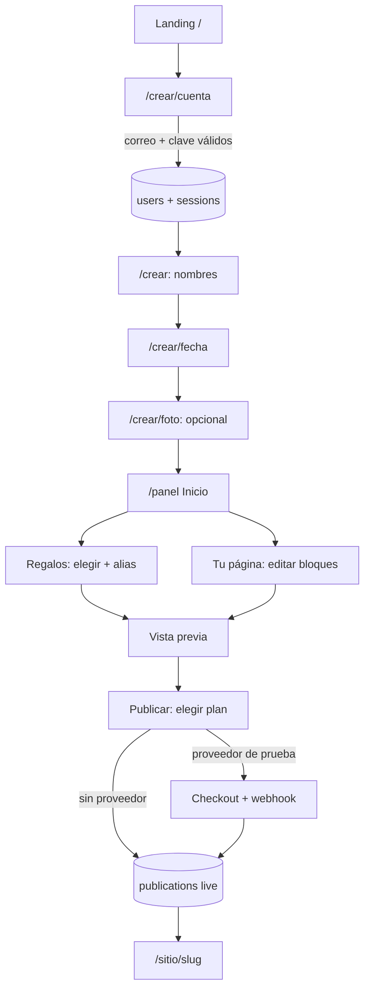
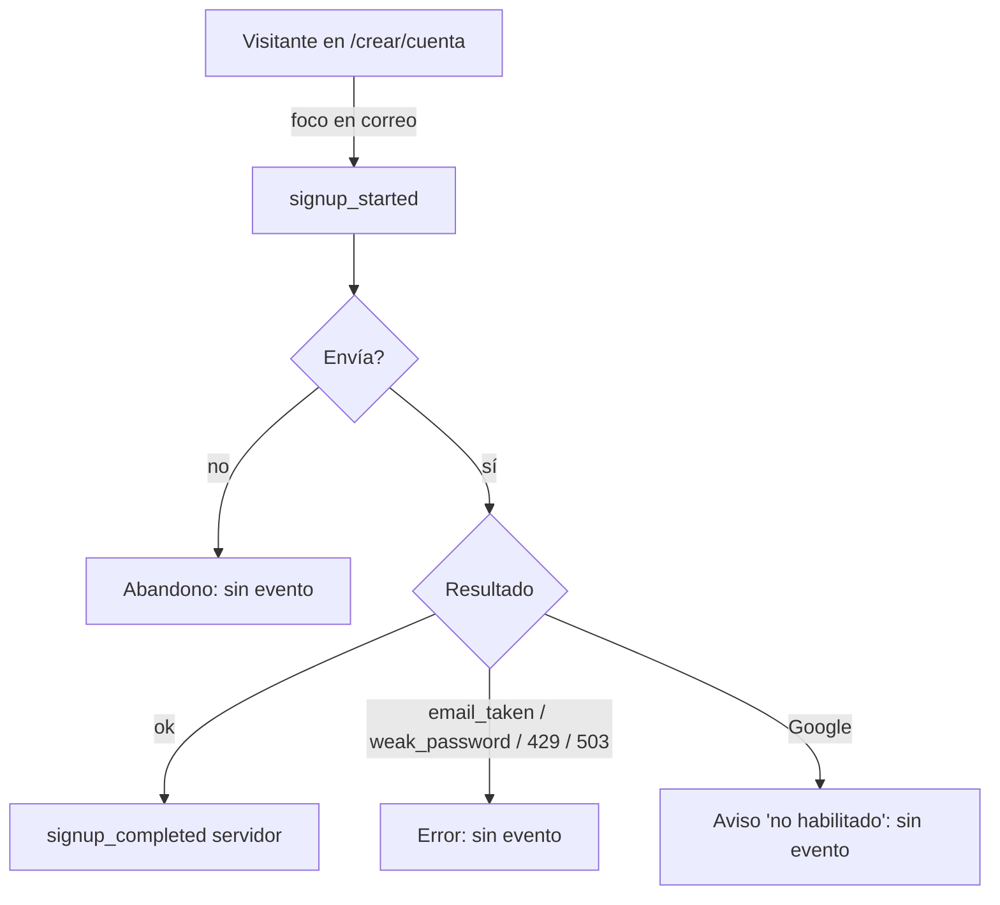
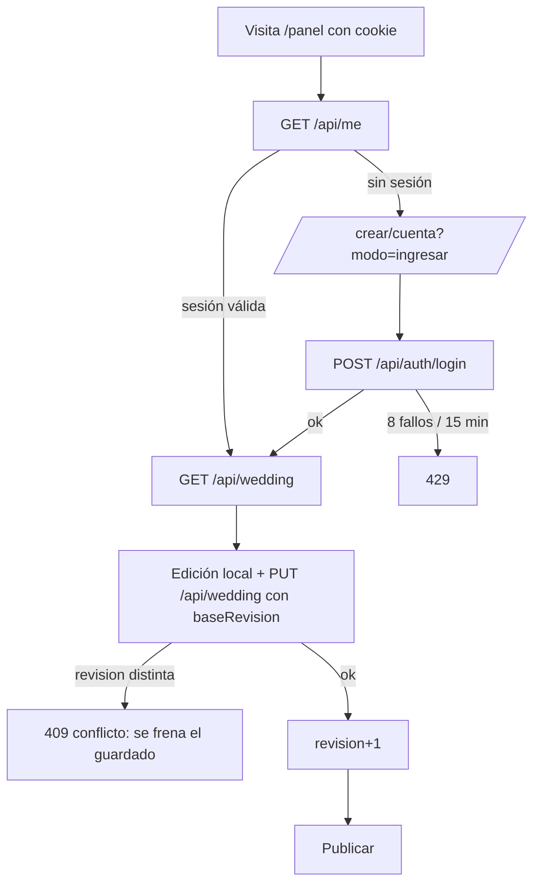
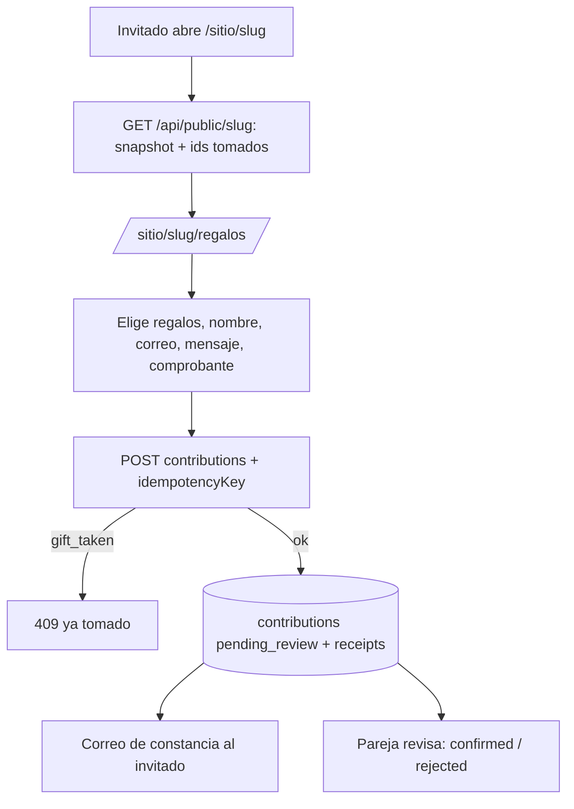
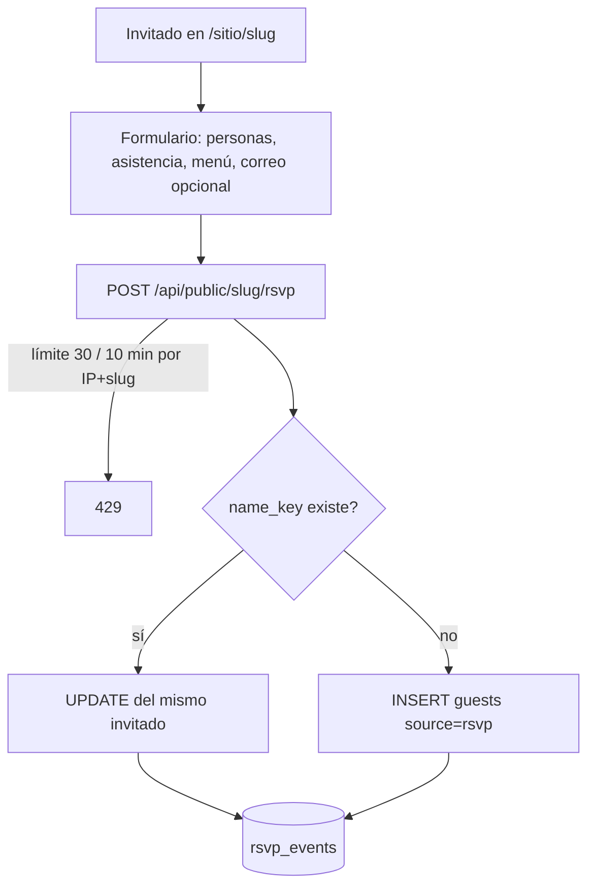
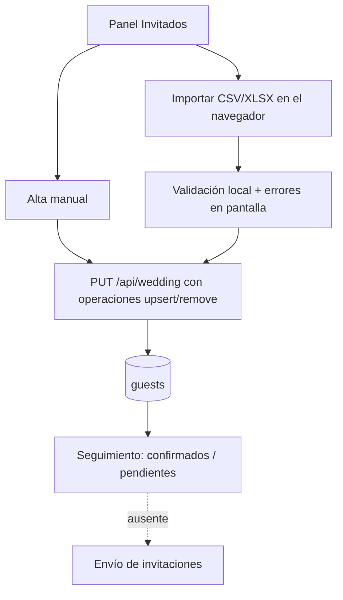
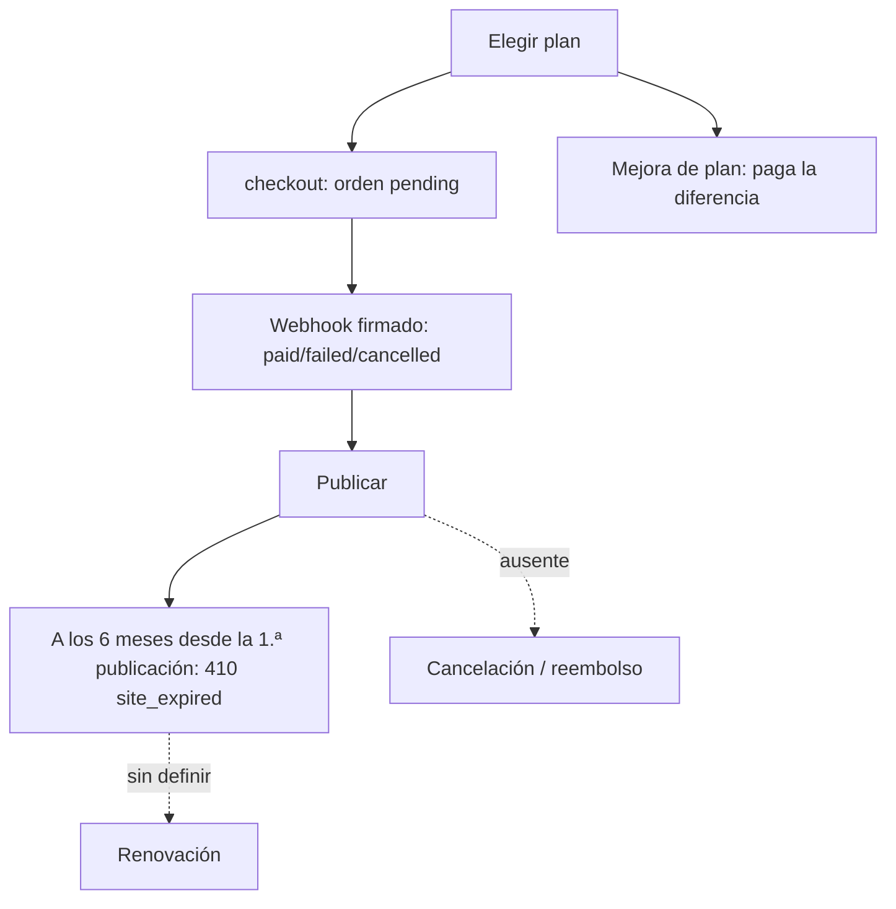
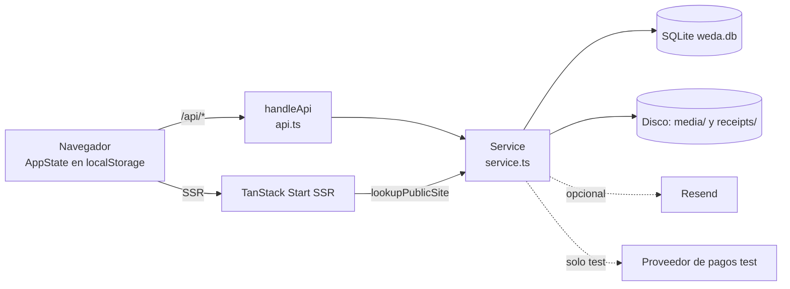
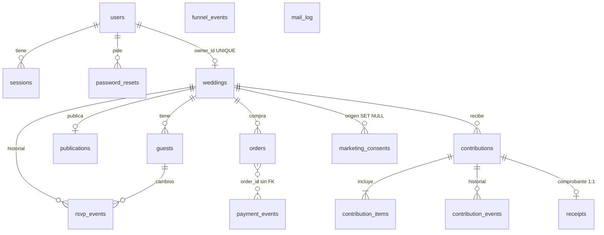

# Weda · Arquitectura de datos · Fase 1 — Auditoría y mapa del producto actual

Fecha: 2026-10-29 · Commit base: `eee48dc` (`main`) con cambios locales sin subir (botón de Google, frase de la landing; no tocan datos).
Alcance: **solo diagnóstico**. No se modificó código de la aplicación, esquema, dependencias ni configuración. No se hicieron commits, pushes ni deploys. No se leyeron ni se muestran valores de variables de entorno.

## 0. Cómo leer este documento

Cada afirmación lleva una etiqueta:

| Etiqueta | Significado |
|---|---|
| **[C]** Comprobado | Lo leí en el código o lo ejecuté. Se indica el archivo. |
| **[S]** Supuesto | Lo deduzco, pero no lo verifiqué en ejecución o en producción. |
| **[?]** No investigado | Queda fuera de lo que pude ver desde el repositorio. |

Qué ejecuté: `npx vitest run src/test/server` (8 archivos, **68 pruebas, todas pasan**) y, antes en la sesión, `npx vitest run` (13 archivos, **195 pruebas**, pasan) y los E2E de las áreas que se tocaron. No ejecuté el conjunto E2E completo en esta fase.

---

## 1. Resumen ejecutivo

1. **Lo que hay es bastante más que un prototipo.** [C] Existe un backend real, en el mismo proceso que el frontend (monolito), con SQLite (`node:sqlite`), 6 migraciones versionadas, 16 tablas, cuentas con scrypt, sesiones en cookie `httpOnly`, recuperación de clave, publicación con *snapshot*, RSVP público, aportes con comprobante, órdenes de pago con webhook idempotente (solo con un proveedor de **prueba**), correos transaccionales (Resend, opcional), consentimiento de novedades y un embudo mínimo propio (`funnel_events`).
2. **La arquitectura es correcta para su escala actual**, con una limitación estructural que domina todo: **SQLite + archivos locales exigen un único servidor con disco persistente**. [C] En Vercel (serverless, sin disco persistente) la API responde 503 `backend_unavailable` y el panel queda sin cuentas. [S] Es el estado del sitio hoy en `weda.app` (no verifiqué producción).
3. **Aislamiento entre parejas: sólido en el código revisado.** [C] Toda función de `service.ts` que toca datos privados filtra por el `userId` autenticado; hay pruebas específicas (`auth-isolation.test.ts`). El riesgo no está en el aislamiento, sino en que **el modelo asume un casamiento por cuenta** (`weddings.owner_id UNIQUE`).
4. **El grueso del dominio vive dentro de un JSON** (`weddings.draft`: regalos elegidos, grupos/mesas, sitio, plan, fecha). [C] Eso simplificó el producto, pero hoy **no hay forma relacional de consultar** regalos, grupos ni configuración del sitio, y varias columnas "foráneas" (`guests.group_id`, `contribution_items.gift_id`) **no tienen integridad referencial** porque apuntan a ids dentro de ese JSON.
5. **Analítica: existe una base mínima, pero hoy no responde casi ninguna pregunta de negocio.** [C] `funnel_events` guarda 14 nombres de evento sin identificador de visitante, sesión, usuario ni casamiento, y sin UTM. Los eventos del navegador están **apagados salvo `VITE_ANALYTICS=on`** y no hay ninguna consulta ni tablero que lea la tabla.
6. **Diferencias importantes entre el brief y el código** (detalle en §9): los regalos se pueden aportar **una sola vez** (`gift_taken`), no múltiples veces; solo hay pesos (no dólares); no hay Mercado Pago ni proveedor real; no hay colaboradores ni envío de invitaciones; no hay verificación de correo, borrado de cuenta ni backups de la base.

---

## 2. Stack, runtime y despliegue [C]

| Capa | Hallazgo | Evidencia |
|---|---|---|
| Framework | TanStack Start (React 19) + TanStack Router, SSR | `package.json`, `vite.config.ts` |
| Servidor | Nitro (solo en `vite build`); entrada propia `src/server.ts` envuelve el handler SSR y monta `/api/*` | `vite.config.ts`, `src/server.ts` |
| Runtime | Node 22 (`node:sqlite` experimental). Sin `engines` en `package.json` | `src/server/db.ts` |
| Base | SQLite en archivo (`WEDA_DB_PATH` o `WEDA_DATA_DIR/weda.db`), WAL, `busy_timeout=5000`, `foreign_keys=ON` | `db.ts`, `config.ts` |
| Capa de acceso | SQL a mano con `prepare()`; **sin ORM**. Todo en `db.ts` + `service.ts` | `src/server/` |
| Migraciones | Arreglo `MIGRATIONS[]` con `PRAGMA user_version`, cada una en transacción, no se editan las publicadas | `db.ts` |
| Archivos | Disco local: fotos (`media/`, públicas, nombre = sha256) y comprobantes (`receipts/`, privados, `0600`) | `media.ts`, `service.ts` |
| Correo | Resend por HTTP, opcional; sin clave → `skipped` en `mail_log` | `mail.ts` |
| Pagos | Interfaz `PaymentProvider` con **un solo adaptador, `test`** (nunca cobra) | `payments.ts` |
| Analítica | Tabla propia `funnel_events`; cliente `track()` apagado por defecto | `analytics*.ts` |
| Mapas | Google Maps/Places en el navegador (`VITE_GOOGLE_MAPS_KEY`) | `google-places.ts` |
| Hosting | **Sin `vercel.json`**; Nitro autodetecta el preset al compilar. El sitio `weda.app` está en Vercel (dato de la dueña, no verificado por mí) | repo, conversación |
| Estado del cliente | `AppState` en `localStorage['weda-app']`, sincronizado al servidor cuando hay sesión | `store.ts`, `remote.ts` |

**Hecho verificado en esta sesión:** al compilar con preset Vercel y ejecutar la función localmente, las páginas responden 200; la API responde 503 si falta la variable obligatoria `WEDA_SECRET` (corregido en `15c94db`: antes caían **todas** las páginas).

---

## 3. Mapa funcional

Estados: **Implementado** · **Parcial** · **Ausente** · **Futuro** (propuesto en el brief, no existe).

| Área | Estado | Evidencia y notas |
|---|---|---|
| Landing / marketing | Implementado | `src/routes/index.tsx`, planes (`landing-plans.tsx`), testimonios (`lib/testimonials.ts`). Sin páginas de campaña separadas ni formularios de lead. |
| Registro | Implementado | `crear.cuenta.tsx` → `POST /api/auth/register`. Botón «Registrarme con Google» presente pero **sin OAuth** (avisa). Apple descartado. |
| Login | Implementado | `POST /api/auth/login`, límite 8 intentos / 15 min por correo+IP (en memoria). |
| Recuperar clave | Implementado | `clave.index.tsx`, `clave.nueva.tsx`; token 1 h, un uso, cierra todas las sesiones. |
| Verificación de correo | **Ausente** | Sin tabla ni flujo (búsqueda en el código). |
| Sesiones | Parcial | Cookie `weda_session`, 30 días, hash en base. Sin lista de dispositivos, sin rotación, sin cierre remoto. |
| Onboarding | Implementado | `crear.index/fecha/foto.tsx` (estado local, luego sincronizado). |
| Crear casamiento | Implementado | `ensureWedding()` lo crea **al primer acceso** (incluso en un `GET`). Uno por usuario. |
| Plan y contratación | Parcial | Matriz en `plans.ts` (3 planes, precio único, 6 meses). Orden de compra y checkout con proveedor de **prueba**. Sin renovación ni cancelación. |
| Lista de regalos | Implementado | Catálogo en el código (`catalog.ts`), lista elegida dentro del JSON del borrador. |
| Configuración de cobro | Parcial | Alias/CBU/banco en el borrador (JSON). Mercado Pago: «Próximamente». |
| Invitados | Implementado | Tabla `guests`; alta manual, importación CSV/XLSX en el navegador (`guests-io.ts`, `xlsx.ts`). |
| Importar / exportar invitados | Implementado (cliente) | Se procesa en el navegador; no queda registro de importaciones ni de errores en el servidor. |
| Mesas y grupos | Implementado | Grupos dentro del JSON; `guests.group_id` sin FK. |
| Constructor del micrositio | Implementado | `panel.sitio.tsx`; configuración dentro del JSON (`SiteConfig`). |
| Vista previa | Implementado | Iframe del sitio real con `?borrador`. |
| Publicar / despublicar | Implementado | `POST /api/wedding/publish|unpublish`; *snapshot* único por casamiento. Vence a los 6 meses de la **primera** publicación. |
| Página pública | Implementado | `/sitio/$slug`, SSR desde el *snapshot*. `noindex`. |
| RSVP | Implementado | `POST /api/public/:slug/rsvp`; sin enlace personal por invitado. |
| Aportes / regalos del invitado | Implementado | `POST /api/public/:slug/contributions`, comprobante obligatorio, idempotencia, token de gestión. |
| Pagos y comprobantes | Parcial | Comprobante: sí (revisión manual por la pareja). Pago real: no. |
| Cuenta / perfil | Parcial | `panel.perfil.tsx` edita datos del casamiento; cambiar correo/clave no disponible con cuenta. Sin borrado de cuenta. |
| Usuarios y permisos | **Ausente** | Sin roles, sin colaboradores, sin administradores internos. |
| Panel administrativo interno | **Ausente** | No hay ruta, rol ni herramienta de soporte. |
| Invitaciones enviadas (canales) | **Ausente** | No se envían invitaciones por correo ni WhatsApp. |
| Notificaciones | Parcial | Solo correos transaccionales de regalo, recordatorio de comprobante y recuperación de clave. |
| Estados vacíos y errores | Implementado | Pantalla de error SSR, 404, estados vacíos en el panel. |
| Marketplace de proveedores | Futuro | No existe. |

Rutas del frontend [C]: públicas `/`, `/ejemplo*`, `/encontrar`, `/sitio/$slug[/regalos]`, `/comprobante`, `/privacidad`, `/terminos`, `/clave*`; flujo de alta `/crear*`; privadas `/panel*` (`index`, `regalos`, `sitio`, `invitados`, `mesas`, `perfil`, `pago`, `vista-previa`); de prueba `/pago-de-prueba` (solo con proveedor `test`).

---

## 4. Flujos principales

Convención de eventos: **hoy** = lo que el código realmente emite a `funnel_events`; **deseado** = lo que debería emitirse (Fase 3, no implementado).

### A. Visitante → landing → registro → onboarding → casamiento → regalos → micrositio → publicación

| Aspecto | Detalle |
|---|---|
| Entradas | Landing, botones «Crear mi evento», `/crear/cuenta?modo=ingresar`. |
| Obligatorio | Correo válido y clave fuerte (8+, mayúscula, minúscula, número); nombres de la pareja; plan (para publicar). |
| Opcional | Fecha, lugar, foto, regalos, bloques del sitio, invitados. |
| Errores | Correo ya registrado (409), clave débil, 429 por límite, 503 sin backend, 409 de revisión al guardar. |
| Datos creados | `users`, `sessions`, `weddings` (con `draft`), luego `publications`, `orders`. |
| Eventos **hoy** | `landing_viewed`, `signup_started`, `signup_completed` (servidor), `event_created`, `gift_list_started/completed` (una vez por navegador), `microsite_completed`, `plan_selected`, `checkout_started`, `publication_completed` (servidor), `payment_confirmed` (servidor). Los de cliente solo con `VITE_ANALYTICS=on`. |
| Eventos **deseados** | Pasos del onboarding vistos/saltados, `wedding_created` confirmado por servidor, `publish_started/failed`, errores por paso. |
| Abandono | No medible hoy: no hay identificador que una los pasos. |
| Estados finales | Publicado (`live`), borrador, despublicado (`taken_down`), vencido (410). |

### B. Visitante → inicio de registro → error o abandono

Hueco [C]: **no existe `signup_failed`** ni evento de clic en Google; el abandono solo se infiere por diferencia entre `signup_started` y `signup_completed`, sin ventana ni identidad.

### C. Usuario registrado → login → recuperación de sesión → panel → edición → publicación

Recuperación de clave: `forgot` → correo con token (1 h, un uso) → `reset` → se cierran todas las sesiones. Eventos hoy: ninguno de login ni de reset.

### D. Invitado → micrositio → regalos → aporte → confirmación

Datos creados: `contributions`, `contribution_items`, `contribution_events`, `receipts`, opcionalmente `marketing_consents`, `mail_log`. Eventos hoy: `public_invitation_opened` (cada GET del sitio, sin dedupe), `gift_submitted`. **No hay `payment` real**: el aporte confirmado es una verificación manual del comprobante.

### E. Invitado → micrositio → RSVP

Evento hoy: `rsvp_submitted` (`attending`). No hay `rsvp_started`. Riesgo de identidad en §7.

### F. Pareja → invitados → importación → invitaciones → seguimiento

Ausente [C]: envío de invitaciones, enlaces personales, historial de importaciones, exportación registrada. Eventos hoy: ninguno.

### G. Pareja → plan → renovación / cambio / cancelación

[C] Existen mejora de plan (paga la diferencia), reutilización de orden pendiente y vencimiento. **Ausentes:** renovación, cancelación, reembolsos, cupones, facturación. [C] Renovar tras el vencimiento es una "decisión comercial pendiente" en el código.

---

## 5. Inventario técnico

### 5.1 Arquitectura

Monolito modular de un solo proceso: `api.ts` (HTTP fino) → `service.ts` (dominio y autorización) → `db.ts` (SQL). [C]

### 5.2 Tablas (16) y relaciones

| Tabla | Para qué | Notas y restricciones relevantes [C] |
|---|---|---|
| `users` | Cuenta | `email UNIQUE COLLATE NOCASE`, `password_hash` scrypt. Sin estado, sin `updated_at`, sin verificación. |
| `sessions` | Sesión | `id = sha256(token)`, `expires_at`, índice por usuario. Sin dispositivo/IP/último uso. Se borra solo al presentarse vencida. |
| `weddings` | Casamiento | `owner_id UNIQUE` (un casamiento por usuario), `slug UNIQUE` (se asigna al publicar), `draft` JSON, `revision` (concurrencia optimista). |
| `guests` | Invitados | `status CHECK`, `source CHECK`, `name_key` normalizado, `email`, `group_id` **sin FK**. Índice `(wedding_id, name_key)` no único. |
| `rsvp_events` | Historial de respuestas públicas | Solo inserciones; sin índice propio. |
| `publications` | Publicación | **PK = `wedding_id`** (una por casamiento), `snapshot` JSON, `status CHECK`, `version`, `expires_at`. Se sobrescribe: **no hay historial de versiones**. |
| `orders` | Compra de plan | `amount INTEGER` en pesos, **sin columna de moneda**; `status CHECK`; índice único parcial `(provider, provider_ref)`. |
| `payment_events` | Idempotencia de webhooks | PK `(provider, event_id)`; `order_id` sin FK. |
| `contributions` | Aporte del invitado | `how CHECK ('alias')`, `status CHECK`, `UNIQUE (wedding_id, idempotency_key)`, `manage_token_hash`, `giver_email`. |
| `contribution_items` | Regalos del aporte | PK `(contribution_id, gift_id)`; `gift_id` **sin FK** (el regalo vive en el JSON publicado); monto y nombre copiados del *snapshot*. |
| `contribution_events` | Historial del aporte | Cambios de estado con actor `guest/owner/system`. |
| `receipts` | Comprobante | 1:1 con aporte, `storage_key` aleatorio en `receipts/`. |
| `marketing_consents` | Consentimiento de novedades | Correo, origen, versión del texto, `granted_at/revoked_at`; no se borra con el casamiento. Sin unicidad por correo vigente (se controla en código). |
| `mail_log` | Correos salientes | Tipo, destinatario, estado, `error`; nunca el contenido. Sin retención definida. |
| `password_resets` | Recuperación | Solo `token_hash`, un uso, 1 h. Nunca se purga. |
| `funnel_events` | Embudo | `name`, `source`, `props` JSON, `at`. **Sin visitante, sesión, usuario ni casamiento.** Nunca se purga. |

Cascadas: 14 `ON DELETE` declarados; borrar un casamiento elimina invitados, aportes, comprobantes (filas) y publicaciones. **Los archivos de `receipts/` y `media/` no se borran con las filas** [C: no hay código que los elimine al borrar el casamiento; no hay borrado de casamiento ni de cuenta expuesto]. [S]

### 5.3 Qué hay dentro de los JSON

`weddings.draft` (hasta 6 MB, saneado por `sanitizeDraft`): `couple`, `date`, `photo`, `planId`, `gifts.{alias, bank, cbu, items[], ...}`, `groups[]`, `site` (eventos, dress code, galería, playlist, orden de bloques, textos), `onboarded`. Los invitados y los aportes **no** van en el JSON (tablas propias). `publications.snapshot` = `siteFromState(...)` con el plan decidido por el servidor.

### 5.4 Endpoints [C: `src/server/api.ts`]

| Método y ruta | Autenticación | Escribe |
|---|---|---|
| `GET /api/health` | no | no |
| `GET /api/media/:nombre` | pública | no |
| `GET /api/unsubscribe?t=` | enlace firmado | `marketing_consents` |
| `POST /api/auth/register|login|forgot|reset|logout` | no / cookie | `users`, `sessions`, `password_resets`, `mail_log`, `funnel_events` |
| `GET /api/me` | cookie | no |
| `GET|PUT /api/wedding` | cookie | `weddings`, `guests` (el `GET` puede **crear** el casamiento) |
| `POST /api/wedding/publish|unpublish` | cookie | `publications`, `weddings.slug`, `funnel_events` |
| `GET /api/contributions`, `PATCH /api/contributions/:id`, `POST …/:id/remind`, `GET …/:id/receipt` | cookie + dueño | `contributions`, `contribution_events`, `mail_log` |
| `GET|POST /api/orders`, `GET /api/orders/:id`, `GET /api/payments`, `POST /api/checkout` | cookie | `orders` |
| `POST /api/test-payments/:orden` | cookie (solo con proveedor `test`) | `orders`, `payment_events` |
| `POST /api/webhooks/payments/:proveedor` | firma del proveedor | `orders`, `payment_events`, `funnel_events` |
| `POST /api/events` | no (límite 120/10 min por IP) | `funnel_events` |
| `GET /api/public/:slug` | no | `funnel_events` |
| `POST /api/public/:slug/rsvp`, `…/contributions` | no (límite 30/10 min por IP+slug) | `guests`, `rsvp_events`, `contributions`, `contribution_items`, `receipts`, `marketing_consents`, `mail_log` |
| `GET|PUT /api/public/contributions/:id[/receipt]` | token de gestión del invitado | `receipts`, `contribution_events` |

### 5.5 Autenticación y sesiones [C]

scrypt (N=16384, r=8, p=1, sal de 16 bytes), comparación en tiempo constante, cálculo de hash aunque el correo no exista; token de sesión de 32 bytes aleatorios, **solo su sha256 en base**; cookie `HttpOnly; SameSite=Lax; Path=/; Max-Age=30d` y `Secure` en producción; defensa CSRF adicional por `Origin`. Recuperación sin enumeración de correos. Cambiar la clave cierra todas las sesiones. **Faltan:** verificación de correo, MFA, rotación del identificador al iniciar sesión, lista/cierre de sesiones, bloqueo de cuenta persistente (el límite está en memoria), OAuth.

### 5.6 Autorización [C]

Todo el control está en `service.ts`: las funciones privadas reciben `userId` de la sesión y consultan con `owner_id = ?` (por ejemplo `ownedContribution`, `orderStatus`). Acceso cruzado devuelve 404 (no 403) para no revelar existencia. Los invitados no tienen cuenta: acceden por `slug` (público) y por un **token de gestión** de capacidad para su propio aporte. No hay roles ni membresías.

### 5.7 Archivos y fotos [C]

Fotos: el navegador manda *data URLs*; el servidor las externaliza a `media/<sha256>.<ext>` (≤ 4 MB, tipo por magia de bytes, servidas públicas con caché inmutable y CSP restrictivo). Comprobantes: ≤ 5 MB, tipo por contenido, privados. **Sin almacenamiento de objetos, sin escaneo, sin miniaturas, sin política de borrado.**

### 5.8 Integraciones [C]

Resend (opcional). Proveedor de pagos: solo `test`. Google Maps/Places (cliente). **No hay** Mercado Pago, WhatsApp, Google/Apple OAuth, herramienta de analítica externa, CRM ni campañas.

### 5.9 Pruebas existentes

| Tipo | Cantidad | Qué cubre |
|---|---|---|
| Vitest (unitarias + servidor) | 13 archivos / **195** (68 en `src/test/server`) | Aislamiento entre cuentas, endurecimiento, flujo del casamiento, expiración, recuperación de clave, pagos e idempotencia de webhooks, media, embudo |
| Playwright E2E | ≈ 100 pruebas en 16 archivos (celular y escritorio) | Recorridos del panel, alta, landing, regalos, publicación |
| Exploratorias | `WEDA_EXPLORE=1` | Matrices de estado (según `docs/e2e-coverage.md`) |

[?] No ejecuté el conjunto E2E completo en esta fase. Hay 3 pruebas E2E con fallos conocidos y previos por errores de hidratación en consola (registrados en la sesión).

---

## 6. Qué está bien y conviene mantener

- Capa de datos aislada (`db.ts` + `service.ts`); las rutas no ven SQL.
- Autorización centralizada con filtro por `userId` y pruebas de aislamiento.
- Concurrencia optimista por `revision` y transacciones `BEGIN IMMEDIATE` en operaciones críticas.
- Idempotencia real en aportes (`idempotency_key`) y webhooks (`payment_events`).
- El estado "pagado" solo lo fija un webhook verificado; el monto lo calcula el servidor.
- Tokens guardados solo como hash; sin enumeración de correos.
- *Snapshot* de publicación: lo que ve un invitado no cambia hasta publicar.
- Eventos de negocio críticos los emite el servidor, no el navegador; propiedades de analítica en una lista cerrada, sin datos personales.
- Historial de estados del aporte (`contribution_events`) y del RSVP (`rsvp_events`).

---

## 7. Riesgos identificados

Gravedad: **A** alta · **M** media · **B** baja. Clasificación: *Seguridad*, *Integridad*, *Operación*, *Producto*.

| # | Riesgo | G | Evidencia / explicación | Tipo |
|---|---|---|---|---|
| R1 | **SQLite + disco local no sirven en serverless.** En Vercel no hay cuentas ni publicación real. | A | `db.ts`, `docs/backend-readiness.md`. Verificado localmente simulando Vercel. | Operación |
| R2 | **Sin backups ni restauración** de la base ni de `receipts/` y `media/`. | A | Búsqueda en el repo: solo existe un respaldo del navegador (`weda-app-local-backup`). | Operación |
| R3 | **RSVP sin identidad del invitado.** Cualquiera con el enlace puede responder por cualquier nombre y **sobrescribir** la respuesta de otro (`name_key`). Dos personas con el mismo nombre se funden. | A | `submitRsvp`. Hay historial en `rsvp_events`, pero no autenticación ni enlace personal. | Seguridad / Integridad |
| R4 | **Un casamiento por cuenta**, sin colaboradores ni roles. Cambiarlo toca la clave `owner_id UNIQUE` y todo el filtrado por `userId`. | M | `db.ts` migración 1. | Producto |
| R5 | **Integridad referencial débil en el JSON:** `guests.group_id` y `contribution_items.gift_id` no tienen FK; un grupo o regalo borrado deja referencias huérfanas. | M | `db.ts`. | Integridad |
| R6 | **Límites de uso en memoria** (login, RSVP, aportes, eventos): se pierden al reiniciar y no se comparten entre instancias. La IP sale de `X-Forwarded-For` sin lista de proxies de confianza (falseable si el servidor está expuesto). | M | `security.ts`, `api.ts:52`. | Seguridad |
| R7 | **`GET /api/wedding` crea un casamiento** si no existe (efecto secundario en una lectura). | B | `ensureWedding`. | Integridad |
| R8 | **Datos personales sin política de retención ni borrado:** `mail_log`, `marketing_consents`, `funnel_events`, `password_resets` crecen sin límite; **no hay borrado de cuenta ni de casamiento**; los archivos no se eliminan con sus filas. | A | `db.ts`, búsqueda. Ley 25.326 (la valoración jurídica requiere asesoramiento). | Seguridad / Legal |
| R9 | **Sesiones:** sin rotación al iniciar sesión, sin lista ni cierre remoto, sin límite de sesiones por usuario, vencidas solo se borran al usarse. | M | `service.ts`. | Seguridad |
| R10 | **Fotos públicas por URL con hash del contenido:** quien conozca el archivo conoce la URL; no hay forma de revocar una foto publicada. | B | `media.ts`. | Seguridad |
| R11 | **Webhook de pagos:** el proveedor `test` firma con HMAC; el verificador de un proveedor real **no existe**. La verificación y el manejo de reembolsos/contracargos tendrán que diseñarse con el proveedor elegido. | M | `payments.ts`. | Integridad |
| R12 | **Importes sin moneda** (`INTEGER` en pesos). Soportar dólares exige migración y reglas de redondeo. | M | `orders`, `contributions`, `contribution_items`. | Integridad |
| R13 | **Publicación sin historial:** cada republicación pisa el *snapshot*; no se puede auditar ni revertir. | M | `publications` PK `wedding_id`. | Integridad |
| R14 | **Analítica sin identidad:** imposible reconstruir embudos por persona, sesión o campaña. Eventos del cliente apagados por defecto. `public_invitation_opened` cuenta cada recarga. | A | `analytics*.ts`, `funnel_events`. | Producto |
| R15 | **SSR de páginas públicas** consulta la base en cada pedido. Si la base falla, la página se comporta como «no encontrada» (se loguea el error). | B | `server/public.ts`. | Operación |
| R16 | **Contenido de campos libres** (mensajes, nombres) se guarda como texto; el render del cliente escapa, y el correo escapa HTML. Sin moderación ni lista de abuso. | B | `mail.ts` (`esc`), `submitContribution`. | Seguridad |
| R17 | **Sin administración interna ni trazabilidad de acciones de soporte:** nada permite que un operador revise un comprobante, un reembolso o una cuenta con registro de quién lo hizo. | M | Búsqueda. | Operación |

[S] No auditoré el cumplimiento de subida de archivos maliciosos más allá de la validación por magia de bytes; no hay antivirus ni reprocesado de imágenes.

---

## 8. Deuda técnica relacionada con datos

1. Esquema "híbrido": columnas relacionales para lo que se consulta (invitados, aportes, órdenes) y JSON para el resto; falta una frontera explícita y documentada entre ambos.
2. `AppState` es a la vez modelo del cliente, borrador del servidor y fuente del *snapshot*: cualquier cambio de estructura obliga a migrar JSON ya guardado (`version: 2` + `sanitize`).
3. Marcas de tiempo como `TEXT` ISO en UTC (`toISOString()`): consistentes, pero sin tipo ni función de zona horaria; el vencimiento se calcula en UTC.
4. Identificadores como `TEXT` con prefijo (`usr_`, `wed_`, `inv_`…) aleatorios de 12 bytes: bien (no predecibles); `rsvp_events`, `contribution_events` y `funnel_events` usan `INTEGER AUTOINCREMENT`.
5. Migraciones dentro de un arreglo en `db.ts` sin pruebas de migración desde cada versión anterior [?: no encontré tests que migren desde una base vieja con datos].
6. Tres tablas de "registro" crecen sin purga: `mail_log`, `funnel_events`, `password_resets`.
7. Un solo lugar de verdad para precios y planes (`plans.ts`) está bien, pero **los precios no están versionados**: una orden guarda el monto, pero no la versión de precio.
8. Cliente: dos fuentes de verdad temporales (localStorage y servidor) con reglas de conflicto ya definidas en `remote.ts`.

---

## 9. Diferencias entre el brief y lo implementado

| Brief | Código | Impacto |
|---|---|---|
| Regalos simbólicos que **se pueden comprar múltiples veces**, sin stock | Cada regalo se puede aportar **una sola vez**: el servidor responde 409 `gift_taken` si ya existe un aporte no rechazado. | **Decisión de producto necesaria** antes de modelar. |
| Montos en **pesos o dólares** | Solo pesos enteros; el panel muestra «Total en dólares: —». | Cambia el modelo de importes. |
| Mercado Pago y otros proveedores | Solo proveedor `test`. Mercado Pago figura como «Próximamente». | Define la fase de monetización. |
| Registro con Google (o Apple) | Botón de Google presente pero sin OAuth. Apple descartado. | OAuth pendiente. |
| Planes con funcionalidades por plan | Matriz en código (`plans.ts`); la base solo guarda `plan_id`. | Hoy es suficiente; no hay planes en base. |
| Invitaciones y seguimiento de confirmaciones | Hay seguimiento de RSVP; **no hay envío de invitaciones ni enlaces personales**. | Afecta R3 y analítica de invitados. |
| «Gestión de usuarios y permisos» | Sin roles ni colaboradores. | R4. |
| Importación/exportación de invitados | Solo en el navegador, sin registro en servidor. | Sin métricas de importación (`guest_import_*`). |
| Analítica / CRM / campañas | Tabla mínima propia; nada de CRM ni campañas. | Fase 3 y 4. |
| «Persistencia SQLite, Node 22» | Cierto, pero **no en el hosting actual**. | R1. |

---

## 10. Supuestos y lo que no investigué

- **[S]** El estado de producción de `weda.app` (qué variables están cargadas, si la API responde 503) no lo verifiqué: sin acceso a Vercel. Se infiere de la configuración local y de capturas de la dueña.
- **[?]** Volumen real de datos (no hay producción con datos), por lo que no se pueden estimar crecimientos ni diseñar índices por consultas reales.
- **[?]** No audité `docs/auditoria-ux-conversion/*` línea por línea; los usé como contexto, no como fuente de verdad. Donde difieren del código, prevalece el código.
- **[?]** Rendimiento de las consultas (no hay mediciones).
- **[?]** Requisitos legales aplicables (Ley 25.326, 24.240, comunicaciones comerciales, conservación de comprobantes): se anotan riesgos técnicos, no conclusiones jurídicas.
- **[?]** Existencia de un entorno de *staging* o de procedimientos de despliegue distintos de Vercel.

---

## 11. Decisiones que necesito de vos antes de la Fase 2

| # | Decisión | Por qué importa | Mi recomendación provisoria |
|---|---|---|---|
| D1 | **¿Un regalo se puede aportar varias veces?** (el brief dice que sí; el código lo impide) | Cambia el modelo de aportes, la unicidad y las métricas de conversión. | Permitir múltiples aportes por regalo, con el aporte como unidad (no el regalo "tomado"). |
| D2 | **Monedas:** ¿pesos y dólares desde el inicio, o primero solo pesos y dejar la moneda preparada? | Hay que agregar `currency` a importes. | Preparar `currency` ahora (barato) y activar USD cuando haya proveedor. |
| D3 | **Colaboradores:** ¿dos usuarios por casamiento entran en el alcance cercano? | Cambia `weddings.owner_id UNIQUE` por membresías. | Diseñarlo en el modelo, implementarlo después. |
| D4 | **Hosting:** ¿mudar a un servidor con disco persistente (SQLite) o apuntar a Postgres administrado? | Condiciona todo lo demás (R1, R2). | Servidor único con volumen + backups primero; Postgres solo con criterios medibles. |
| D5 | **Identidad del invitado en el RSVP:** ¿enlaces personales por invitado (token) o seguir con respuesta abierta por nombre? | R3, la analítica de invitados y las invitaciones enviadas. | Enlace personal opcional por invitado; el abierto queda como modo alternativo. |
| D6 | **Analítica:** ¿herramienta externa (por ejemplo PostHog) o tabla propia ampliada? | Fase 3. | Tabla propia con sobre de evento común + exportación a herramienta externa más adelante. |
| D7 | **Alcance de la Fase 2:** ¿incluir ya marketplace/proveedores y campañas en el diseño conceptual, o solo documentar los puntos de extensión? | Evita sobrediseñar. | Solo puntos de extensión. |
| D8 | **Borrado y retención:** ¿quién decide los plazos (con asesoramiento legal)? | R8. | Definir una política mínima antes de la Fase 5. |

---

## 12. Qué haría a continuación

1. **Si aprobás este diagnóstico**, la Fase 2 parte de §3, §5 y §9 para el modelo conceptual por dominios, sin crear tablas.
2. Antes de la Fase 2, necesito tus respuestas a **D1, D2, D3 y D5** (afectan el núcleo del modelo). D4, D6, D7 y D8 pueden esperar a la fase que corresponda.
3. Nada de esto toca producción: las únicas modificaciones al repositorio en esta fase son este documento y su carpeta `docs/data-architecture/`.
