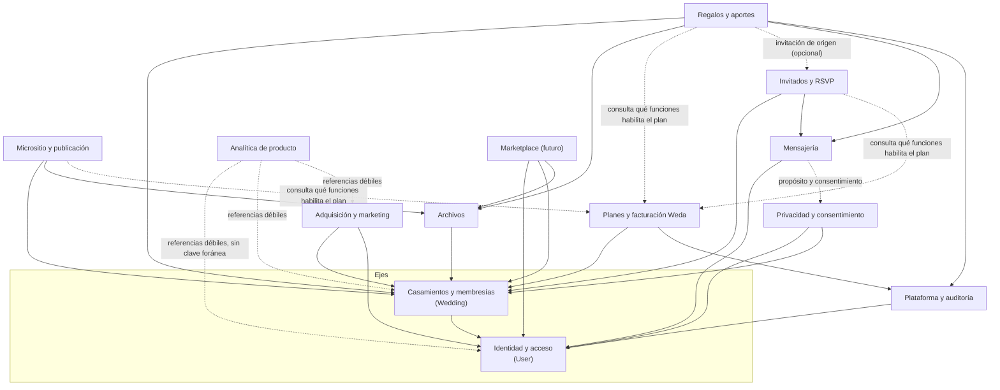
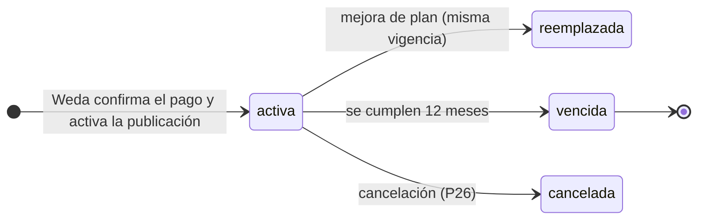

# Weda · Arquitectura de datos · Fase 2 — Modelo de dominio y mapa de datos

Fecha: 2026-10-30 · **Revisión con las decisiones definitivas A1–A8 y Q1–Q8.** Base: `01-current-state.md` (aprobado).
Alcance: **solo diseño conceptual y documentación.** No se creó ninguna tabla, migración, dependencia ni cambio de código de la aplicación, y no se tocó el esquema SQLite.

Documentos de la Fase 2 (todos salen de **un solo catálogo** de entidades y relaciones, así que no pueden contradecirse):

| Documento | Contenido |
|---|---|
| `02-domain-model.md` (este) | Razonamiento, fronteras, decisiones incorporadas, estados, pendientes. |
| [`02b-retention-privacy-deletion.md`](02b-retention-privacy-deletion.md) | Retención en cuatro categorías, eliminación de cuentas, marco de la Ley 25.326 y puntos que requieren asesoramiento. |
| [`02d-event-lifecycle-and-final-export.md`](02d-event-lifecycle-and-final-export.md) | **Ciclo de vida del evento (decisión definitiva):** una sola vigencia de 12 meses desde la primera publicación efectiva, cuatro estados, permisos por estado, descargas, tratamiento de los datos tras el vencimiento. |
| [`05-analytics-architecture.md`](05-analytics-architecture.md) | Fase 3: arquitectura de analítica de producto. |
| [`05b-metric-definitions.md`](05b-metric-definitions.md) | Fase 3: definiciones de métricas (numerador, denominador, período, fuente, exclusiones). |
| [`06-consolidation-report.md`](06-consolidation-report.md) | **Informe final de consolidación**: decisiones, estados, permisos, entidades, riesgos, contradicciones, orden de implementación y puntos legales. |
| [`02c-validation-report.md`](02c-validation-report.md) | Las 12 validaciones obligatorias: resultados, contradicciones, migración a PostgreSQL. |
| [`03-entity-relationship.md`](03-entity-relationship.md) / `.mmd` | Mapa de dominios y relaciones. |
| [`03b-entity-relationship-detail.md`](03b-entity-relationship-detail.md) / `.mmd` | Entidad-relación con cardinalidades. |
| [`04-data-dictionary.md`](04-data-dictionary.md) | Cada entidad: qué es, qué contiene, por qué existe, relaciones, clase de retención. |

> Nota sobre nombres: el pedido nombra `03-entity-relationship.md` y `03b-…md`; los archivos originales eran `.mmd`. Se mantienen los dos formatos: el `.md` se renderiza en GitHub y el `.mmd` sirve a editores de Mermaid.

---

## 0. Resumen

**86 entidades en 13 dominios**: 50 «Ahora», 22 «Preparar» y 14 «Después» (solo documentadas).

**Qué cambió respecto de la versión anterior (y por qué)**

| # | Antes (mi propuesta) | Ahora (decisión definitiva) | Efecto en el modelo |
|---|---|---|---|
| 1 | Al menos un propietario | **Un único propietario** (A2) | `OwnershipTransfer` nuevo; `MemberInvite` no puede crear propietarios. |
| 2 | Contador público opcional «X personas regalaron» (Q2) | **Nunca público** (Q2) | Se elimina `takenGiftIds` y cualquier agregado de aportes de la API pública. |
| 3 | Un medio de cobro por moneda, ambos a la vez | **La pareja elige una moneda de recepción** (Q3) | `GiftSettings` nuevo; `PayoutMethod` versionado e inmutable. |
| 4 | El administrador podía cambiar el alias con aviso | **Solo el propietario**, con reautenticación (Q4) | `PayoutMethodChange` nuevo; `Session` registra la última reautenticación; `MfaFactor` pasa a «Ahora». |
| 5 | Catálogo de planes en el código | **Precios en una administración interna** (Q5) | `Plan`, `PlanPrice`, `Feature`, `PlanFeature` pasan a la base; `StaffRole` «Ahora». |
| 6 | Mantener «primera publicación» como inicio de vigencia, con el pago y la publicación como pasos separados | **Pagar = activar + publicar; inicio = el momento en que Weda confirma el pago y activa la publicación** (Q6, redefinida) | `Subscription` pasa a ser el único reloj de la vigencia y nace activa. |
| 7 | Retención propuesta por mí (12–25 meses) | **Cuatro categorías; vigencia única de 12 meses; tratamiento posterior al cierre por clase de dato, con plazos a validar con asesoramiento (P30)** | Clases de retención por entidad; `AggregateMetric`, `RetentionRun`, `DeletionRequest`, `DataExportJob`; lápidas. |
| 8 | `GiftTransaction` sin conexión con la separación contable | **Registros financieros separados de los operativos** (Q8-B) | El libro no contiene datos personales y sobrevive a la anonimización. |

**Cómo se reflejan tus decisiones**

| Decisión | Dónde cae |
|---|---|
| **A1** Dos dominios financieros | `Regalos y aportes` y `Planes y facturación Weda`, sin tablas compartidas. §5.1 |
| **A2** Propietario único + membresías | `WeddingMember` (rol propietario único) + `OwnershipTransfer`. §5.3 |
| **A3** Permisos explícitos verificados en backend | Catálogo de permisos con clave estable. §5.3 |
| **A4** Extraer entidades progresivamente | §4 y §9: por etapas y con justificación. |
| **A5** Libro inmutable y estados | `GiftTransaction` + 8 conceptos del flujo mapeados a entidades y estados. §5.1 |
| **A6** Invitación como unidad de acceso | `Invitation`, `InvitationAccess`, `Guest`, `RsvpResponse`. §5.5 |
| **A7** Autorización en servidor | Principio de aislamiento y pruebas. §2 y 02c |
| **A8** Bloques independientes y publicaciones versionadas | `MicrositeBlock` + `MicrositeRevision`. §5.6 |
| **Q1** Regalos repetibles y aportes libres | `ContributionItem` con tipo (regalo/libre) y sin unicidad sobre el regalo. §5.1 |
| **Q2** Cantidad de regalos solo en el panel privado | §5.1 (regla de exposición) |
| **Q3** Moneda de recepción elegida | `GiftSettings` + implicancias de cambio. §5.2 |
| **Q4** Alias solo del propietario, seguridad reforzada | `PayoutMethodChange`. §5.4 |
| **Q5** Precios en administración interna | §5.7 |
| **Q6** Vigencia única de 12 meses desde la primera publicación efectiva | `Subscription`. §5.8 y `02d` |
| **Q7** Cupo de acompañantes | `Invitation.cupo` y conteos derivados. §5.5 |
| **Q8** Retención y eliminación | `02b-retention-privacy-deletion.md` |

---

## 1. Evaluación del modelo actual (tabla por tabla)

Veredicto por tabla de las 16 de la Fase 1. «Conservar» no significa no tocar: significa que el concepto es correcto.

| Tabla actual | Veredicto | Destino en el nuevo modelo | Motivo |
|---|---|---|---|
| `users` | **Dividir** | `User` + `AuthIdentity` | Persona y credencial son cosas distintas: hace falta Google, verificación de correo y varios métodos. |
| `sessions` | **Ampliar** | `Session` | Último uso, dispositivo y **última reautenticación**. |
| `password_resets` | **Generalizar** | `AuthToken` (con propósito) | El mismo patrón sirve para verificar el correo. |
| `weddings` | **Reemplazar** | `Wedding` + `WeddingMember` + `Microsite` + `PublicAddress` + … | Hoy es raíz de aislamiento, dueño, borrador y dirección a la vez. |
| `weddings.draft` (JSON) | **Descomponer** | Regalos, medios de cobro, momentos, mesas, bloques, portada | §4. |
| `guests` | **Dividir** | `Guest` + `Invitation` + `RsvpResponse` (+ `SeatingTable`) | Persona, unidad invitada y respuesta no son lo mismo; la identidad por nombre es el riesgo R3. |
| `rsvp_events` | **Conservar** | `RsvpResponseEvent` | Historial correcto; pasa a colgar de la respuesta. |
| `publications` | **Dividir** | `Publication` (estado) + `MicrositeRevision` (historial) | Hoy se sobrescribe y no hay historial. |
| `orders` | **Evolucionar** | `Order` + `OrderLine` + `Payment` + `Subscription` | Una orden puede tener varios intentos y renglones; el plan contratado es otra entidad. |
| `payment_events` | **Generalizar** | `ProviderEvent` | Bandeja de notificaciones, común a regalos y facturación. |
| `contributions` | **Evolucionar** | `Contribution` | Pasa a ser la *intención social*; moneda, destino informado, invitación de origen. |
| `contribution_items` | **Conservar** | `ContributionItem` | Ya permite el mismo regalo en varios aportes; falta tipo (aporte libre), moneda y referencia opcional. |
| `contribution_events` | **Conservar** | `ContributionEvent` | Historial correcto. |
| `receipts` | **Dividir** | `PaymentProof` + `MediaAsset` | La prueba (un acto revisable) y el archivo (un recurso con retención) son distintos. |
| `marketing_consents` | **Generalizar** | `CommunicationConsent` + `TermsAcceptance` | Hoy solo correo; aceptar términos no es consentir marketing. |
| `mail_log` | **Generalizar** | `OutboundMessage` (+ eventos de entrega) | Sirve a todos los canales y a los reintentos. |
| `funnel_events` | **Reemplazar** | `ProductEvent` con sobre común + `AggregateMetric` | Sin identidad no hay embudos; y hay que conservar métricas sin personas. |

**Lo que el modelo actual hace bien y se conserva:** la autorización vive en `service.ts` y filtra siempre por el usuario autenticado. Sigue siendo la regla central, pero el filtro deja de ser «el casamiento cuyo `owner_id` es mi usuario» y pasa a ser «un casamiento donde tengo una membresía activa cuyo rol concede este permiso».

---

## 2. Principios de modelado

1. **El casamiento es la raíz de aislamiento («tenant»).** Toda entidad que es de una pareja lleva el identificador del casamiento, también las hijas. «¿Pertenece a este casamiento?» se verifica sin depender de joins, y las referencias entre entidades del mismo casamiento pueden exigir que ambas apunten al mismo (referencia compuesta en el diseño físico). Objetivo: que acceder a datos de otro casamiento sea **estructuralmente imposible**, no solo filtrado por código (A7).
2. **Los dos ejes.** `Wedding` (aislamiento) y `User` (identidad) conectan con casi todo. En los diagramas se marcan en cada entidad (◆, ◇, ●) y no se dibujan como flechas.
3. **Una entidad si hay vida propia; JSON si es presentación** (A4). Es entidad cuando: (a) otras entidades la referencian; (b) se consulta, filtra o agrega; (c) tiene ciclo de vida, permisos, datos personales o retención propios; (d) exige integridad. Es JSON validado cuando es presentacional, se lee junto a su dueño y su forma cambia seguido. **No se normaliza por normalizar.**
4. **Dinero = entero en unidades menores + moneda, siempre juntos.** Nunca decimales flotantes ni importes sin moneda. Sin conversión implícita. Sin sumar monedas distintas.
5. **Los hechos financieros se agregan, no se editan** (A5). Se corrigen con movimientos nuevos relacionados. El estado de un flujo de trabajo es otra cosa que la verdad económica.
6. **Persona ≠ cuenta ≠ miembro ≠ invitado.** `User`, `Guest`, `Lead` y `Visitor` nunca se fusionan por parecerse.
7. **Secretos solo como hash**: sesión, invitación, gestión de un aporte, recuperación, transferencia de propiedad.
8. **Lo público se congela** (A8): lo que ve un invitado es una revisión inmutable.
9. **Archivar, no borrar, lo que otros referencian.** Un regalo con aportes, una versión de destino de cobro, una revisión publicada se retiran con una marca.
10. **Los registros financieros se separan de los operativos** (Q8-B): el libro y los registros contables de Weda **no contienen datos personales** y no dependen de que se borren los datos de las personas.
11. **Eliminar es anonimizar con lápida.** Un casamiento o un usuario eliminado deja una fila mínima (identificador y fechas) para que sigan siendo coherentes los registros que deben conservarse; los datos personales se borran de verdad.
12. **Operaciones críticas exigen contraseña reciente.** Cambiar el destino del dinero, transferir la propiedad, eliminar la cuenta o cambiar la moneda de recepción exigen reautenticación; la sesión registra cuándo fue.
13. **Referencias débiles deliberadas** en analítica y auditoría (sin clave foránea), para sobrevivir al borrado. Es el único lugar donde se admite «tipo + identificador» genérico.
14. **Identificadores opacos y prefijados**, nunca secuenciales en lo público; los enlaces personales llevan un token aparte.
15. **Fechas en UTC** con la zona horaria del casamiento guardada aparte.

---

## 3. Dominios y fronteras

Trece dominios dentro del **monolito modular** (módulos del mismo proceso y base, no servicios). Cada dominio es dueño de sus entidades; los demás lo usan a través de su servicio público, no leyendo sus tablas.

| Dominio | Entidades que se construyen («Ahora») | Se preparan o quedan documentadas |
|---|---|---|
| **Identidad y acceso** — Quién es la persona y cómo prueba que lo es. Credenciales, sesiones y tokens de un solo uso. | `User`, `AuthIdentity`, `Session`, `AuthToken`, `MfaFactor` | — |
| **Casamientos y membresías** — El casamiento como raíz de aislamiento, quién lo administra y sus momentos. | `Wedding`, `WeddingMember`, `OwnershipTransfer`, `EventMoment` | `MemberInvite` |
| **Micrositio y publicación** — Lo que se edita (borrador), lo que se publica (revisiones inmutables) y dónde se encuentra (direcciones). | `Microsite`, `MicrositeBlock`, `GalleryItem`, `MicrositeRevision`, `Publication`, `PublicAddress` | `Theme`, `CustomDomain` *(después)* |
| **Archivos** — Metadatos y reglas de los archivos; los binarios viven fuera de las tablas. | `MediaAsset` | — |
| **Regalos y aportes** — El dinero de los regalos: de la pareja hacia ella. Weda no pasa por ese dinero. | `Gift`, `GiftSettings`, `PayoutMethod`, `PayoutMethodChange`, `Contribution`, `ContributionItem`, `ContributionEvent`, `PaymentProof`, `GiftTransaction` | `GiftCollection`, `GiftCatalogItem`, `PaymentIntent` |
| **Invitados y RSVP** — Personas invitadas, invitaciones personales, respuestas y mesas. | `Guest`, `Invitation`, `InvitationAccess`, `RsvpSettings`, `RsvpResponse`, `RsvpResponseEvent`, `SeatingTable` | `InvitationDelivery`, `GuestImport`, `EventInvitee` |
| **Planes y facturación Weda** — Lo que la pareja le compra a Weda: planes, precios, contrataciones, órdenes y pagos. | `Plan`, `PlanPrice`, `Feature`, `PlanFeature`, `Subscription`, `Order`, `OrderLine`, `Payment` | `Coupon`, `CouponRedemption`, `Invoice` *(después)*, `Refund` *(después)* |
| **Adquisición y marketing** — Visitantes, campañas, leads y atribución, antes de que exista una cuenta. | — | `Visitor`, `VisitSession`, `Campaign`, `Lead`, `IdentityLink`, `CampaignSpend` *(después)*, `ReferralCode` *(después)* |
| **Analítica de producto** — Eventos de comportamiento y de negocio, separados de los datos transaccionales. | `ProductEvent`, `AggregateMetric` | `WeddingMonthlySnapshot`, `OutboxEvent` |
| **Mensajería** — Todo lo que Weda envía a una persona y su estado de entrega. | `OutboundMessage` | `MessageDeliveryEvent`, `NotificationPreference` |
| **Privacidad y consentimiento** — Consentimientos, aceptaciones legales y derechos de las personas sobre sus datos. | `CommunicationConsent`, `TermsAcceptance`, `DeletionRequest`, `DataExportJob` | — |
| **Plataforma y auditoría** — Auditoría, seguridad, personal interno e integraciones con proveedores externos. | `AuditLog`, `StaffRole`, `ProviderEvent` | `SecurityEvent`, `BackgroundJob`, `FeatureFlag` *(después)*, `RetentionRun` |
| **Marketplace (futuro)** — Proveedores de servicios y publicidad. Solo documentado. | — | `Vendor` *(después)*, `VendorMember` *(después)*, `VendorProfile` *(después)*, `VendorService` *(después)*, `Inquiry` *(después)*, `Review` *(después)*, `ModerationCase` *(después)*, `AdCampaign` *(después)* |

### 3.1 Dependencias permitidas entre dominios

**Reglas de frontera**
- **Sin ciclos** (verificado automáticamente sobre las relaciones del catálogo; ver 02c). La consulta de «qué funciones habilita el plan» es de *lectura*, hacia `Planes y facturación`; este dominio **nunca** llama de vuelta: se entera de lo que pasa en los demás por **eventos** (§3.3).
- **`Regalos` y `Planes y facturación` no se tocan** (A1). Son dos flujos de dinero; comparten solo el patrón de notificaciones de proveedores (`ProviderEvent`) y el tipo «importe + moneda».
- **`Analítica` solo lee y agrega.** Ningún dominio de negocio decide nada a partir de `ProductEvent`.
- **`Marketplace` es otro mundo.** Un proveedor y una pareja nunca comparten tablas ni permisos; lo único común es `User`, `MediaAsset` (con otro dueño) y la mensajería.

### 3.2 Referencias que cruzan fronteras

Todas las referencias *entre dominios* que el modelo dibuja (sin contar las que van a `Wedding` o `User`, que son los ejes):

| Desde | Referencia | Hacia | Forma |
|---|---|---|---|
| `User` (Identidad y acceso) | participa como | `WeddingMember` (Casamientos y membresías) | uno a muchos |
| `GalleryItem` (Micrositio y publicación) | usa el archivo | `MediaAsset` (Archivos) | muchos a uno (obligatoria) |
| `Microsite` (Micrositio y publicación) | portada | `MediaAsset` (Archivos) | muchos a cero o uno (opcional) |
| `Gift` (Regalos y aportes) | imagen | `MediaAsset` (Archivos) | muchos a cero o uno (opcional) |
| `PaymentProof` (Regalos y aportes) | archivo privado | `MediaAsset` (Archivos) | muchos a uno (obligatoria) |
| `GiftTransaction` (Regalos y aportes) | confirmada por | `ProviderEvent` (Plataforma y auditoría) | muchos a cero o uno (opcional) |
| `Contribution` (Regalos y aportes) | viene del enlace de | `Invitation` (Invitados y RSVP) | muchos a cero o uno (opcional) |
| `InvitationDelivery` (Invitados y RSVP) | usa | `OutboundMessage` (Mensajería) | muchos a cero o uno (opcional) |
| `EventMoment` (Casamientos y membresías) | convoca | `EventInvitee` (Invitados y RSVP) | uno a muchos |
| `Payment` (Planes y facturación Weda) | confirmado por | `ProviderEvent` (Plataforma y auditoría) | muchos a cero o uno (opcional) |
| `User` (Identidad y acceso) | queda vinculado en | `IdentityLink` (Adquisición y marketing) | uno a muchos |
| `ProductEvent` (Analítica de producto) | ocurre en | `VisitSession` (Adquisición y marketing) | muchos a cero o uno (opcional) |
| `TermsAcceptance` (Privacidad y consentimiento) | condiciona la confirmación de | `Order` (Planes y facturación Weda) | muchos a cero o uno (opcional) |
| `User` (Identidad y acceso) | participa en | `VendorMember` (Marketplace (futuro)) | uno a muchos |
| `WeddingMember` (Casamientos y membresías) | solicita | `PayoutMethodChange` (Regalos y aportes) | uno a muchos |
| `PayoutMethodChange` (Regalos y aportes) | se notifica con | `OutboundMessage` (Mensajería) | muchos a cero o uno (opcional) |

### 3.3 Eventos entre dominios (no son dependencias)

El dominio que origina el hecho lo publica; los demás reaccionan. Ninguno depende del que reacciona.

| Evento | Lo origina | Lo reciben | Para qué |
|---|---|---|---|
| Confirmación del pago y activación | Planes y facturación | Micrositio y publicación | Crear la suscripción activa, publicar el micrositio y fijar el inicio y el vencimiento de la vigencia en una sola operación (Q6). |
| Pago confirmado | Planes y facturación | (Planes) | Fijar `pago confirmado` en la suscripción. |
| Aporte confirmado / revertido | Regalos y aportes | Analítica, Mensajería | Medición y aviso a la pareja. |
| Destino de cobro cambiado | Regalos y aportes | Plataforma (auditoría), Mensajería | Registro y notificación al propietario. |
| Propiedad transferida | Casamientos y membresías | Plataforma, Mensajería | Auditoría y aviso a ambas partes. |
| Respuesta de RSVP registrada | Invitados y RSVP | Analítica | Embudo de invitados, sin nombres. |
| Solicitud de eliminación | Privacidad y consentimiento | Todos los dominios con datos | Cada dominio implementa **su propio** procedimiento de anonimización; el orquestador (`RetentionRun`) no toca tablas ajenas. |

---

## 4. Qué pasa con `weddings.draft`

Hoy `draft` es un JSON de hasta 6 MB con casi todo el casamiento. Decisión por cada parte (A4):

| Parte del JSON actual | Destino | Entidad o JSON | Por qué |
|---|---|---|---|
| `couple` (nombres) | Atributos de `Wedding` | Atributos | Lo usan todos los dominios. |
| `date` | `Wedding` (fecha + zona horaria) | Atributo | Calendario y cuenta regresiva la leen; **no determina ninguna vigencia** ni la retención. |
| `onboarded` | Estado de onboarding en `Wedding` | Atributo | Hecho del ciclo de vida. |
| `email`, `seeded` | **Se eliminan** | — | Dato del usuario / de la demostración. |
| `photo` | `Microsite.portada` → `MediaAsset` | Referencia a archivo | Un archivo con retención no puede ser un data-URL en un JSON. |
| `planId`, `preferredPlan` | `Subscription` y señal de adquisición | Entidad comercial | El plan es un hecho comercial; `preferredPlan` es solo señal y va como evento. |
| `publication` | `Publication` + `MicrositeRevision` | Entidades | Con historial y puntero vigente. |
| `slug` | `PublicAddress` | Entidad | Con historial. |
| `gifts.items[]` | `Gift` | **Entidad** | Los aportes lo referencian; no puede mutar ni desaparecer. |
| `gifts.alias`, `bank`, `cbu` | `PayoutMethod` (+ `PayoutMethodChange`) | **Entidad** (financiera) | Hoy se guardan dentro del borrador y **cualquier guardado los reescribe**: pasan a una operación propia con permisos reforzados. |
| moneda (hoy implícita: pesos) | `GiftSettings` | **Entidad** | Q3. |
| `gifts.acceptCard` | Medio de cobro de tipo proveedor | Entidad | Una preferencia no es un dato: es qué medios existen. |
| `gifts.cover` | `MediaAsset` | Referencia a archivo | — |
| `gifts.given[]` | **Ya no existe** (vive en `Contribution`) | — | — |
| `guests[]` | `Guest` + `Invitation` | Entidades | Ya están en tablas; se rediseñan. |
| `groups[]` | `SeatingTable` | **Entidad** | Hoy «grupo» es mesa. |
| `site.events[]` | `EventMoment` | **Entidad** | Lo usan el sitio, el calendario y el seguimiento. |
| `site.order` | `MicrositeBlock.posición` | Atributo | El orden es propiedad del bloque. |
| `site.coverText`, `saveDate`, `countdown` | `Microsite` (opciones) | JSON validado | Presentacional. |
| `site.rsvp` | `RsvpSettings` | **Entidad** | Reglas que valida el servidor. |
| `site.giftsSection`, `dressCode`, `note`, `message`, `playlist` | Bloques | JSON validado | Presentacional. |
| `site.gallery.photos[]` | `GalleryItem` → `MediaAsset` | **Entidad** | Retención, borrado seguro y límites del plan. |

**Quedan como JSON validado (con versión de esquema):** el contenido de cada `MicrositeBlock`, las opciones del `Microsite` y la revisión publicada. **Regla práctica:** si dos personas editan a la vez bloques distintos, no deben pisarse.

---

## 5. Cómo se resuelve cada decisión

### 5.1 A1 · A5 · Q1 · Q2 — Regalos, aportes y dinero

**Comprobado en el código:** la restricción `gift_taken` no es de la base de datos. La clave de `contribution_items` es `(aporte, regalo)`, o sea que el esquema ya permite el mismo regalo en muchos aportes. La regla vive en tres lugares de la aplicación: el chequeo `taken` al registrar un aporte (`service.ts`, 409), la lista `takenGiftIds` que devuelve `getPublicSite` y la marca `gift.taken` de la interfaz. Se elimina en esos tres sitios.

**Dos modalidades (Q1)**

| Modalidad | En el modelo |
|---|---|
| Regalo con **importe sugerido** | `ContributionItem` de tipo «regalo»: referencia al `Gift`, copia del importe sugerido en ese momento e **importe aportado** (puede diferir). |
| **Aporte libre** | `ContributionItem` de tipo «libre»: sin regalo, solo importe y moneda. Se habilita por casamiento en `GiftSettings` (con importe mínimo opcional). |

Un mismo regalo puede estar en cualquier cantidad de aportes; una persona puede hacer cuantos aportes quiera. **No existe stock ni estado «tomado»** y la base no impone unicidad sobre el regalo (verificado en 02c).

**Los ocho conceptos del flujo (A5) y dónde viven**

| Concepto | ¿Se guarda? | Dónde |
|---|---|---|
| Intención de regalo | No (es del navegador). Se mide como evento sin datos personales. | `ProductEvent` |
| Selección de un regalo | No (carrito en el navegador). | `ProductEvent` |
| **Aporte iniciado** | Sí | `Contribution` en estado *iniciado* |
| **Comprobante cargado** | Sí | `PaymentProof` + `MediaAsset`; evento en `ContributionEvent` |
| **Aporte pendiente de revisión** | Sí | `Contribution` en estado *pendiente de revisión* |
| **Aporte confirmado** | Sí | `Contribution` *confirmado* **y** un asiento de confirmación en `GiftTransaction` |
| **Rechazo** | Sí | `Contribution` *rechazado* (sin asiento en el libro) |
| **Reembolso o reversión** | Sí | `Contribution` *revertido* **y** un asiento nuevo de tipo reembolso/reversión que referencia al original |

Hoy el flujo de transferencia cruza «iniciado → comprobante → pendiente de revisión» **en un solo envío** porque se decidió (2026-10-28) que no exista un regalo sin comprobante. El estado *iniciado* existe en el modelo para otros medios (por ejemplo, proveedor de pagos) y no se usa en ese envío: no es una contradicción, es una política del medio.

**Libro de transacciones inmutable (A5).** `GiftTransaction` registra solo lo que la pareja confirmó o corrigió (Weda no verifica transferencias bancarias ni afirma que el dinero haya llegado): confirmaciones, reembolsos, reversiones y correcciones. Reglas: (1) solo se inserta, nunca se edita ni se borra; (2) los importes son siempre positivos y el **tipo** da el sentido; (3) una corrección es un asiento nuevo que **referencia** al anterior; (4) **no contiene datos personales**; (5) el comprobante (`PaymentProof`) es una prueba separada que la transacción puede referenciar como respaldo; (6) en el diseño físico la inmutabilidad se refuerza en la base con restricciones que impidan modificar y borrar (SQLite 3.50.4, el de este entorno, soporta disparadores y tablas `STRICT`). **Invariante:** un aporte está *confirmado* si y solo si la suma neta de sus asientos iguala su total.

**Integridad sin «tomado»:** idempotencia por casamiento y clave (se conserva), copia de nombre e importe en cada renglón, el regalo se **archiva** (no se borra) si tiene aportes, total = suma de renglones verificada en la transacción, una moneda por aporte, aviso blando de posible duplicado como ayuda (no como restricción).

**Exposición pública (Q2).** La cantidad de personas que regalaron, los importes y los nombres **se ven únicamente en el panel privado** de la pareja, para los roles con permiso. La API pública no devuelve ningún dato agregado de aportes: desaparece `takenGiftIds` y no se agrega nada equivalente. Los conteos del panel son **derivados**, no se guardan en el regalo.

### 5.2 Q3 — Moneda de recepción

- **La pareja elige una moneda** (ARS o USD) en `GiftSettings`. Esa moneda determina cómo se expresan los importes de la lista y de los aportes. Según la moneda elegida debe cargar la cuenta correspondiente (`PayoutMethod`): el destino vigente debe aceptar esa moneda; si no existe, los aportes **no se aceptan** (no se muestra la lista como disponible).
- **Moneda en cada importe** (`Gift`, `Contribution`, `ContributionItem`, `GiftTransaction`, `PayoutMethod`, `Order`, `Payment`, `PlanPrice`): unidades menores enteras + código ISO. Una moneda por operación; nunca se suman ARS y USD; no hay conversión; ninguna tabla de cotizaciones.
- **Moneda de visualización ≠ conversión.** Mostrar un importe en otra moneda no es un dato del sistema y no se guarda. El modelo no tiene un «equivalente».

**Implicancias de cambiar la moneda de recepción cuando ya hay aportes**

| Qué pasa | Regla propuesta |
|---|---|
| Aportes confirmados | **No cambian**: conservan su moneda original, su asiento en el libro y su comprobante. |
| Aportes iniciados o pendientes de revisión | El cambio **se bloquea** hasta resolverlos (confirmarlos o rechazarlos). Se muestra la lista. |
| Regalos de la lista | **No se convierten.** Quedan «en espera de reprecio» y fuera de la página pública hasta que el propietario cargue el importe en la nueva moneda (uno por uno o con un factor que elija él: Weda no sugiere ninguna cotización). |
| Destino de cobro | El destino vigente debe aceptar la nueva moneda; hasta que exista, no se aceptan aportes. |
| Quién y cómo | Solo el propietario, con contraseña reciente, confirmación explícita, auditoría y notificación. Se limita la frecuencia. |
| Reportes y panel | Totales **por moneda**, en secciones separadas; el historial en la moneda anterior sigue visible. |

**Implicancias de cambiar el alias o los datos bancarios (misma moneda)**

| Qué pasa | Regla propuesta |
|---|---|
| Datos anteriores | **No se editan**: se crea una versión nueva y la anterior queda «reemplazada». |
| Aportes confirmados | Conservan el destino con el que se informaron. |
| Aportes en curso (iniciados o pendientes) | Fueron informados al invitado con el destino anterior. El panel avisa al propietario **cuántos** y la revisión del comprobante muestra «informado a un destino anterior». Los constancias ya enviadas por correo seguirán mostrando el anterior. |
| Invitados que ya transfirieron | La responsabilidad de verificar si el dinero llegó al destino viejo es de la pareja: Weda lo hace visible, no lo corrige. |
| Quién y cómo | Ver §5.4. |

### 5.3 A2 · A3 — Propiedad, membresías y permisos

- **Una boda tiene un único propietario.** No hay `owner_id` en `Wedding`: el propietario es el `WeddingMember` con rol *propietario*. **Invariante:** exactamente un propietario activo por casamiento (a lo sumo uno, por una restricción de unicidad parcial; al menos uno, verificado dentro de la transacción que cambia roles, retira miembros o transfiere).
- Que la pareja sean dos personas **no** las hace dos propietarias: la otra persona se invita como **administradora** (o colaboradora) según los permisos que se quiera darle.
- **Transferencia de propiedad** (`OwnershipTransfer`): la inicia el propietario con contraseña reciente (y segundo factor si lo tiene activo); el destinatario debe ser miembro activo con correo verificado y **aceptar explícitamente**; se completa en una sola transacción (el anterior pasa a administrador, el nuevo a propietario); vence si no se acepta; ambos reciben aviso; queda en auditoría. No hay otra forma de cambiar propietario, y `MemberInvite` no puede crearlo.
- **Un propietario que quiere salir** debe transferir primero. Si pide eliminar su cuenta y la boda tiene otros miembros activos, el procedimiento **se detiene** hasta resolver la propiedad (§ 5.9 y 02b).
- **Los permisos son constantes explícitas del código** (rol → lista de claves), verificadas en el servidor en cada operación: *membresía activa* + *el rol concede la clave* + *si es función de plan, el plan la habilita*. La interfaz solo oculta lo que no se puede; un cambio de ID, ruta o petición manipulada no concede nada. Permisos más finos se agregan después con una tabla de excepciones por miembro, sin migrar datos.

**Catálogo de permisos y matriz propuesta** (a validar; el cambio de destino y de moneda es solo del propietario por Q4):

| Clave de permiso | Propietario | Administrador | Colaborador |
|---|:-:|:-:|:-:|
| `wedding.view` Ver el casamiento y el panel | ✓ | ✓ | ✓ |
| `wedding.edit_details` Editar nombres, fecha, momentos | ✓ | ✓ | ✓ |
| `microsite.edit` Editar bloques y fotos | ✓ | ✓ | ✓ |
| `microsite.publish` Publicar o dar de baja | ✓ | ✓ | — |
| `microsite.restore` Restaurar o republicar una versión anterior | ✓ | ✓ | — |
| `gifts.manage_list` Altas, ediciones y archivo de regalos | ✓ | ✓ | ✓ |
| `gifts.view_contributions` Ver aportes, importes y comprobantes | ✓ | ✓ | — |
| `gifts.review_contribution` Confirmar, rechazar o revertir un aporte | ✓ | ✓ | — |
| **`payout.manage`** Cambiar alias o datos bancarios | **✓** | — | — |
| **`gifts.change_currency`** Cambiar la moneda de recepción | **✓** | — | — |
| `guests.manage` / `invitations.manage` Invitados e invitaciones | ✓ | ✓ | ✓ |
| `rsvp.view` Ver respuestas | ✓ | ✓ | ✓ |
| `data.export` Exportar datos del casamiento | ✓ | ✓ | — |
| `members.view` Ver miembros | ✓ | ✓ | ✓ |
| `members.manage` Invitar, cambiar rol o retirar miembros (nunca al propietario) | ✓ | ✓ | — |
| `audit.view` Ver el registro de actividad | ✓ | ✓ | — |
| `ownership.transfer` Transferir la propiedad | ✓ | — | — |
| `billing.manage` Contratar un plan (para un evento nuevo) o mejorarlo mientras está vigente; ver órdenes | ✓ | — | — |
| `wedding.close` Cerrar o eliminar el casamiento | ✓ | — | — |

**Filtro por estado del evento (P13).** Esta matriz se aplica **junto con** el estado del evento: con el evento finalizado (a los 12 meses de la primera publicación) se bloquean todas las escrituras, la publicación, las exportaciones y el acceso al panel para **todos los roles**, el propietario incluido, sin excepciones. Matriz completa en [`02d-event-lifecycle-and-final-export.md`](02d-event-lifecycle-and-final-export.md) §3.

**Concurrencia entre colaboradores (A8).** Cada bloque tiene su propio contador de revisión: dos personas editando bloques distintos no se pisan; editar el mismo bloque devuelve un conflicto explícito (como hoy, pero por bloque), nunca una sobrescritura silenciosa.

### 5.4 Q4 — Seguridad de alias y datos bancarios

El cambio del destino del dinero es la operación más sensible del producto. Un error o un acceso indebido envía transferencias a una cuenta equivocada.

| Requisito | Mecanismo | Dónde |
|---|---|---|
| Solo el propietario | `payout.manage` solo en el rol propietario; verificado en el servidor | Catálogo de permisos |
| Reautenticación con contraseña | La operación exige que la última reautenticación de la sesión sea reciente (propuesta: ≤ 5 minutos) | `Session` |
| Confirmación explícita | Paso aparte donde se muestra el destino anterior y el nuevo (enmascarados) y se pide confirmar | `PayoutMethodChange` |
| Validación en el backend | La entidad y el permiso se validan en cada paso; **no se reescribe el destino en un guardado de borrador** | Servicio de regalos |
| Auditoría: quién, cuándo | Cada paso (solicitud, reautenticación, confirmación, activación, cancelación) en el registro, con usuario, fecha, dispositivo resumido | `AuditLog` (categoría financiera) |
| Sin datos sensibles en registros | Se registra la **huella** (hash) y el valor enmascarado, nunca el alias o el CBU completos | `AuditLog`, `PayoutMethodChange` |
| Notificación al propietario | Correo al propietario (correo verificado) al solicitar y al activar, con vínculo «no fui yo» | `OutboundMessage` |
| Protección ante cambios no autorizados | Reautenticación + confirmación fuera de banda (ver abajo) + límite de frecuencia + alerta | `SecurityEvent`, `PayoutMethodChange` |
| Colaboradores no pueden | `payout.manage` no está en sus roles | Catálogo de permisos |
| Versionado | El destino anterior queda como versión «reemplazada»; los aportes conservan el que vieron | `PayoutMethod` |

**¿Hace falta un segundo factor? (evaluación)**

| Opción | Protege contra | Costo | Veredicto |
|---|---|---|---|
| Solo contraseña reciente + confirmación + aviso | Uso indebido de una sesión robada sin la contraseña | Mínimo | **Base obligatoria** |
| + **confirmación por un vínculo enviado al correo** (fuera de banda) | Alguien con la contraseña y la sesión pero sin acceso al correo | Bajo | **Recomendado**: el destino nuevo no se muestra a invitados hasta confirmar |
| + **TOTP** (aplicación de autenticación) | Robo de contraseña y de correo | Medio | **Ofrecerlo a propietarios**; cuando lo activan, pasa a ser exigido en esta operación |
| Espera de N horas con cancelación | Cambios fraudulentos tardíos | Fricción para el propietario | Pendiente (P5) |
| TOTP **obligatorio** para todos | Todo lo anterior | Alta fricción para parejas | No ahora |

**TOTP obligatorio para el personal de Weda** desde que existe la administración de precios (Q5). Cada acceso y cambio queda en auditoría.

### 5.5 A6 · Q7 — Invitaciones, enlaces y acompañantes

**Modelo**
- `Invitation` es la **unidad de acceso**: una persona o un grupo familiar, con un **cupo** definido por la pareja (personas autorizadas) y un contacto de envío.
- `Guest` pertenece a **exactamente una** invitación. Cada integrante tiene identidad propia y su **propio estado individual**.
- `InvitationAccess` es el **enlace personal**: token aleatorio de 256 bits, **solo el hash en la base**, estado (activo, revocado, vencido), último uso. Se puede **revocar** (inmediato) y **renovar** (se emite otro; el anterior queda revocado) sin borrar la invitación ni sus respuestas.
- `RsvpResponse` pertenece al **invitado**; cada cambio genera `RsvpResponseEvent` (vía, actor, estado anterior y nuevo, fecha). La respuesta se puede **modificar** hasta la fecha que fije `RsvpSettings`.
- `SeatingTable` es la **mesa**: concepto aparte del grupo familiar.

**Cupo y conteos (Q7).** Se **guarda** un único dato: el cupo (`personas autorizadas`). Todo lo demás se **deriva** de los integrantes y sus respuestas:

| Medida | Qué cuenta | ¿Se guarda? |
|---|---|---|
| Personas autorizadas | El cupo que fijó la pareja | Sí (en la invitación) |
| Integrantes registrados | Personas con nombre en la invitación (incluye acompañantes que cargó el invitado) | No (derivada) |
| Personas confirmadas (con respuesta) | Integrantes con respuesta distinta de «pendiente» | No (derivada) |
| Personas que asistirán | Integrantes con respuesta «asistirá» | No (derivada) |
| Personas que no asistirán / pendientes | Integrantes con «no asistirá» / sin respuesta | No (derivada) |

**Invariantes:** integrantes registrados ≤ cupo, verificado **en la misma transacción** que agrega un nombre (dos pestañas no pueden pasarse del cupo); el invitado **no puede aumentar el cupo** (solo la pareja); un integrante agregado por el invitado queda marcado con su origen; si la pareja baja el cupo por debajo de los integrantes ya registrados, el cambio se rechaza hasta resolverlo.

**Qué concede el enlace (capacidad, no cuenta):** ver el sitio personalizado, responder y modificar la respuesta de *los integrantes de esa invitación*, y registrar acompañantes hasta el cupo. **No concede:** ver otros invitados, ver datos de la pareja ni tocar otra invitación.

**Formulario abierto (alternativa permitida).** Para parejas que no quieren repartir enlaces. **Nunca sobrescribe personas por coincidencia de nombre:** cada envío crea una invitación nueva marcada «sin verificar»; no actualiza a nadie existente; la pareja concilia o fusiona con historial.

**Datos actuales:** cada invitado existente pasa a una invitación individual sin enlace activo; los llegados por RSVP abierto quedan «sin verificar».

### 5.6 A8 — Micrositio y publicaciones

| Operación | Cómo se modela |
|---|---|
| **Editar bloques** | Cada `MicrositeBlock` es una fila con contenido JSON validado y su propio contador de revisión. |
| **Guardar cambios** | Se guarda el bloque editado con la revisión que se vio; si otra persona lo cambió antes, **conflicto explícito** (no se sobrescribe). |
| **Publicar** | Valida lo que el plan habilita, arma el contenido completo y **inserta una `MicrositeRevision` inmutable** (número de versión, quién, cuándo, plan); `Publication` apunta a ella. |
| **Volver a publicar** | Es otra revisión nueva; las anteriores no se tocan. **No reinicia la vigencia** (Q6). |
| **Consultar publicaciones anteriores** | Se listan las revisiones con su metadato y se pueden ver. |
| **Recuperar una versión anterior** | Dos operaciones distintas: (1) **restaurar al borrador**: copia el contenido de una revisión a los bloques (con confirmación explícita, sube la revisión de cada bloque afectado y por lo tanto genera conflicto a quien tenía el bloque abierto; auditado); (2) **republicar una versión anterior**: crea una revisión nueva con referencia a la restaurada. |
| Dar de baja | `Publication` cambia de estado; las revisiones y el borrador se conservan. |

Las revisiones son datos de la pareja (clase `W`): se conservan mientras exista la cuenta y se eliminan con la boda.

### 5.7 Q5 — Administración de precios

- **Todo precio vive en la base** (`Plan`, `PlanPrice`, `Feature`, `PlanFeature`), no en el código ni disperso: la landing, el panel y el servidor leen la misma configuración (con caché). Se siembra desde `plans.ts` y ese archivo deja de ser fuente de verdad.
- **Solo el responsable de Weda**, desde la administración interna, con rol `StaffRole`, segundo factor obligatorio y auditoría. Los clientes no pueden modificar nada; ninguna ruta de cliente escribe estas entidades.
- **Qué permite:** modificar precios; activar/desactivar planes; gestionar vigencias (precio con inicio y fin, incluso a futuro); consultar precios anteriores; ver quién cambió qué.
- **`PlanPrice` es inmutable:** cambiar un precio cierra la vigencia del vigente y crea uno nuevo. **No pueden superponerse vigencias** del mismo plan y moneda (en el diseño físico: restricción verificada en la aplicación y reforzada en la base; en PostgreSQL existe una restricción de exclusión por rango, en SQLite se refuerza con disparadores).
- **El precio contratado no cambia:** cada `OrderLine` guarda la referencia al precio y **copia del importe y la moneda**. Modificar la lista nunca altera una compra anterior ni una suscripción vigente.
- **Funcionalidades contratadas:** la suscripción guarda una **copia de las funcionalidades y límites vigentes al contratar**, de modo que cambiar un plan no quita nada a quien ya pagó. Si Weda quiere que una mejora alcance a clientes existentes, es una acción explícita (P3).
- **Qué cambia en el backend actual:** hoy `plans.ts` lo consumen cliente, servidor y pruebas; pasa a ser un catálogo leído desde la base (ver 02c, contradicciones).

### 5.8 Q6 — Vigencia única de 12 meses

**Regla (decisión definitiva).** **Contratar, pagar y publicar son una única acción.** Cuando el pago queda confirmado, el evento se activa y el micrositio se publica automáticamente, en la misma operación. Cada evento tiene **una sola vigencia de 12 meses que comienza en el momento en que Weda confirma el pago y activa la publicación**. **No hay renovación, extensión, reactivación ni período adicional de acceso privado.** La fecha de la boda no inicia ni modifica la vigencia. **No existe un plazo posterior para una primera publicación ni una contratación pagada que espere publicación.**

| Hecho | ¿Inicia o cambia el plazo? |
|---|---|
| **Confirmación del pago por Weda y activación de la publicación** | **Inicia** los 12 meses |
| Crear un borrador · registrarse · completar el onboarding · **iniciar el checkout o hacer clic en pagar sin pago confirmado** | No |
| Despublicar y republicar · mejorar el plan · fijar o cambiar la fecha de la boda | No (no reinician ni modifican el vencimiento) |

| Dato | Qué es | Dónde vive |
|---|---|---|
| **Momento de confirmación** (inicio de la vigencia) | El instante en que Weda confirma el pago y activa la publicación; si el proveedor avisa con demora, **se usa el de Weda** y la hora del proveedor se guarda aparte | `Payment` y `Subscription` (mismo valor, tomado una vez) |
| **Primera publicación efectiva** | Es la activación; `Publication` referencia la suscripción y **no guarda una fecha propia** | `Subscription` → `Publication` |
| **Vencimiento** | Inicio + **12 meses calendario** (si el día no existe, se usa el último del mes), en UTC y mostrado en la zona del casamiento; el instante es exclusivo | `Subscription` |
| Estado del plan | **Activa** · **vencida (terminal)** · reemplazada · cancelada | `Subscription` |

Ejemplos: (1) el pago se confirma el 10/3 → el evento queda activo y publicado ese día y vence el 10/3 del año siguiente. (2) La notificación del proveedor llega con demora y Weda confirma el 11/3 → inicia el 11/3. (3) Republicaciones, bajas, mejoras de plan o cambios de fecha de la boda → sin cambios. (4) Boda posterior al vencimiento → el evento vence igual (sin límite de anticipación).

**Publicación aunque falte contenido.** El evento se publica aunque la pareja no haya completado todos sus contenidos; completarlos después es su responsabilidad. **No se bloquea por secciones opcionales incompletas**: solo se validan los requisitos estrictamente necesarios para generar una página pública válida y segura (lista exacta pendiente, P35). La activación y la publicación son **atómicas e idempotentes**; una falla técnica se reintenta y no es un estado de producto.

**Durante los 12 meses** el evento está completamente operativo: edición de todos los bloques, publicar, despublicar y republicar, regalos, invitados, RSVP, aportes y comprobantes, datos bancarios (con los controles de Q4), información financiera y exportaciones. **No hay ningún bloqueo funcional intermedio.**

**Al cumplirse los 12 meses** el plan pasa a **vencida (terminal)** y el evento a **finalizado**: se bloquea toda edición, la publicación y republicación, la gestión (para todos los roles, el propietario incluido), las funciones públicas interactivas (RSVP y regalos), el acceso privado al panel y las descargas y exportaciones; la URL pública deja de estar disponible y no se reutiliza. No se puede reactivar desde soporte ni mediante acciones administrativas ordinarias, ni renovar ni extender. **El cierre es definitivo e irreversible desde el flujo normal.** Quién vence lo decide el servidor en cada pedido. Detalle: [`02d`](02d-event-lifecycle-and-final-export.md).

**Aceptación y avisos.** La pareja debe **aceptar expresamente las seis condiciones de vigencia** antes de confirmar la contratación (P33; se guarda usuario, evento y contratación, fecha y hora, versión del texto y evidencia en `TermsAcceptance`; la orden no se confirma sin ella). La fecha exacta de vencimiento se informa al activarse el evento y se muestra en el panel y en el resumen de contratación; hay avisos a **30, 7 y 1 día antes** (panel y correo al propietario), con un recordatorio destacado de descargar datos y comprobantes; **no modifican ni extienden la vigencia** y se envían con clave de idempotencia sin asumir que un correo fue entregado ([`02d`](02d-event-lifecycle-and-final-export.md) §1.4 y §1.5).

**Qué pasa con los datos después** se define por clase y **sin plazos fijados hasta contar con asesoramiento** (P30): ver `02b` y `02d` §6.

### 5.9 Q8 — Retención y eliminación (resumen; detalle en `02b`)

- **Cuatro categorías independientes**: A datos personales y operativos (se usan durante la vigencia de 12 meses; **después, según la política posterior al cierre, con plazos a validar con asesoramiento, P30**); B registros financieros (separados, con plazo propio a validar); C analítica (seudónimos 13 meses, fotografía mensual 25 meses; luego solo agregados que superaron la evaluación de riesgo); D marketing (solo con consentimiento vigente, independiente de los invitados).
- **Cada entidad del catálogo tiene su clase** (se ve en `04-data-dictionary.md`).
- **El libro y los registros contables de Weda no tienen datos personales**, así que anonimizar a las personas no destruye lo financiero.
- **Eliminar = tombstone:** el casamiento y el usuario eliminados dejan una fila mínima; los datos personales se borran.
- **Eliminar una cuenta:** procedimiento auditado, resumible y con paso obligatorio de resolver la propiedad de las bodas (`DeletionRequest` + `RetentionRun`).
- **Marco legal:** Ley 25.326; los plazos y la clasificación contable **requieren validación profesional** (`02b`).

### 5.10 Máquinas de estado

| Entidad | Estados | Quién cambia el estado |
|---|---|---|
| `Contribution` | iniciado → pendiente de revisión → confirmado / rechazado → revertido | Invitado (declara y adjunta); miembro con `gifts.review_contribution` |
| `GiftTransaction` | **No tiene estados**: se inserta (confirmación, reembolso, reversión, corrección) | Miembro con permiso o notificación verificada del proveedor |
| `PayoutMethodChange` | solicitada → confirmada / cancelada / vencida | Propietario (con reautenticación y confirmación fuera de banda) |
| `OwnershipTransfer` | solicitada → aceptada → completada / cancelada / vencida | Propietario y destinatario |
| `Publication` | publicada ⇄ dada de baja → **no disponible** (se cumplen 12 meses desde la activación; terminal) | La activación (pago confirmado) la crea publicada; la pareja (baja y republicación) con el evento activo; el cumplimiento de los 12 meses lo decide el reloj del servidor |
| `Subscription` | **activa** (nace así al confirmarse el pago) → **vencida (terminal)** / reemplazada / cancelada | Confirmación del pago (crea la suscripción activa y publica), cumplimiento de los 12 meses, mejora, cancelación (P26); **no hay renovación ni extensión ni estado de espera** |
| `Order` | pendiente → pagada / fallida / cancelada | Solo notificación verificada del proveedor |
| `Invitation` (derivado) | sin enviar → enviada → vista → respondida | Pareja y enlace |
| `DeletionRequest` | recibida → identidad verificada → pendiente de propiedad → período de gracia → ejecutándose → completada / cancelada | Solicitante, propietario, sistema |
| `Wedding` | **Estado operativo:** en armado → activo → **finalizado**. **Estado de retención:** datos completos → en retención posterior → depurado → lápida. El acceso privado **no es un estado**: se deduce del operativo | **La confirmación del pago** (activo, en la misma operación que activa y publica); cumplimiento de los 12 meses (finalizado); política posterior al cierre (depurado); propietario o política (lápida). **Finalizado no vuelve a activo** |

---

## 6. Dominio por dominio (qué cambia y por qué)

**6.1 Identidad y acceso** — `User`, `AuthIdentity`, `Session`, `AuthToken`, `MfaFactor`. La clave sale de `users`; las sesiones registran último uso, dispositivo y última reautenticación; el token de recuperación se generaliza; el segundo factor existe desde ahora (obligatorio para el personal). Alternativa descartada: una tabla con una columna por proveedor.

**6.2 Casamientos y membresías** — `Wedding`, `WeddingMember`, `OwnershipTransfer`, `MemberInvite`, `EventMoment`. El casamiento deja de tener dueño en una columna; la propiedad es única y se transfiere con un procedimiento. Alternativa descartada: conservar `owner_id` y sumar colaboradores (dos fuentes de propiedad).

**6.3 Micrositio y publicación** — `Microsite`, `MicrositeBlock`, `GalleryItem`, `MicrositeRevision`, `Publication`, `PublicAddress`. Borrador por bloques, publicación inmutable, direcciones con historial. Alternativas: un JSON por sitio (más simple, los colaboradores se pisan), una tabla por tipo de bloque (normaliza presentación sin ganancia). **Revisable**: si resultara pesado, se puede empezar con un JSON por micrositio; la revisión publicada es igual.

**6.4 Archivos** — `MediaAsset`. Metadatos y reglas; los binarios siguen fuera de las tablas. El borrador referencia archivos por identificador, nunca por URL ni data-URL. Cada archivo tiene dueño, visibilidad, estado y clase de retención según su uso (portada, comprobante, importación).

**6.5 Regalos y aportes** — `GiftSettings`, `Gift`, `PayoutMethod`, `PayoutMethodChange`, `Contribution`, `ContributionItem`, `ContributionEvent`, `PaymentProof`, `GiftTransaction` (+ `PaymentIntent`, `GiftCatalogItem`, `GiftCollection`). §5.1 a §5.4.

**6.6 Invitados y RSVP** — `Guest`, `Invitation`, `InvitationAccess`, `RsvpSettings`, `RsvpResponse`, `RsvpResponseEvent`, `SeatingTable` (+ `InvitationDelivery`, `GuestImport`, `EventInvitee`). §5.5.

**6.7 Planes y facturación Weda** — `Plan`, `PlanPrice`, `Feature`, `PlanFeature`, `Subscription`, `Order`, `OrderLine`, `Payment` (+ `Coupon`, `CouponRedemption`; `Invoice` y `Refund` documentados). §5.7 y §5.8. Plan comercial ≠ permisos técnicos; las funcionalidades se derivan de la contratación.

**6.8 Adquisición y marketing** — `Visitor`, `VisitSession`, `Campaign`, `Lead`, `IdentityLink` (+ `CampaignSpend`, `ReferralCode`). El identificador anónimo solo existe con consentimiento de analítica; cada visita guarda su origen sin pisarlo; la atribución se calcula; un vínculo de identidad une un visitante con un lead o usuario **sin fusionar personas**. **Los contactos de los invitados no se convierten en leads de Weda**: el consentimiento comercial se pide aparte y se guarda en su propia entidad.

**6.9 Analítica de producto** — `ProductEvent` (seudónimo, plazo acotado), `AggregateMetric` (anónimo, permanente), `OutboxEvent` (cuando haya destino externo). Ver `02b` para la diferencia entre anonimización y seudonimización.

**6.10 Mensajería** — `OutboundMessage` (+ eventos de entrega y preferencias). El consentimiento de marketing se verifica **al enviar**.

**6.11 Privacidad y consentimiento** — `CommunicationConsent`, `TermsAcceptance`, `DeletionRequest`, `DataExportJob`. Consentir marketing y aceptar términos son cosas distintas.

**6.12 Plataforma y auditoría** — `AuditLog` (con categorías de retención distinta), `ProviderEvent`, `StaffRole` (+ `SecurityEvent`, `RetentionRun`, `BackgroundJob`, `FeatureFlag`).

**6.13 Marketplace (futuro)** — solo documentado. Decisiones de hoy que lo dejan abierto: `User` global; membresías por tipo de cuenta sin tabla polimórfica; `MediaAsset` con dueño intercambiable; mensajería y consentimiento independientes de la pareja.

---

## 7. Datos adicionales (punto 2.12 del prompt maestro)

| Tema | Veredicto | Cómo se contempla |
|---|---|---|
| Feature flags | Después | Configuración hasta que haga falta activar gradualmente. Distinto de las funciones por plan. |
| Versionado de esquemas de eventos | **Ahora** | `schema_version` en cada evento. |
| Registro de consentimiento | **Ahora** | `CommunicationConsent` + `TermsAcceptance`. |
| Historial de cambios | **Ahora** | `AuditLog`, `MicrositeRevision`, `RsvpResponseEvent`, `ContributionEvent`. No se versiona cada edición del borrador. |
| Borrado lógico | **Ahora, acotado** | Archivo de regalos; lápida de casamiento y usuario. El resto se elimina de verdad. |
| Retención de datos | **Ahora** | Clases por entidad y `RetentionRun`. Plazos a validar con asesoramiento. |
| Deduplicación | **Ahora** | Claves de idempotencia (aportes, pagos, notificaciones) y anti-duplicado de `Lead`. |
| Identificadores estables | **Ahora** | Opacos y prefijados. |
| Segundo factor | **Ahora** (personal) / ofrecido a propietarios | `MfaFactor`. |
| Solicitudes de eliminación y exportación | **Ahora** | `DeletionRequest`, `DataExportJob`. |
| Tareas asíncronas | Preparar | `BackgroundJob`, cuando haya envíos o purgas en volumen. |
| Colas de procesamiento | Fuera de alcance | La base alcanza a esta escala. |
| Métricas de salud | Preparar | Fallos de integraciones ya se registran. |
| Control de abuso | Preparar | Límites persistentes y `SecurityEvent` al pasar a más de una instancia. |
| Experimentos A/B | Después | — |
| Dominios propios | Después | `CustomDomain`. |
| Internacionalización | **Ahora (campos)** | Idioma, zona horaria y moneda en el modelo; la interfaz sigue en español rioplatense. |
| Recuperación ante errores / backups | **Ahora** | Lote A (Fase 5): backups verificados y restauración. |
| Observabilidad | Preparar | Fase 3. |

---

## 8. Decisiones que siguen pendientes

Ninguna bloquea la Fase 3. Todas necesitan tu respuesta (o asesoramiento) antes del diseño físico (Fase 5).

| # | Pendiente | Por qué importa | Mi recomendación |
|---|---|---|---|
| **P1** | **RETIRADA (obsoleta):** ya no existe una fase intermedia con recuerdo estático; ver P31 para lo que muestra la dirección tras el cierre. | — | Reemplazada por P31. |
| **P2** | **CERRADA (decisión definitiva):** vigencia única de 12 meses desde que Weda confirma el pago y activa la publicación, **sin límite de anticipación respecto de la boda**; si la boda es posterior, el evento vence igual. Debe explicarse antes de contratar (P23, P33). | Riesgo comercial reconocido y aceptado. | Aplicada (`02d` §1.3). |
| **P3 (reformulada)** | No hay renovación ni extensión del mismo evento. ¿Qué precio tiene un plan nuevo para quien ya tuvo un evento y hay beneficio por recontratar?; ¿una mejora del plan alcanza a clientes existentes? | Define órdenes y la métrica de recontratación. | Sin beneficio automático; mejoras solo para nuevos salvo acción explícita. |
| **P4** | ¿Los planes de Weda se venden también en USD? | `PlanPrice` ya admite moneda. | Solo ARS por ahora. |
| **P5** | **ABIERTA (definición de seguridad y producto).** Seguridad adicional del cambio de alias: ¿confirmación fuera de banda siempre?, ¿espera cancelable?, ¿TOTP obligatorio para propietarios o solo ofrecido? **Importa** porque un cambio indebido envía transferencias a una cuenta equivocada. **Bloquea:** la secuencia de `PayoutMethodChange`, las reglas de reautenticación de `Session` y `MfaFactor` del propietario. **Responsable:** la dueña (producto) con asesoramiento de seguridad. **No implementar hasta resolverla:** ningún endpoint ni pantalla de cambio de alias o de datos bancarios, ni el segundo factor del propietario. | Equilibrio fricción/seguridad. | Confirmación por correo siempre; TOTP ofrecido; espera no por ahora (`06` §2). |
| **P6** | **ABIERTA (definición contable).** Qué documentos son respaldo contable de Weda y cuáles evidencia operativa (comprobantes de invitados), y plazos de B1 y B2. **No se asume** que un comprobante de un invitado sea documentación contable válida. **Bloquea:** los plazos de las clases `B1`, `B2` y `B3` y el tratamiento de `PaymentProof` y del libro tras el cierre. **Responsable:** contador (con abogado). **No implementar hasta resolverla:** ninguna eliminación ni archivo de registros financieros o comprobantes, ni constantes de plazo. | Retención de 10 años no aplica a todo. | Asesoramiento contable (`06` §2). |
| **P7** | Contenido de la pareja (sitio, lista, fotos) tras el cierre. | La categoría A cubre datos de terceros; el contenido propio es otra cosa. | Se resuelve junto con P30. |
| **P8** | Política de celdas pequeñas y granularidad de las métricas agregadas. **Se retira la propuesta de «umbral de 10»**: un umbral no garantiza anonimización por sí solo (Fase 3, `05-analytics-architecture.md` §7). | Evitar reidentificación. | Conjunto de medidas (minimización, dimensiones gruesas, supresión, control de dominancia, evaluación de riesgo) y validación profesional. |
| **P9** | Período de gracia para eliminar cuenta (propuesto 14 días) y casamiento (30 días). | Arrepentimiento vs. cumplimiento. | Esos plazos, cancelables. |
| **P10** | Boda cuyo propietario no responde o desaparece: ¿qué procedimiento de soporte existe? | Exactamente un propietario no debe dejar la boda atrapada. | Procedimiento de soporte con verificación de identidad y auditoría. |
| **P11** | **CERRADA (redefinida):** **pagar = activar + publicar**: el micrositio se publica automáticamente cuando Weda confirma el pago; no hay publicación manual previa ni un período entre el pago y la primera publicación. | — | Aplicada (`02d` §1.1). |
| **P12** | ¿El cupo incluye a la persona invitada? ¿Un invitado puede quitar a un acompañante que cargó? | Conteos. | Sí incluye; sí, hasta la fecha límite. |
| **P13** | **CERRADA (decisión definitiva, versión de 12 meses):** una sola vigencia de 12 meses desde que Weda confirma el pago y activa la publicación; al cumplirse, el evento finaliza y se cierra, sin renovación, extensión, reactivación ni acceso privado adicional (`02d`). | Define el ciclo de vida del evento. | Aplicada; lo derivado está en P19, P23, P25, P26, P30–P35. |
| **P14** | Base y consentimiento de la analítica de comportamiento (¿consentimiento o interés legítimo?; ¿aviso en el sitio?). | Define si los eventos del navegador pueden encenderse. | Mantenerlos apagados hasta tener política y asesoramiento. |
| **P15** | **CERRADA (plazos):** eventos con seudónimo 13 meses; fotografía mensual por casamiento 25 meses; agregados sin vencimiento automático solo tras la evaluación de riesgo. La **base legal** sigue en P14. | Cuánto se puede reconstruir una historia individual. | Aplicada (`05` §3). |
| **P16** | ¿Se permite unir la visita anónima con el registro (`IdentityLink`) y bajo qué condiciones? | Atribución de campañas vs. privacidad. | Solo con consentimiento y desde la creación de cuenta. |
| **P17** | **CERRADA:** la analítica vive en la misma base SQLite con separación lógica; sin proveedores externos. | Riesgos de hosting y transferencias internacionales. | Aplicada (`05` §3). |
| **P18** | **ELIMINADA:** el escenario «contratación pagada que espera una primera publicación» **ya no existe**, porque pagar implica activar y publicar. No hay plazo, avisos, cancelación ni métricas para un período entre el pago y la publicación. | — | Eliminada del modelo. |
| **P19** | **ADOPTADA (valores de producto; fundamento legal pendiente):** se aplica solo a lo **nunca contratado**: cuenta sin evento **12 meses**; evento creado sin contratación **6 meses**; onboarding incompleto **6 meses**; borrador avanzado nunca contratado **12 meses** de inactividad. **Actividad** = inicio de sesión o escritura efectiva. La contratación activa el evento y lo saca del régimen de borradores. Los avisos a 30, 7 y 1 día, qué se elimina y la suspensión ante solicitudes de derechos pendientes quedan como **recomendaciones asociadas por confirmar** (`02d` §2.8). | Minimización: datos de la pareja y de terceros (invitados cargados) sin finalidad. | Aplicada; el fundamento legal por inactividad requiere validación (P30). |
| **P20** | **CERRADA:** el evento no puede reactivarse, tampoco por soporte ni por acciones administrativas ordinarias. | — | Aplicada. |
| **P21** | **RETIRADA (obsoleta):** ya no existe una ventana de descarga posterior. | — | — |
| **P22** | **CERRADA:** la revisión y actualización manual de comprobantes y aportes se hace **durante los 12 meses**; después no. | — | Aplicada. |
| **P23** | **CERRADA (decisión de producto):** avisos a **30, 7 y 1 día antes** del vencimiento, en el panel y por correo al propietario; fecha exacta visible en el panel y en el resumen de contratación e informada al activarse el evento; aviso destacado para descargar datos y comprobantes; **no modifican la vigencia**. Idempotencia, registro y manejo de fallos en `02d` §1.5. | — | Aplicada; detalles de plantillas, hora de envío y reintentos se definen en la implementación. |
| **P24** | **CERRADA:** la dirección pública de un evento finalizado no se reutiliza. | — | Aplicada. |
| **P25** | Exportación: formato Excel sin dependencia nueva, tope del ZIP y vida de los archivos generados. | Costo técnico. | Decidir en la Fase 5; CSV como alternativa. |
| **P26** | Política de **cancelación y reembolso de planes** (por ejemplo, un pago hecho por error): cuándo corresponde devolución, cuánto, quién la aprueba. **No se inventa.** **Bloquea:** `Refund`, el estado `cancelada` de `Subscription` y cobros reales. **Responsable:** abogado y contador; decide la dueña. **No implementar:** reembolsos ni cancelaciones automáticas. | Sin ella no se pueden habilitar pagos reales. | Definir antes de monetizar. |
| **P27** | **RETIRADA (obsoleta):** no hay modo de consulta posterior al cierre. | — | — |
| **P28** | **RETIRADA (obsoleta):** no hay vista de recuerdo. | — | Reemplazada por P31. |
| **P29** | **CERRADA:** no existe acceso privado adicional después de los 12 meses. | — | Aplicada. |
| **P30 (reformulada, ABIERTA)** | **Tratamiento posterior al cierre por clase de dato** (personales y operativos, comprobantes, contenido de la pareja, contractuales, financieros): finalidad, fundamento y plazo; y proporcionalidad de conservar datos de invitados durante la vigencia. **Sin plazos fijados.** **Bloquea:** los valores de `RetentionRun` y de `DeletionRequest` (plazos de respuesta), la anonimización de `Contribution` y la depuración. **Responsable:** asesor legal en protección de datos y contador; decide la dueña. **No implementar hasta resolverla:** ninguna eliminación o anonimización automática posterior al cierre ni constantes de plazo. | Minimización y obligaciones legales. | Política versionada sin plazos fijos en el código (`06` §2). |
| **P31** | **CERRADA (decisión):** al cumplirse los 12 meses la URL pública **deja de estar disponible**; sin vista estática ni micrositio público, sin RSVP ni regalos, sin datos de invitados, información financiera ni alias; la URL no se reutiliza y el servidor responde como evento no disponible. | — | Aplicada (`02d` §2.3). |
| **P32** | **CERRADA (decisión):** la cuenta puede seguir existiendo; el evento vencido permanece cerrado (no se reactiva, edita, duplica ni recupera); se puede crear y contratar un evento nuevo e independiente; una cuenta activa no cambia el estado del evento vencido; la retención sigue su política; los **derechos de acceso, rectificación y supresión se atienden por un procedimiento separado**, sin reactivar el evento ni habilitar el panel. | No confundir el derecho legal de acceso con el acceso comercial. | Aplicada (`02d` §3.3 y §6.3). |
| **P33** | **CERRADA (requisito):** antes de confirmar la contratación, aceptación expresa de las **seis** condiciones de vigencia (con la redacción de las dos primeras ajustada a «pagar = activar + publicar»; **requiere tu aprobación**); se guarda usuario, evento y contratación, fecha y hora, versión del texto y evidencia. **Consideraciones legales pendientes** en `02d` §1.4. | Prueba de que se explicó antes de contratar. | Aplicada como requisito; sin implementar. |
| **P34** | **PROPUESTA ADOPTADA (pendiente de validar la conservación de cada categoría):** el evento vencido aparece en la cuenta del propietario como «Finalizado» solo con información comercial y contractual (nombres, fecha de la boda, plan, primera publicación, vencimiento, historial de órdenes y pagos, comprobantes de compra de Weda); sin acceso a micrositio, invitados, RSVP, regalos, aportes, alias, comprobantes de invitados ni información operativa o financiera del evento; no se edita, duplica, recupera, exporta ni reactiva. Se distinguen cuatro categorías con plazos que **no se asumen iguales** (`02d` §3.4). | Muestra el historial sin reabrir el evento. | Aplicada como propuesta; plazos con P6 y P30. |
| **P35** | **Requisitos mínimos de publicación** (nueva): lista exacta de lo estrictamente necesario para generar una página pública válida y segura al confirmarse el pago, qué se muestra cuando una sección opcional está vacía y si se valida y reserva la dirección antes de iniciar el pago. | La publicación automática no puede bloquearse por secciones opcionales incompletas ni fallar tras un pago confirmado. | Mínimos: nombres de la pareja, dirección válida y disponible, contenido saneado, imágenes válidas; secciones vacías no se muestran; validar y reservar antes de pagar. |

---

## 9. Costo del diseño y estrategia de extracción

**Tamaño.** 50 «Ahora» (de las cuales 4 son datos de referencia en el código), 22 «Preparar» y 14 «Después». El crecimiento respecto de las 16 tablas actuales es real; cada entidad «Ahora» responde a una causa:

| Causa | Entidades «Ahora» que nacen de ella |
|---|---|
| Ya existen y se reutilizan (aunque cambien de nombre) | `User`, `Session`, `AuthToken`, `Wedding`, `Publication`, `Guest`, `RsvpResponseEvent`, `Order`, `Contribution`, `ContributionItem`, `ContributionEvent`, `OutboundMessage`, `CommunicationConsent`, `ProductEvent`, `ProviderEvent` |
| Decisiones A2, A5, A6, Q1–Q4, Q7 | `GiftTransaction`, `Gift`, `GiftSettings`, `PayoutMethod`, `PayoutMethodChange`, `WeddingMember`, `OwnershipTransfer`, `Invitation`, `InvitationAccess`, `RsvpResponse`, `RsvpSettings`, `AuthIdentity`, `MfaFactor` |
| Sacar el JSON de `weddings.draft` (A4) | `Microsite`, `MicrositeBlock`, `GalleryItem`, `EventMoment`, `SeatingTable`, `MediaAsset` |
| Publicar con historial y direcciones (A8) | `MicrositeRevision`, `PublicAddress` |
| Precios, planes y vigencia (Q5, Q6) | `Plan`, `PlanPrice`, `Feature`, `PlanFeature`, `Subscription`, `OrderLine`, `Payment`, `StaffRole` |
| Privacidad, retención y eliminación (Q8) | `TermsAcceptance`, `DeletionRequest`, `DataExportJob`, `AggregateMetric`, `AuditLog`, `PaymentProof` |

**Candidatas a fusionarse al bajar al diseño físico** (se conserva el concepto, no necesariamente la tabla): `RsvpSettings` y `GiftSettings` como columnas de `Wedding`; `ContributionEvent` y `RsvpResponseEvent` como historial común consultable por tipo; `PlanFeature` y `Feature` podrían unirse. Lo decido en la Fase 5 con las consultas reales.

**Extracción por etapas (vista previa, no es el plan de implementación):**
1. **Integridad y respaldos** (backups verificados, lápidas, impedir el borrado en cascada de lo financiero).
2. **Regalos, aportes, libro y moneda** (Q1–Q4, A5).
3. **Invitaciones y RSVP con cupo** (A6, Q7).
4. **Membresías, propietario único y transferencia** (A2, A3).
5. **Precios y vigencia** (Q5, Q6) con la administración interna.
6. **Micrositio por bloques y publicación versionada** (A8).
7. **Analítica con identidad, retención y eliminación de cuentas** (Fases 3 y 4, Q8).
Cada etapa debe poder revertirse y convivir con los datos existentes.

**Qué NO construimos ahora:** marketplace, cupones, facturas, reembolsos de planes, dominios propios, A/B, colas, almacenamiento analítico separado, envío masivo de invitaciones, `PaymentIntent` (sin proveedor real) y gastos de campaña. Documentados, no modelados físicamente.

---

## 10. Riesgos del diseño y qué viene

| Riesgo | Mitigación |
|---|---|
| Sobrediseño frente a 16 tablas. | Extracción por etapas, fusiones en la Fase 5, causa explícita por entidad. |
| Migrar datos existentes (importes a unidades menores, invitados a invitaciones, JSON a filas, alias fuera del borrador) sin pérdida. | Plan de migración con respaldos verificados en la Fase 5; sin transformar producción sin aprobación. |
| Referencias compuestas para aislamiento complican el esquema. | Solo donde cruzar casamientos sería grave (aportes, invitados, cobros). |
| Mover los precios a la base requiere una administración interna que hoy no existe. | Es un prerrequisito de la etapa 5; mientras tanto el precio sigue en el código. |
| Separar lo financiero de lo operativo contradice las cascadas actuales. | Lápidas y restricciones de borrado en la Fase 5 (02c). |
| Decisiones P1–P35: **cerradas P2, P11, P13, P15, P17, P19, P20, P22, P23, P24, P29, P31, P32, P33**; **propuesta adoptada P34**; **eliminada P18**; **retiradas por obsoletas P1, P21, P27, P28**; el resto abiertas, entre ellas **P5, P6 y P30**, que requieren asesoramiento o definición financiera (P14–P17 salen de la analítica; P18–P34 del ciclo de vida). | Marcadas; ninguna bloquea la Fase 3. |
| El modelo asume un solo proceso con disco persistente (SQLite). | Problema de hosting (Fase 1, D4), independiente del modelo; ver 02c para PostgreSQL. |

**Siguiente paso, cuando lo apruebes:** Fase 3 — arquitectura de analítica de producto (taxonomía, contrato, instrumentación, embudos y métricas), usando la identidad y las clases de retención definidas acá. **No inicio la Fase 3 ni implemento nada sin tu aprobación explícita.**
