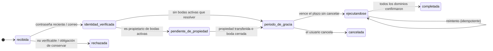

# Weda · Arquitectura de datos · Fase 2 — Retención, privacidad y eliminación de datos

Fecha: 2026-10-30. Decisión Q8 (retención y eliminación) y criterios legales del pedido.
Alcance: diseño conceptual. No implementa nada.

> **Advertencia.** Este documento traduce tus decisiones a un diseño técnico y señala dónde hace falta un criterio profesional. **No es asesoramiento legal ni contable y no garantiza el cumplimiento de ninguna norma.** Los plazos son propuestas de producto. Las citas de artículos de la Ley 25.326 se hacen de memoria como referencia para la conversación con el asesor: **verificar el texto vigente**. Los puntos que requieren validación están reunidos en el §12.

**86 entidades en 13 dominios**: 50 «Ahora», 22 «Preparar» y 14 «Después» (solo documentadas).

---

## 1. Qué se decidió y qué se propone

| Tema | Decisión de la dueña | Propuesta técnica |
|---|---|---|
| Datos personales y operativos | Se usan durante la **vigencia única de 12 meses** desde que Weda confirma el pago y activa la publicación. **Después**, según la **política posterior al cierre** por clase de dato, con plazos **a validar con asesoramiento** (P30); no se asume ni que se eliminan de inmediato ni que se conservan indefinidamente. | Clase `A` + `DataExportJob` + `RetentionRun`. |
| Datos financieros | Separar de los operativos; conservar lo que deba conservarse (art. 328 CCyC, diez años para ciertos libros y registros); **no asumir** que todo comprobante de invitado cae ahí. | Clases `B1`, `B2`, `B3`; libro sin datos personales. |
| Analítica | Conservar métricas históricas **agregadas y anonimizadas**; sin datos personales indefinidos; anonimización **irreversible**. | `ProductEvent` (seudónimo, plazo) + `AggregateMetric` (anónimo, permanente). |
| Marketing | Los contactos de invitados **no** pasan a ser contactos comerciales; suscripción independiente, informada, opcional, revocable. | `CommunicationConsent` separado de `Guest`. |
| Eliminación de cuenta | Revocar sesiones, resolver propiedad, anonimizar, conservar solo lo con fundamento legal, financiero separado, métricas solo anonimizadas; no eliminar una boda con miembros sin resolver su propiedad. | `DeletionRequest` + `RetentionRun`; lápidas. |

---

## 2. Marco: Ley 25.326 y cómo lo refleja el diseño

La referencia es la Ley 25.326 de Protección de Datos Personales y sus normas complementarias. La tabla indica **qué principio busca cuidar el diseño**, no que lo cumpla.

| Principio o derecho (referencia, verificar) | Cómo lo contempla el diseño | Requiere validación |
|---|---|---|
| Calidad y finalidad (art. 4): datos adecuados, no excesivos, no usados para otra finalidad, conservados solo el tiempo necesario | Cada entidad tiene finalidad y **clase de retención**; solo se guarda lo necesario (por ejemplo, el libro no guarda nombres). | Plazos |
| Consentimiento (art. 5) | `CommunicationConsent` con texto, versión, fecha y origen; consentimientos de marketing separados de los términos. | Bases de tratamiento distintas del consentimiento |
| Información (art. 6) | Política de privacidad y avisos al recolectar (invitados, aportes, RSVP). | Texto definitivo |
| Seguridad (art. 9) | §10. | Medidas adecuadas al riesgo |
| Confidencialidad (art. 10) | Permisos explícitos; datos de aportes solo para roles con permiso. | — |
| Cesión (art. 11) y transferencia internacional (art. 12) | Lista de proveedores en §9; varios son extranjeros. | **Sí: transferencias internacionales** |
| Acceso (art. 14), rectificación, actualización y supresión (art. 16) | `DeletionRequest` tipifica acceso, rectificación, portabilidad, oposición y supresión con plazos de respuesta; `DataExportJob` entrega los datos. | **Plazos de respuesta** (la norma los fija cortos; confirmar el valor) |
| Registro de bases de datos (art. 21 y normas del organismo de aplicación) | — | **Sí: inscripción y su vigencia** |

Los invitados que regalan o responden **no son clientes de Weda**: sus datos los carga la pareja o ellos mismos. El diseño minimiza lo que se les pide y se les informa a quién se lo da y por cuánto tiempo.

---

## 3. Qué se trata, para qué y con qué fundamento

| Datos | De quién | Finalidad | Fundamento propuesto | Clase | Quién los ve |
|---|---|---|---|---|---|
| Correo, clave (hash), nombre, sesiones | Pareja (usuario) | Prestar el servicio, seguridad | Ejecución del servicio | `U`, `S` | Weda |
| Nombres, fechas, lugares, fotos, textos del sitio | Pareja | Armar y publicar el sitio | Ejecución del servicio | `W` | Pareja e invitados (lo publicado) |
| Nombres, correo, teléfono, restricciones alimentarias, acompañantes, respuestas | Invitados (cargados por la pareja o por ellos) | Organizar el evento | Ejecución del servicio a la pareja; información al invitado | `A` | Pareja (roles con permiso) |
| Nombre, correo, mensaje, importes de un aporte | Quien aporta | Informar el aporte y emitir constancia | Ejecución del servicio; consentimiento para lo que exceda | `A` | Pareja (roles con permiso) |
| Comprobante de transferencia | Quien aporta | Que la pareja verifique | Ejecución del servicio | `B3` | Pareja (roles con permiso) |
| Asientos del libro (importe, moneda, fecha, tipo) | Sistema | Registro financiero inmutable | Obligaciones/legitimidad contable (a validar) | `B2` | Pareja; Weda con restricciones |
| Órdenes, pagos, precios contratados, suscripciones | Pareja | Facturación de Weda | Obligaciones contables y fiscales | `B1` | Weda; pareja (sus órdenes) |
| Eventos de uso (seudónimos) | Visitantes y usuarios | Mejorar el producto | **A definir**: interés legítimo o consentimiento (según la jurisdicción y el tipo de dato) | `C` | Weda |
| Métricas agregadas anonimizadas | Sistema | Evolución del negocio | No son datos personales si la anonimización es efectiva | `C` (permanente) | Weda |
| Correo/teléfono con consentimiento comercial | Quien tilda la casilla | Novedades y promociones de Weda | **Consentimiento expreso**, revocable | `D` | Weda |

**Regla:** no se usan datos personales identificables para finalidades nuevas sin el fundamento y el consentimiento que correspondan. Una finalidad nueva implica volver a esta tabla.

---

## 4. Las cuatro categorías

### A. Datos personales y operativos

**Entidades:** `Guest`, `Invitation`, `InvitationAccess`, `InvitationDelivery`, `RsvpResponse`, `RsvpResponseEvent`, `SeatingTable`, `GuestImport`, `EventInvitee`, `Contribution` (datos de la persona), `ContributionItem`, `ContributionEvent`.

**Regla (vigencia única de 12 meses):** los datos se usan mientras el evento está **activo** (hasta 12 meses desde que Weda confirma el pago y activa la publicación, [`02d-event-lifecycle-and-final-export.md`](02d-event-lifecycle-and-final-export.md) §1). La pareja puede exportarlos durante esa vigencia. **Al vencer**, el evento se cierra: la pareja ya no accede ni exporta, y los datos pasan a «en retención posterior». **No hay período adicional de acceso privado.** Lo que ocurre con cada dato después **depende de su clase y de plazos que todavía no están definidos** (P30):

1. **Al vencer**, se calculan las métricas del evento (categoría C) —**condición previa verificada antes de depurar**— y se cierra el acceso; no se eliminan datos por el solo hecho de vencer.
2. **Después**, según la política posterior al cierre (**configuración versionada, sin plazos fijos en el código**), se eliminan o anonimizan de forma efectiva los datos que ya no tengan finalidad ni obligación de conservación (`RetentionRun`); cada clase conservada tiene finalidad, base y plazo documentados.

**Qué significa «anonimizar» en cada caso**

| Entidad | Qué se hace cuando la política posterior al cierre ordena depurar (no necesariamente al vencer) |
|---|---|
| `Guest`, `RsvpResponse`, `Invitation`, `InvitationAccess`, `InvitationDelivery` | Se **eliminan**. |
| `RsvpResponseEvent`, `GuestImport`, `EventInvitee`, `SeatingTable` | Se eliminan. |
| `Contribution` | Se **anonimiza**: se borran nombre, correo y mensaje de quien aportó; se conservan importe, moneda, fecha y estado (no identifican a nadie y coinciden con el libro). |
| `ContributionItem`, `ContributionEvent` | Se conservan solo sin datos personales (notas libres eliminadas). |
| `PaymentProof` y su archivo | Ver §5 (clase `B3`): se eliminan salvo disputa abierta o que se determine que son respaldo contable; el plazo es P30/P6. |
| `OutboundMessage` | Se elimina el destinatario; se conserva el tipo, estado y fecha por el plazo de la clase `S`. |

**La fecha del casamiento no interviene** en la vigencia ni en la retención: ni su cambio, ni su ausencia, ni que sea posterior al vencimiento modifican estos plazos.

### B. Datos financieros

**Se separan de los operativos.** Hay tres subclases con lógica distinta:

| Subclase | Qué es | Por qué se separa | Entidades |
|---|---|---|---|
| **B1** Registros financieros **de Weda** | Lo que la pareja le paga a Weda: órdenes, pagos, precio contratado, suscripciones, notificaciones del proveedor de pagos, facturas y reembolsos (a futuro). | Es **contabilidad de Weda**: obligaciones contables y fiscales propias. | `Order`, `OrderLine`, `Payment`, `Subscription`, `PlanPrice`, `Invoice`, `Refund`, `ProviderEvent`, `Coupon*`, `CampaignSpend` |
| **B2** Registro financiero **de los regalos** | El libro de aportes confirmados y los destinos de cobro versionados. | Es un registro **de la pareja**, no de Weda (Weda no pasa por el dinero). Se mantiene inmutable y **sin datos personales**. | `GiftTransaction`, `PayoutMethod`, `PayoutMethodChange`, `PaymentIntent` |
| **B3** Evidencia operativa de pagos | Comprobantes que cargan los invitados. | No se asume que sea respaldo contable de Weda. | `PaymentProof` + archivo |

**Qué cita el pedido y qué no se asume.** Se toma como dato, según tu indicación, que el art. 328 del Código Civil y Comercial de la Nación establece diez años para determinados libros, registros e instrumentos respaldatorios. **No se asume** que todo comprobante cargado por un invitado esté alcanzado por ese plazo: quién es el obligado y qué documentos son respaldo es la clasificación pendiente de §5.

**Cómo se separa técnicamente**
- Las tablas financieras **no contienen datos personales de invitados**: el libro y los registros B1/B2 guardan importes, monedas, fechas, tipos y referencias opacas.
- Las referencias de lo financiero hacia el casamiento o el usuario apuntan a **lápidas** (filas mínimas), de modo que borrar a las personas no deje huérfano lo que se conserva.
- Sin **borrado en cascada** desde el casamiento hacia lo financiero: el borrado de un casamiento se convierte en lápida y borrado selectivo (hoy el esquema usa cascadas; ver 02c).
- Acceso restringido: solo roles con permiso financiero y, para Weda, personal autorizado, con auditoría.
- Separación física posible a futuro (esquema o base distinta) si hiciera falta.

### C. Datos de producto y analítica

Weda quiere conservar la historia del negocio **sin conservar a las personas**.

**Dos niveles, con nombres distintos**

| Nivel | Qué es | Es dato personal | Plazo propuesto |
|---|---|---|---|
| **Seudonimización** (`ProductEvent`) | Eventos con identificadores opacos (anónimo, sesión, usuario, casamiento) que **permiten reconstruir embudos**. Quien tenga la tabla de equivalencias podría volver a la persona. | **Sí**: la seudonimización reduce el riesgo pero no deja de ser dato personal. | Acotado; propuesta 13–25 meses (se define en la Fase 3) |
| **Anonimización** (`AggregateMetric`) | Cifras agregadas por período y categorías gruesas, sin ningún identificador ni vínculo con un casamiento, usuario o invitado. | **No**, si es efectiva e irreversible. | **Sin plazo** |

**Diseño de la anonimización irreversible**
1. **Se agrega antes de borrar:** las métricas se calculan y guardan **antes** de depurar los datos originales (al vencer el evento y al vencer los plazos de analítica).
2. **Sin llaves de retorno:** `AggregateMetric` no guarda identificadores ni clave que enlace a un casamiento. No se guarda el casamiento «anonimizado» como fila individual.
3. **Granularidad gruesa:** período mensual; dimensiones en categorías amplias (plan, moneda, tipo de dispositivo, canal en grupos); importes como promedios o rangos.
4. **Control de celdas pequeñas, sin dar por hecho que alcanza:** una celda con pocos casos se agrupa u omite, pero **un umbral numérico no garantiza anonimización por sí solo** (importa quién queda en la celda, la dominancia de un caso, las combinaciones de dimensiones y las consultas repetidas). El conjunto de medidas está en `05-analytics-architecture.md` §7 (por ejemplo, «una boda de 14 invitados con un regalo de 3 USD en marzo» es identificable aunque haya otras diez bodas en el período).
5. **Nunca se mezclan monedas:** los importes se agregan por moneda.
6. **Versión de la definición** de cada métrica, para poder comparar en el tiempo.
7. **Eliminar el puente:** al vencer el plazo de la seudonimización, se borra el vínculo (tablas de equivalencias) y los eventos antiguos se eliminan o se convierten solo en agregados.

**Métricas históricas que el sistema debe poder conservar** (todas agregadas, definidas en `05b-metric-definitions.md`, y solo si superan la evaluación de riesgo): cantidad de bodas; invitados por boda (promedio y distribución en rangos); porcentaje de confirmación; regalos por evento; **importe promedio por moneda**; categorías de regalos más elegidas; planes contratados; conversión entre registro y publicación; tiempo hasta completar el micrositio; funcionalidades más usadas; **recontratación para eventos nuevos**; retención durante la vigencia; embudos; evolución comercial.

**Riesgo honesto:** con pocos datos, un agregado puede ser reidentificable. La garantía de «irreversible» depende del conjunto de medidas y de la evaluación de riesgo, no de la intención ni de un umbral. **Validar con asesoramiento** (§12) y probar contra reidentificación antes de dar por buena la anonimización.

### D. Datos comerciales y marketing

- **Los contactos de los invitados no se convierten automáticamente en contactos de Weda.** Un invitado que regala o responde puede tildar, **aparte y destildada**, una casilla para recibir novedades de Weda.
- Ese consentimiento se guarda en **su propia entidad** (`CommunicationConsent`): contacto, canal, propósito, texto y versión aceptados, origen, fecha de alta y de baja. **No depende** de que el registro del invitado se conserve: cuando se eliminan los datos del evento, el consentimiento vigente sigue con su propia base y se puede revocar.
- **Aceptar los términos no es consentir comunicaciones comerciales.** `TermsAcceptance` es otra entidad.
- Cada mensaje de marketing lleva el vínculo de baja y se verifica el consentimiento **al enviar**. La baja se marca, no se borra (prueba de cuándo se dio y se retiró).
- Un `Lead` (alguien que dejó sus datos comerciales) es distinto de un invitado y de un usuario, y se vincula con una visita solo con consentimiento de analítica.

---

### E. Evento finalizado: cierre, descargas y datos posteriores

El evento tiene **una sola vigencia de 12 meses** desde que Weda confirma el pago y activa la publicación (pagar, activar y publicar son una única acción). Al cumplirse, **vence definitivamente y se cierra**: sin renovación, extensión ni reactivación, y **sin período adicional de acceso privado**. Diseño completo en [`02d-event-lifecycle-and-final-export.md`](02d-event-lifecycle-and-final-export.md).

| Tema | Regla |
|---|---|
| Durante los 12 meses | Acceso completo; la pareja descarga sus datos cuando quiera |
| Qué se puede descargar | (1) invitados, acompañantes y respuestas, (2) regalos y aportes, (3) ZIP de comprobantes, (4) resumen financiero |
| Quién | Propietario y administrador (`data.export`); queda registrado quién exportó, cuándo y qué alcance, **sin guardar el contenido** |
| Archivos generados | Datos personales de terceros: almacenamiento privado, enlace con vencimiento, eliminación a los pocos días (P25) |
| Qué NO se exporta | Tokens, hashes, IP, huellas de dispositivo, alias o CBU completos, tarjetas, auditoría interna |
| Lo que Weda sabe | Los informes solo muestran lo registrado: aporte registrado, comprobante cargado, revisado, **confirmado manualmente por la pareja**, rechazado, reembolso o corrección registrada. **Weda no verifica transferencias**; los importes no se presentan como fondos recibidos o acreditados |
| Al vencer | Se bloquean edición, publicación, gestión, descargas y exportaciones **para todos los roles, incluido el propietario**; se cierra el acceso privado al panel; se deshabilitan RSVP y regalos públicos; la URL no se reutiliza; se calculan las métricas del evento |
| Después del vencimiento | **No se asume eliminación inmediata.** Cada clase sigue la política posterior al cierre (§F y `02d` §6): personales y operativos, financieros sujetos a obligaciones legales (conservados con acceso restringido, sin reactivar el evento), analíticos, comerciales y contractuales. **Plazos a validar con asesoramiento (P30)** |
| Derechos de las personas | **Procedimiento separado** (§7, `02d` §6.3): no reactiva el evento ni habilita el panel; no confunde el derecho de acceso con el acceso comercial |
| Aceptación de la vigencia | `TermsAcceptance` (usuario, evento y contratación, fecha y hora, versión del texto y evidencia) es **evidencia contractual de solo agregar**; su conservación sigue la clasificación contractual (P30), no la del evento |
| Avisos de vencimiento | Mensajes con clave de idempotencia y registro de entrega; no se asume la entrega; no prolongan la vigencia (`02d` §1.5) |
| Analítica | El vencimiento **no borra** eventos ni métricas que cumplen su plazo; las del evento se calculan **antes** de depurar |
| Eliminación anticipada | La pareja puede pedirla en cualquier momento durante la vigencia; se recomienda descargar antes |

### F. Separación de las cinco clases de datos

Los datos de Weda se agrupan por **naturaleza**, y cada grupo tiene su acceso, plazo y borrado. Una entidad pertenece a **una sola** de estas clases.

| Naturaleza | Qué incluye | Clases de retención (§13) | Regla clave |
|---|---|---|---|
| **Datos personales** | Nombres, correos, teléfonos, restricciones alimentarias y mensajes de invitados; datos de la pareja y de quienes aportan | `A` (invitados y aportantes), `U` (cuenta) | Se usan durante la vigencia; después se eliminan o anonimizan **de forma efectiva** según la política posterior al cierre (plazos a validar, P30); nunca se usan automáticamente para marketing |
| **Datos operativos** | Invitaciones, enlaces, respuestas, mesas, configuración, mensajes enviados, sesiones | `A`, `W`, `S` | Existen para operar el evento; después siguen la política posterior al cierre (P30) |
| **Datos financieros** | Libro de confirmaciones y correcciones, destinos de cobro versionados, órdenes y pagos de Weda | `B1`, `B2`, `B3` | Separados de los datos personales, sin borrado en cascada, conservados según lo legalmente exigible |
| **Datos analíticos** | Eventos con seudónimos, fotografía mensual, agregados | `C` | Plazos 13 y 25 meses; agregados solo tras evaluación de riesgo; **no son fuente de verdad** |
| **Datos comerciales** | Consentimientos y contactos comerciales | `D` | Fundamento y autorización **independientes**; no derivan de invitados |

**Un dato que cruza clases se divide, no se copia:** el nombre de quien aporta vive en `Contribution` (`A`), el hecho económico en `GiftTransaction` (`B2`, sin nombre), el comprobante en `PaymentProof` (`B3`), y la estadística en `AggregateMetric` (`C`, sin vínculo).

**Anonimización efectiva (criterio)**
1. Eliminar es preferible a anonimizar: lo que no tiene finalidad se borra.
2. Cuando hay que conservar el hecho (importe, moneda, fecha, estado), se eliminan **todos** los campos identificables (nombre, correo, teléfono, mensaje, etiquetas como «Familia Pérez», notas libres) y se evalúa la **reidentificación por combinación** de lo que queda.
3. Reemplazar un nombre por un identificador **no** es anonimizar: eso es seudonimización y el dato sigue siendo personal.
4. Si no se puede garantizar, se elimina la fila.

### G. Eventos nunca contratados: borradores abandonados (P19, adoptada)

> **Estado:** **decisión adoptada** (casos, plazos de inactividad y definición de actividad: valores de **producto**); el **fundamento legal** de eliminar por inactividad sigue pendiente de validación. Los avisos y el detalle de qué se elimina son **recomendaciones asociadas** por confirmar. Detalle en [`02d-event-lifecycle-and-final-export.md`](02d-event-lifecycle-and-final-export.md) §2.8.

**P19 solo se aplica a lo nunca contratado.** Contratar (pago confirmado) activa y publica el evento y lo pasa al ciclo de 12 meses: **no existe** un evento contratado que siga como borrador. **Eliminar un borrador no es eliminar la cuenta ni ejercer un derecho legal**; los derechos de acceso y supresión (§7) no se reemplazan ni se demoran por esta limpieza (recomendación: se suspende la eliminación automática si hay una solicitud pendiente sobre esos datos).

| Caso | Inactividad (adoptada) | Datos que existen | Avisos (recomendación) | Se elimina (recomendación) | Se conserva |
|---|---|---|---|---|---|
| 1. Cuenta registrada sin evento | **12 meses** | Correo, hash de clave, nombre visible | 30, 7 y 1 día antes | La cuenta (**política distinta del borrador**; validar) | Auditoría mínima; consentimientos comerciales según su clase |
| 2. Evento creado sin contratación | **6 meses** | Nombres, fecha, portada | Ídem | El evento en armado y su contenido | Auditoría mínima; la cuenta |
| 3. Onboarding incompleto | **6 meses** | Datos parciales | Ídem | El evento en armado | Ídem |
| 4. Borrador avanzado nunca contratado | **12 meses** | Bloques, fotos, regalos, **invitados cargados**, posibles **datos de cobro** | Ídem, con recordatorio de descargar una copia | Todo el borrador | Auditoría mínima; la cuenta |

**Actividad** = inicio de sesión o escritura efectiva.

- **Qué es dato personal, operativo, financiero y contractual** en un borrador: datos personales de la pareja y de terceros (invitados cargados) y datos operativos; **no hay registros financieros ni contractuales** (nunca hubo contratación), por lo que se elimina la fila del casamiento sin dejar lápida.
- **Qué no se implementa hasta validar:** ningún trabajo de eliminación por inactividad, ningún aviso de inactividad, ninguna constante de plazo en el código.
---

## 5. Clasificación de documentos financieros (a validar)

| Documento / registro | Propuesta | Plazo propuesto | Quién decide |
|---|---|---|---|
| Orden de compra de un plan, pago confirmado, notificaciones del proveedor de pagos | **B1** (contabilidad de Weda) | Largo; candidato 10 años (art. 328 CCyC) | Contador / abogado |
| Precio contratado por orden, suscripción, reembolso | **B1** | Igual | Contador / abogado |
| Factura o comprobante fiscal que emite Weda (a futuro) | **B1** | Según norma fiscal | Contador |
| Libro de aportes confirmados (importe, moneda, fecha, tipo, **sin nombres**) | **B2** | Propuesta: conservar sin datos personales; plazo a definir | Contador / abogado |
| Versiones de destino de cobro (alias, CBU) y sus cambios | **B2** | Igual que el libro; datos sensibles con acceso restringido | Contador / abogado |
| Registro de auditoría financiera (quién cambió el destino, confirmó, revirtió) | **B2/S** (`AuditLog` financiero) | Igual que el libro | Contador / abogado |
| **Comprobante de compra de Weda** (factura o comprobante que Weda emite por el plan, cuando corresponda) | **B1**: contabilidad de Weda; **no** es un comprobante de invitado | Según norma fiscal y contable; **no se asume igual** que ningún otro | **Contador** |
| **Historial de órdenes y pagos a Weda y ficha comercial del evento** (nombres de la pareja y fecha de la boda congelados al vencer) | **B1** (contractual) | **A validar** (P34, P30) | **Contador / abogado** |
| **Comprobante cargado por un invitado** | **B3**: evidencia operativa, **no** respaldo contable de Weda por defecto | Descargable en el ZIP durante la vigencia; luego según la política posterior al cierre (P30), salvo disputa o clasificación distinta | **Contador / abogado**: ¿es respaldo contable de alguien? |
| Mensajes con datos personales del invitado | `A`/`S` | Durante la vigencia; luego según la política posterior al cierre (P30) | Producto |

---

## 6. Eliminación de cuentas

**Quién:** el propio usuario, con contraseña reciente (y segundo factor si lo tiene), o personal de Weda por una solicitud verificada. Cada paso queda en `AuditLog` (categoría privacidad) y se resuelve con `DeletionRequest`.

**Pasos, en orden**

1. **Verificar identidad** (contraseña reciente; correo de confirmación).
2. **Resolver la propiedad de las bodas activas** (obligatorio, no se puede saltear):
   - Si el usuario es **propietario** de una boda con **otros miembros activos**: no se elimina la boda ni la cuenta hasta transferir la propiedad (`OwnershipTransfer`) o hasta que los miembros acepten el cierre. El procedimiento queda en «pendiente de propiedad».
   - Si es propietario de una boda **sin otros miembros**: puede cerrarla (se programa su eliminación) o exportar y continuar.
   - Si es **colaborador o administrador**: se retira su membresía; el contenido que editó se conserva atribuido a un seudónimo.
3. **Período de gracia** (propuesta: 14 días, cancelable) con aviso por correo.
4. **Ejecución**, de forma **idempotente y reanudable** (`RetentionRun`), con cada dominio ejecutando su propia anonimización:
   - Identidad: **revocar todas las sesiones y tokens**, borrar credenciales y segundo factor, anonimizar al usuario (**lápida**: identificador y fechas).
   - Casamientos eliminados: datos personales y de invitados borrados; el casamiento queda como lápida.
   - Datos de terceros (invitados, aportes): según §4-A.
   - Marketing: se conserva el consentimiento **solo si el titular lo pidió**; si pide eliminar todo, se revoca y se bloquea el envío.
   - Auditoría: el actor pasa a un seudónimo; el contenido no se borra.
   - **Financiero B1/B2: se conserva** (sin datos personales), con acceso restringido y apuntando a lápidas.
   - Analítica: eventos seudónimos del usuario se eliminan o se desvinculan; las métricas agregadas **no se tocan** (ya son anónimas).
5. **Confirmación** al correo previo, y registro del resultado en `DeletionRequest`.

**Invariantes:** nunca se elimina una boda con miembros activos sin resolver su propiedad; una solicitud ejecutada **no deja datos personales en las clases A, U, D**; lo que se conserva tiene un fundamento documentado; si falla un dominio, la solicitud queda «ejecutándose» y se reintenta, nunca se marca completada con tareas pendientes.

**Qué hace distinto la eliminación de una boda sola:** mismo procedimiento sin tocar al usuario. La política posterior al cierre **no elimina la cuenta**, y el contenido de la pareja sigue la decisión P7/P30.

---

## 7. Derechos de las personas

**Procedimiento separado del acceso comercial (P32).** El derecho legal de acceso a los datos personales **no es** el acceso comercial al producto. Las exportaciones del panel existen solo mientras el evento está vigente; **no son el canal de los derechos** y bloquearlas al vencer **no los anula**. Los derechos se atienden por una solicitud (`DeletionRequest`) resuelta por personal autorizado, con verificación de identidad, informe puntual y auditoría, **sin reactivar el evento ni habilitar de nuevo el panel**. Detalle en [`02d-event-lifecycle-and-final-export.md`](02d-event-lifecycle-and-final-export.md) §6.3.

| Derecho | Quién lo ejerce | Cómo se atiende | Observación |
|---|---|---|---|
| Acceso | Usuario, invitado o persona que aportó | Informe puntual por el procedimiento de derechos, con identidad verificada | **No** usa las exportaciones del panel ni reabre el evento. **Plazo legal a confirmar.** |
| Rectificación | Cualquier titular | Corrección del dato en el registro conservado, con constancia, por personal autorizado | No edita el evento. Plazo a confirmar |
| Supresión | Cualquier titular | `DeletionRequest` | Con excepciones por obligación de conservar (financieros y contractuales), que se informan |
| Oposición a marketing | Cualquiera | Vínculo de baja en cada mensaje; revocación inmediata | Se registra la baja |
| Portabilidad | Pareja | Exportación estructurada **durante la vigencia** | Buena práctica, no necesariamente una obligación: validar |

---

## 8. Plazos propuestos (resumen; todo «a validar»)

| Categoría | Plazo | Disparador |
|---|---|---|
| Sesiones vencidas y tokens usados o vencidos | 30 días | Vencimiento |
| `A` datos personales y operativos | **A definir (P30)**, después del vencimiento de los 12 meses; durante la vigencia, mientras opera el evento | Política posterior al cierre (`RetentionRun`) |
| `W` contenido de la pareja | Mientras exista la cuenta | Eliminación de cuenta o de boda |
| `B1` financiero de Weda | Candidato 10 años | Obligación contable |
| `B2` libro de regalos | A definir | Obligación o decisión de producto |
| `B1` comprobantes de compra de Weda, historial de órdenes y pagos y ficha comercial | **A definir (P6, P30, P34)**; **no se asume el mismo plazo que `B3`** | Obligación contable o contractual |
| `B3` comprobantes de invitados | **A definir (P30, P6)**, después del vencimiento (salvo disputa) | Política posterior al cierre |
| Archivos de exportación generados | Pocos días después de generarse (propuesta 7, P25) | Calendario |
| `C` eventos seudónimos | 13–25 meses (Fase 3) | Calendario |
| `C` agregados anónimos | Sin plazo | — |
| `D` consentimiento comercial | Mientras esté vigente; la baja se conserva como prueba | Revocación |
| `S` mensajes enviados | 12 meses (sin destinatario después de A) | Calendario |
| `S` auditoría | Seguridad y administración: según política; financiera: como `B2` | Calendario |

---

## 9. Destinatarios y proveedores

Lo que **está comprobado en el código o dicho por la dueña**; el resto no se asume.

| Proveedor | Para qué | Datos que recibe | Ubicación | Estado |
|---|---|---|---|---|
| Hosting (Vercel hoy) | Ejecutar la aplicación | Todo lo que viaja por la aplicación | **A confirmar** (transferencia internacional) | En uso (dato de la dueña) |
| Resend | Enviar correos transaccionales | Correo del destinatario y contenido | **A confirmar** | Integrado, opcional |
| Google Maps / Places | Buscar lugares | Texto de búsqueda y referencia de la página | Exterior | En uso en el navegador |
| Google (inicio de sesión) | OAuth | Correo y nombre del usuario | Exterior | **No integrado** |
| Google Workspace / Squarespace | Correo corporativo y registro del dominio | Correos de la empresa | Exterior | En uso (dato de la dueña) |
| Proveedor de pagos (p. ej. Mercado Pago) | Cobrar planes | Datos de pago y orden | **A confirmar** | **No integrado** |

**Pendiente:** contrato y condiciones de tratamiento con cada proveedor; ubicación de los servidores y requisitos de transferencia internacional.

---

## 10. Medidas de seguridad

**Ya presentes (comprobado en el código):** contraseñas con scrypt y sal; tokens de sesión y recuperación solo como hash; cookie `HttpOnly`, `SameSite`, `Secure`; verificación de `Origin`; límites de intentos; aislamiento por usuario en el servidor; comprobantes en almacenamiento privado; correos sin guardar el contenido.

**Propuestas del modelo:** tokens de invitación y de transferencia como hash y revocables; reautenticación para operaciones críticas; segundo factor para personal y opcional para propietarios; versiones inmutables de destino de cobro con auditoría; libro inmutable; lápidas; acceso restringido a lo financiero; registros sin valores sensibles (huellas y valores enmascarados); retención automática auditada.

**Para la Fase 6:** referencias a prueba de manipulación de ID, límites persistentes, política de `Referer` en las rutas con token, exportaciones autorizadas, pruebas de aislamiento entre casamientos.

---

## 11. Política de privacidad: lo que debería cubrir

Hoy existe un borrador en `/privacidad` (no indexado, con datos de la empresa a completar). Para alinearlo con este diseño debe incluir, redactado con asesoramiento: finalidades por categoría de dato; qué se recolecta de pareja, invitados y quienes aportan; fundamento y consentimientos; plazos (§8); destinatarios y proveedores (§9); transferencias internacionales; medidas de seguridad; derechos y cómo ejercerlos; procedimiento de eliminación; contacto del responsable; inscripción de la base; cambios de política y su versión (la versión queda en `TermsAcceptance`).

---

## 12. Puntos que requieren validación profesional

1. **Plazos de conservación posteriores al cierre** de cada clase (datos de invitados y de quienes aportan, comprobantes, contenido de la pareja, contractuales), su finalidad y fundamento; y la proporcionalidad de conservar datos de invitados durante los 12 meses de vigencia aunque la boda sea antes (P30).
2. **Contable/fiscal:** qué registros de Weda caen en el art. 328 CCyC y por cuánto tiempo; quién es el obligado respecto de los asientos del libro de regalos; si el comprobante de un invitado es respaldo contable de alguien (P6).
3. **Transferencias internacionales** de datos a los proveedores listados y las cláusulas necesarias.
4. **Inscripción y mantenimiento** de la base de datos ante el organismo de aplicación.
5. **Plazos de respuesta** a derechos de acceso, rectificación y supresión.
6. **Fundamento del tratamiento de analítica** (consentimiento o interés legítimo) y uso de cookies o identificadores anónimos.
7. **Efectividad de la anonimización** (umbral, granularidad, riesgo de reidentificación) y distinción práctica con la seudonimización.
8. **Comunicaciones comerciales:** requisitos de consentimiento, identificación y baja.
9. **Datos de menores** (acompañantes o integrantes de un grupo familiar).
10. **Eliminación:** excepciones por obligación de conservar, plazos de gracia y comunicación al titular.
11. **Obligaciones del proveedor de pagos** al integrarlo (Fase de monetización).
12. **Defensa del consumidor** en la venta de planes: información **previa** sobre la vigencia de 12 meses desde que se confirma el pago y se publica, sin importar la fecha del casamiento; ausencia de renovación y extensión; cierre definitivo sin descargas posteriores; desistimiento (P33).
13. **Derechos de acceso y supresión** de las personas sobre un evento cerrado, dado que las exportaciones se bloquean al vencer (P32).
14. **Boda posterior al vencimiento:** que el evento cierre antes del casamiento, sin extensión, y los avisos y constancia de aceptación previos (P2 cerrada, P23, P33).
15. **Efectividad de la anonimización** de los registros que se conservan (aportes anonimizados) y criterio de reidentificación por combinación.

16. **Constancia de aceptación de la vigencia** (P33): suficiencia de la aceptación electrónica como evidencia, información previa al consumidor, si las cláusulas «sin renovación», «sin extensión» y «sin exportaciones después del vencimiento» requieren destaque, si es proporcionado guardar IP y dispositivo, y su plazo de conservación.
17. **Avisos de vencimiento:** si pueden ser obligatorios y no desactivables, y qué se considera constancia de comunicación sin confirmar la entrega.
18. **Procedimiento de derechos sobre un evento cerrado:** plazos de respuesta, identidad de quien no tiene cuenta y rol de Weda frente a los datos de invitados (P32).

19. **Historial comercial visible en la cuenta (P34):** fundamento y plazo para conservar y mostrar la ficha comercial (nombres de la pareja, fecha de la boda), el historial de órdenes y pagos y los comprobantes de compra de Weda; si los cuatro tipos de documentos (comercial y contractual, operativos, compra de Weda, comprobantes de invitados) requieren plazos distintos.
20. **Cancelación y reembolso de planes (P26)** (por ejemplo, un pago hecho por error): si corresponde devolución, tratamiento contable y condiciones del proveedor de pagos.
21. **Eliminación por inactividad (P19):** fundamento, suficiencia del aviso y proporcionalidad de los plazos; eliminación de cuentas inactivas; suspensión ante solicitudes de derechos pendientes.

---

## 13. Clases de retención por entidad

| Clase | Entidades |
|---|---|
| `W` — Contenido de la pareja <small>Mientras exista la cuenta o el casamiento; al eliminar queda una lápida sin nombres.</small> | `Wedding`, `WeddingMember`, `EventMoment`, `Microsite`, `MicrositeBlock`, `GalleryItem`, `MicrositeRevision`, `Publication`, `PublicAddress`, `CustomDomain`, `MediaAsset`, `Gift`, `GiftSettings`, `RsvpSettings`, `Vendor`, `VendorMember`, `VendorProfile`, `VendorService` |
| `A` — Datos personales y operativos (categoría A) <small>Mientras opera el evento (12 meses desde que se confirma el pago y se activa); después, según la política posterior al cierre (plazos por clase a validar con asesoramiento; se elimina o anonimiza de forma efectiva).</small> | `Contribution`, `ContributionItem`, `ContributionEvent`, `Guest`, `Invitation`, `InvitationAccess`, `InvitationDelivery`, `RsvpResponse`, `RsvpResponseEvent`, `SeatingTable`, `GuestImport`, `EventInvitee`, `Inquiry`, `Review` |
| `B1` — Registros financieros y contractuales de Weda (categoría B) <small>Según obligaciones contables y fiscales de Weda; candidato 10 años (art. 328 CCyC), a validar con asesoramiento contable.</small> | `PlanPrice`, `Subscription`, `Order`, `OrderLine`, `Payment`, `Coupon`, `CouponRedemption`, `Invoice`, `Refund`, `CampaignSpend`, `TermsAcceptance`, `ProviderEvent`, `AdCampaign` |
| `B2` — Registro financiero de los regalos (categoría B) <small>Libro inmutable sin datos personales, separado de lo operativo; plazo a validar (no es contabilidad de Weda).</small> | `PayoutMethod`, `PayoutMethodChange`, `GiftTransaction`, `PaymentIntent` |
| `B3` — Evidencia operativa de pagos (categorías A/B) <small>Comprobantes de invitados: descargables durante la vigencia; luego según la política posterior al cierre (a validar), salvo disputa o que se determine que son respaldo contable; a clasificar.</small> | `PaymentProof` |
| `C` — Analítica de producto (categoría C) <small>Eventos seudónimos 13 meses; fotografía mensual por casamiento 25 meses; luego solo métricas agregadas que superaron la evaluación de riesgo.</small> | `Visitor`, `VisitSession`, `Campaign`, `ProductEvent`, `WeddingMonthlySnapshot`, `OutboxEvent`, `AggregateMetric` |
| `D` — Comercial y marketing (categoría D) <small>Mientras haya consentimiento vigente; se elimina o se bloquea al revocarlo.</small> | `Lead`, `IdentityLink`, `ReferralCode`, `CommunicationConsent` |
| `S` — Seguridad, auditoría y operación <small>Plazos propios y cortos para registros técnicos; auditoría financiera y de administración según su categoría.</small> | `Session`, `AuthToken`, `OwnershipTransfer`, `MemberInvite`, `OutboundMessage`, `MessageDeliveryEvent`, `DeletionRequest`, `DataExportJob`, `AuditLog`, `SecurityEvent`, `StaffRole`, `BackgroundJob`, `ModerationCase`, `RetentionRun` |
| `U` — Cuenta <small>Mientras exista la cuenta; al eliminarla queda una lápida anonimizada.</small> | `User`, `AuthIdentity`, `MfaFactor`, `NotificationPreference` |
| `R` — Referencia y configuración <small>Sin datos personales; sin plazo.</small> | `Theme`, `GiftCollection`, `GiftCatalogItem`, `Plan`, `Feature`, `PlanFeature`, `FeatureFlag` |
