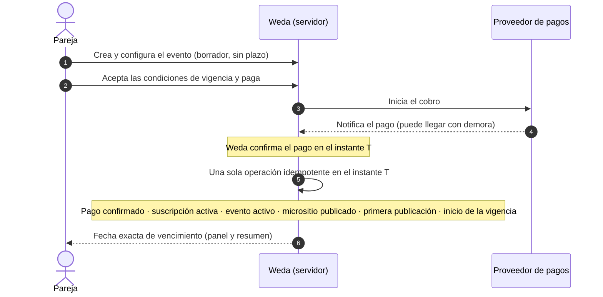
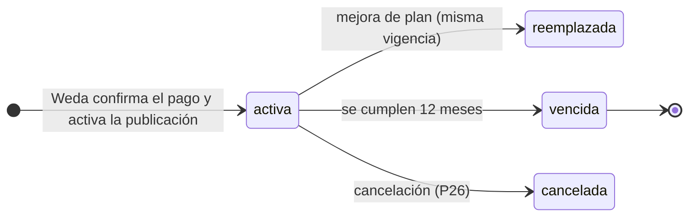
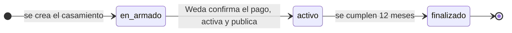
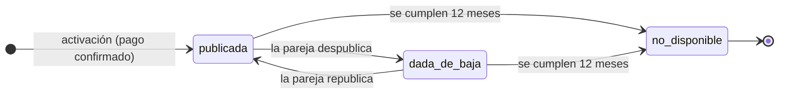
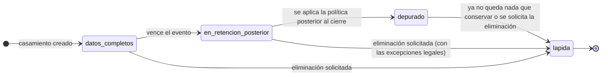

# Weda · Arquitectura de datos · Ciclo de vida del evento: vigencia única de 12 meses

Fecha: 2026-10-30. Estado: **documentación de diseño para revisión. No se implementó nada** (sin código, SQLite, migraciones, APIs ni dependencias; sin commits, push ni deploy).
Esta versión **reemplaza** el modelo anterior de cuatro relojes (plan de 6 meses, permanencia pública de 12 meses con recuerdo estático, 90 días de acceso privado adicional y retención posterior).

> **Advertencia.** Los plazos de tratamiento de datos posteriores al cierre y las clasificaciones contables **no están definidos**: necesitan asesoramiento profesional (§7). Lo marcado «supuesto» o «propuesta» necesita tu definición. Nada de esto es asesoramiento legal.

---

## 0. La decisión definitiva

**Contratar, pagar y publicar son una única acción.** Cuando el pago queda confirmado, el evento se activa y el micrositio se publica automáticamente. **Cada evento tiene una única vigencia de 12 meses que comienza en el momento en que Weda confirma el pago y activa la publicación.** Durante esos 12 meses la pareja usa el producto completo. Al cumplirse, el evento **vence definitivamente y se cierra**: sin renovación, extensión, reactivación ni período adicional de acceso privado. **La fecha de la boda no determina la vigencia.**

**No existe** un plazo posterior para hacer una primera publicación ni una contratación pagada que espere publicarse: ese escenario (antes P18) **desaparece**.

| Antes (reemplazado) | Ahora |
|---|---|
| Plan de **6 meses**; permanencia pública de 12 meses con **recuerdo estático**; **90 días** adicionales de acceso privado | **No existen.** Una sola vigencia de 12 meses, sin bloqueos intermedios ni recuerdo ni acceso posterior |
| Inicio = primera publicación efectiva, con el pago como prerrequisito; el pago y la publicación eran pasos separados | **Pagar = activar + publicar** en una sola operación; el inicio es **el momento en que Weda confirma el pago y activa la publicación** |
| Estado comercial «pendiente de inicio» (pagado, sin publicar) | **No existe**: la suscripción **nace activa** |
| P18: plazo máximo para publicar, avisos y cancelación de la contratación | **Eliminada** |
| Modelo anterior: cinco dimensiones de estado con acceso privado propio | **Cuatro estados guardados**; el acceso privado se deduce del estado operativo |
| Retención a los 90 días del cierre del acceso | **Política posterior al cierre** por clase de dato, **sin plazos fijados** hasta tener asesoramiento |

---

## 1. Un solo reloj y un solo instante

### 1.1 Contratación y activación: una única operación

La pareja puede **crear y configurar el evento antes de pagar**. Cuando el pago queda confirmado, **en la misma operación**:

1. la contratación queda **activa** (`Subscription` nace `activa`);
2. el evento pasa a estado **activo** (`Wedding`);
3. el micrositio se **publica automáticamente** (`Publication` publicada con una primera revisión);
4. se registra la **primera publicación efectiva**;
5. **comienza la vigencia de 12 meses**;
6. se **informa la fecha exacta de vencimiento** (en el panel y en el resumen de contratación).

**Un único instante.** El inicio de la vigencia es el **momento en que Weda confirma el pago y activa la publicación** (`T`). Ese mismo instante es la confirmación del pago, la activación comercial y la primera publicación efectiva: **se toma una sola vez y se guarda de forma consistente y trazable** (§1.2). Si la notificación del proveedor llega demorada, **se usa el momento en que Weda confirma el pago y activa el evento**, no la hora que informó el proveedor (que se guarda aparte).

**Qué inicia el plazo y qué no**

| Hecho | ¿Inicia los 12 meses? |
|---|:-:|
| **Confirmación del pago por Weda y activación de la publicación** | **Sí** |
| Crear un borrador · registrarse · completar el onboarding | No |
| **Iniciar el checkout** · hacer clic en pagar **si el pago todavía no está confirmado** | No |
| Despublicar y republicar | No (no reinicia ni extiende) |
| Mejorar el plan | No |
| Fijar o cambiar la fecha de la boda | No (no modifica el vencimiento) |

- **Vencimiento = inicio + 12 meses calendario exactos.** Si el día no existe en el mes de destino se usa el último día de ese mes (como hoy, `addTerm`). Todo en UTC; se muestra en la zona del casamiento. **El instante de vencimiento es exclusivo**: una escritura solo se acepta si su momento de confirmación es anterior al vencimiento.
- El servidor **compara la fecha con el reloj en cada pedido**; un trabajo programado solo materializa el estado (registra la transición, avisa, emite eventos).

**Publicación sin contenido completo.** El evento **se publica aunque la pareja no haya completado todos sus contenidos o configuraciones**; completarlos después de contratar es **responsabilidad de la pareja**. **No se bloquea la publicación por secciones opcionales incompletas**: las validaciones se limitan a lo **estrictamente necesario para generar una página pública válida y segura**. La lista exacta de esos requisitos mínimos está pendiente (**P35**); principios propuestos: (a) nombres de la pareja, que el onboarding ya pide; (b) una dirección pública válida y disponible; (c) todo el contenido saneado y escapado; (d) imágenes válidas y de tamaño admitido; todo lo demás es opcional y **una sección sin contenido no se muestra**. **Recomendación:** validar esos mínimos y reservar la dirección **antes de iniciar el pago**, para que un pago confirmado nunca encuentre una página imposible de generar.

**Fallas técnicas.** La activación y la publicación forman **una operación atómica e idempotente** (clave: el pago). Si algo falla, **no se confirma la activación** y la operación **se reintenta** hasta completarse; **no existe un estado de producto «pagado y esperando publicación»**: es una falla operativa, con alerta, y el inicio de la vigencia es el instante en que la activación efectivamente se completa. Es un riesgo técnico a resolver en la implementación, no un período del ciclo de vida.

### 1.2 Cómo se vinculan los timestamps (sin duplicar estados)

| Dato | Dónde vive | Observación |
|---|---|---|
| **Momento en que Weda confirma el pago** (= inicio de la vigencia) | `Payment` (hecho del pago) y `Subscription` (inicio de vigencia) | **Mismo valor**, tomado una vez en la misma operación |
| **Primera publicación efectiva** | **Se deduce** de la suscripción que activó la publicación (`Publication` la referencia) | `Publication` **no guarda una fecha propia** de primera publicación, para no duplicar el instante |
| Hora que informó el proveedor | `Payment` (aparte) | Trazabilidad; no se usa como inicio |
| Fecha de vencimiento | `Subscription` | Inicio + 12 meses |
| Estado del evento (activo) | `Wedding` | Derivado de la suscripción activa |

**Invariantes:** el inicio de la suscripción, la confirmación del pago y la primera publicación comparten el mismo instante; una `Subscription` activa siempre tiene una `Publication` creada en esa operación; no existe `Subscription` sin `Payment` confirmado.

### 1.3 Boda posterior al vencimiento (sin límite de anticipación)

**No se limita con cuánta anticipación se puede publicar por primera vez.** Si la boda ocurre **después** de los 12 meses, el evento vence igual en su fecha: no se extiende por la fecha de la boda ni por cambios posteriores de fecha. Esto cierra **P2**.

Consecuencias que el diseño reconoce y **no corrige con extensiones**:
- Una pareja que contrata con mucha anticipación pierde el acceso **antes** de su casamiento (sin RSVP, sin panel, sin descargas).
- Debe quedar **explicado claramente antes de contratar** y recordado durante la vigencia. Texto propuesto (a revisar con asesoramiento): «La vigencia de tu evento es de 12 meses desde que se confirma tu pago y se publica tu página, sin importar la fecha de tu casamiento. Al vencer, el evento se cierra: no se puede editar, publicar, renovar ni descargar información. Descargá tus archivos antes.»
- **La aceptación expresa de esta condición antes de contratar es un requisito** (P33, §1.4).
- **Los avisos previos (30, 7 y 1 día antes), la fecha exacta visible y las descargas** son la mitigación (P23, §1.5).

### 1.4 Aceptación expresa de las condiciones de vigencia (P33) — requisito, no implementado

**Antes de confirmar la contratación**, la pareja debe **aceptar expresamente** las condiciones de vigencia. **Se mantienen las seis cláusulas originales** (sin séptima condición); su redacción se ajusta a la regla «pagar = activar + publicar»:

1. La vigencia es de **12 meses desde que Weda confirma el pago y activa la publicación** (primera publicación efectiva).
2. **Registrarse, crear el borrador, completar el onboarding o iniciar el pago sin que esté confirmado no inician el plazo.**
3. **Despublicar o republicar no reinicia ni extiende** la vigencia.
4. **La fecha de la boda no modifica el vencimiento.**
5. **Al vencer, el evento se cierra** y no hay renovación ni extensión.
6. **Después del vencimiento no hay acceso al panel ni exportaciones.**

> **Nota para tu aprobación.** El texto original de las cláusulas 1 y 2 decía que «el pago no inicia el plazo» y que la vigencia corre «desde la primera publicación efectiva, con el pago confirmado». Con la regla nueva la **confirmación del pago sí inicia el plazo** (porque activa y publica). Se conserva la estructura de seis cláusulas y solo se ajusta el texto de la 1 y la 2; **requiere tu aprobación expresa**.

**Qué se guarda (`TermsAcceptance`), como mínimo**

| Dato | Detalle |
|---|---|
| Usuario que aceptó | Cuenta autenticada con permiso de contratación (`billing.manage`) |
| Evento y contratación relacionados | `Wedding` y `Order` (y, al confirmarse, `Subscription`) |
| Fecha y hora de aceptación | Del servidor, no del dispositivo |
| Versión identificable de los términos | Identificador de versión **y huella (hash) del texto exacto mostrado** |
| Evidencia de aceptación | Acción **expresa y separada** (casilla sin marcar de antemano más confirmación), sesión y dispositivo resumidos; qué cláusulas se mostraron. **Guardar o no la dirección IP queda pendiente de validación legal** |

**Reglas**
- **La contratación no se confirma sin una aceptación válida vinculada a esa orden**; lo verifica el servidor, no la pantalla.
- La aceptación **solo se agrega, no se edita ni se borra**; una versión nueva de los términos **no cambia** lo aceptado en una contratación anterior.
- Aceptar estas condiciones **no es consentir comunicaciones comerciales** (son registros distintos).
- Es evidencia contractual: su conservación sigue la clasificación contractual (P30), no la de los datos del evento.

**Consideraciones legales pendientes de validación** (no se afirma que el diseño cumpla ninguna norma): (a) si la aceptación electrónica descripta es suficiente como evidencia; (b) la información previa que exige la venta a consumidores y cómo se muestra; (c) si cláusulas como «sin renovación», «sin extensión» y «sin exportaciones después del vencimiento» requieren destaque o confirmación adicional; (d) si es proporcionado guardar IP y dispositivo; (e) el plazo de conservación de la constancia; (f) el desistimiento y la cancelación o reembolso de un plan (P26); (g) redacción definitiva de los términos.

### 1.5 Fecha de vencimiento visible y avisos (P23)

**Los avisos informan; nunca modifican ni extienden la vigencia.** Se calculan sobre **esa única fecha de vencimiento**.

| Cuándo / dónde | Qué se muestra o envía | Canal |
|---|---|---|
| **Al confirmarse el pago y activarse el evento** | La **fecha exacta de vencimiento** | Panel (**obligatorio**, junto con la confirmación de la contratación) y correo al propietario (**supuesto**: la decisión no fija el canal) |
| **Siempre** | **Fecha exacta de vencimiento** en el panel y en el resumen de contratación | Panel |
| **30 días antes** | Aviso del vencimiento + **aviso destacado para descargar datos y comprobantes antes de la fecha** | Panel y correo al propietario |
| **7 días antes** | Ídem | Panel y correo |
| **1 día antes** | Ídem | Panel y correo |

**Cómo funciona**
- **Aviso en el panel:** se **calcula en cada carga del panel** a partir de la fecha de vencimiento; no depende de trabajos ni de correos, así que no puede «enviarse dos veces» ni quedar sin enviar. Se muestra mientras falten 30 días o menos; puede minimizarse pero reaparece (propuesta).
- **Correo:** un mensaje saliente (`OutboundMessage`, propósito «aviso de vencimiento») con **clave de idempotencia** determinista por tipo de aviso, por ejemplo `aviso de vencimiento:<suscripción>:<30|7|1>` + canal. La clave es **única**: el trabajo crea primero el registro y solo envía si lo creó; reintentar o reanudar un trabajo **no duplica** el aviso.
- **Destinatario:** el **propietario actual con correo verificado**, al momento del envío (si cambia la propiedad, los avisos siguientes van al nuevo propietario); queda registrado. Los colaboradores no reciben el correo.
- **Registro de envíos y estados:** en cola → **enviado al proveedor** → **entregado** o **rebotado** → (o **fallido**, **omitido**). **«Enviado al proveedor» no es «entregado»**: solo una notificación del proveedor (`MessageDeliveryEvent`) marca la entrega; sin esa confirmación **no se asume que el correo llegó**.
- **Fallos:** se reintenta con espera creciente mientras el evento siga vigente (cantidad y esperas a definir en la implementación); agotados los intentos queda «fallido» y se genera una alerta operativa. **El aviso del panel sigue visible** y ningún fallo de correo bloquea ni cambia nada del evento.
- **Atrasos (propuesta):** un aviso solo se envía mientras el evento no haya vencido; si el sistema estuvo caído y se pasaron varios umbrales, se envía el **más cercano pendiente** y los anteriores quedan «omitido por atraso».
- **Cambios que no mueven nada:** cambiar la fecha de la boda, republicar o mejorar el plan no alteran la fecha de vencimiento ni los avisos programados.
- **No son marketing:** son información contractual; **no se pueden desactivar** como se desactiva una comunicación comercial (propuesta; a validar).
- **Analítica:** `expiry_notice_dispatched` (resultado de la entrega al proveedor) y, con la entrega confirmada, la métrica de cobertura de avisos (`05b` F7).

---

## 2. Estados

El modelo tiene **cuatro estados guardados** con dueños de transición distintos. El **acceso privado** no es un estado propio: es una consecuencia del estado operativo. **No existe ningún estado entre el pago y la publicación.**

| # | Estado | Entidad | Valores | Quién produce la transición |
|---|---|---|---|---|
| 1 | **Comercial** (qué se contrató) | `Subscription` | **activa** · **vencida (terminal)** · reemplazada · cancelada | La confirmación del pago (crea la suscripción ya activa), el cumplimiento de los 12 meses, una mejora, una cancelación (P26) |
| 2 | **Operativo del evento** | `Wedding` | en armado · activo · **finalizado** | Derivado del estado comercial; se guarda para el servidor y las consultas |
| 3 | **Publicación pública** | `Publication` | publicada · dada de baja · **no disponible** | La activación (publica), la pareja (baja y republicación), el cumplimiento de los 12 meses |
| 4 | **Retención** | `Wedding`, `RetentionRun` | datos completos · en retención posterior · depurado · lápida | Vencimiento; política posterior al cierre; eliminación solicitada |
| — | **Acceso privado al panel** | *(derivado)* | abierto (en armado, activo) · **cerrado** (finalizado) | No se guarda: se deduce del estado operativo |

### 2.1 Estado comercial

- **La suscripción nace activa.** No existe «pendiente de inicio».
- **`vencida` es terminal.** Sin renovación, extensión ni reactivación. Pagar de nuevo crea un contrato para **otro casamiento**.
- `reemplazada` solo por una mejora con la vigencia en curso; no cambia ninguna fecha.
- `cancelada` queda sujeta a la política de cancelación y reembolso (P26), que **no está definida**.
- `Order` admite compra y mejora; una compra sobre un casamiento finalizado se rechaza.

### 2.2 Estado operativo del evento

- **En armado:** el casamiento existe y se edita (borrador, onboarding, regalos, invitados). **No se publica de forma manual antes de pagar**: la publicación ocurre al confirmarse el pago.
- **Activo:** vigencia en curso; el evento está completamente operativo.
- **Finalizado:** vencido; **no vuelve a activo** por ningún medio (fecha, publicación, pago, restauración, soporte).

### 2.3 Estado de publicación pública

- Antes de la activación **no hay fila**: el evento no está publicado.
- La primera publicación es **automática**; despublicar y republicar son decisiones de la pareja mientras el evento está activo.
- **`no disponible` es terminal**: la dirección deja de resolver y **no se reutiliza nunca** (cierra P24). Se deshabilitan RSVP y regalos públicos.
- **Decisión P31:** al cumplirse los 12 meses la **URL pública deja de estar disponible**. **No hay vista estática ni recuerdo**, no se mantiene el micrositio, **no se permite RSVP ni regalos** y no se muestra ningún dato de invitados, información financiera ni alias. **El servidor responde como evento no disponible** sin devolver contenido (el código de respuesta se define en la implementación; hoy el servidor usa `410` para páginas vencidas o despublicadas). La URL no se reutiliza.

### 2.4 Estado de retención

- **Datos completos:** en armado y activo.
- **En retención posterior:** el evento está cerrado; la pareja no accede; los datos existen **solo** mientras la política los justifique (§6). **No se asume que se eliminan al vencer.**
- **Depurado:** se eliminaron o anonimizaron los datos personales y operativos que no deben conservarse; quedan los registros financieros y contractuales exigibles, separados y con acceso restringido.
- **Lápida:** identificador, fechas y plan; sin nombres. Es lo que sigue existiendo cuando lo demás se eliminó.
- La eliminación de cuenta (`DeletionRequest`, `02b` §6) es otra máquina que interactúa con esta, y exige resolver primero la propiedad de bodas activas.

### 2.5 Estados y transiciones eliminados

Ya no existen: `recuerdo` (público); `consulta y descarga`, `ventana final de descarga` y `cerrado` como estados de acceso privado; **`pendiente de inicio` (comercial) y cualquier estado o plazo «pagado y sin publicar»**; las transiciones «vence el plan → recuerdo», «termina la permanencia pública → ventana final», «+90 días → cerrado» y «pendiente de inicio → activa por primera publicación»; **los avisos, la fecha límite y la cancelación asociados a un plazo para publicar**.

### 2.6 Fases válidas

| Fase | Cuándo | 1 Comercial | 2 Operativo | 3 Público | Acceso privado | 4 Retención |
|---|---|---|---|---|---|---|
| **F0** En armado, sin contratación | Hasta que el pago queda confirmado | — | en armado | sin publicar | abierto | datos completos |
| **F1** Vigente | Desde la confirmación del pago, 12 meses | activa | **activo** | publicada o dada de baja | abierto | datos completos |
| **F2** Finalizado | Desde el vencimiento | vencida | **finalizado** | no disponible | **cerrado** | en retención posterior |
| **F3** Depurado | Según la política | vencida | finalizado | no disponible | cerrado | depurado |
| **F4** Lápida | Eliminación o fin de la política | — | — | no disponible | cerrado | lápida |

**Combinaciones prohibidas (invariantes):** operativo *activo* sin plan *activa*; operativo *en armado* con plan *activa*; operativo *finalizado* con plan *activa*; público *publicada* o *dada de baja* con evento *en armado* o *finalizado*; acceso *abierto* con evento *finalizado*; retención distinta de *datos completos* con evento *activo*; **cualquier transición hacia atrás** en los cuatro estados.

### 2.7 Transiciones

| # | Transición | Disparador | Precondición | Efectos |
|---|---|---|---|---|
| T1 | en armado → **activo**; — → **activa**; — → **publicada** | **Weda confirma el pago** (una sola operación atómica e idempotente) | Aceptación de las condiciones de vigencia (P33); requisitos mínimos de publicación (P35) | Crea la suscripción activa, publica el micrositio, registra la primera publicación efectiva, fija inicio (`T`) y vencimiento (`T` + 12 meses) y muestra la fecha |
| T2 | publicada ⇄ dada de baja | La pareja | Evento activo | No mueve ningún reloj |
| T3 | activa → **vencida**; activo → **finalizado**; publicada o dada de baja → **no disponible**; datos completos → **en retención posterior** | Se cumplen los 12 meses | Reloj del servidor | **Una sola transacción lógica**: cierra el acceso de gestión, bloquea escrituras y exportaciones, retira la página, deshabilita lo público interactivo, calcula la fotografía final de la analítica, **congela la ficha comercial del evento** (P34), emite eventos |
| T4 | en retención posterior → depurado | Política posterior al cierre | Métricas del evento calculadas; plazos validados | Elimina o anonimiza personales y operativos; conserva lo financiero y contractual separado |
| T5 | cualquiera → lápida | Eliminación solicitada o fin de la política | Propiedad resuelta; excepciones legales | Lápida; borrado de personales |

### 2.8 Eventos nunca contratados: borradores abandonados (P19) — **adoptada**

> **Estado:** **decisión adoptada** en cuanto a los casos, los plazos de inactividad y la definición de actividad (los plazos son valores de **producto**; el **fundamento legal** de eliminar por inactividad sigue pendiente de validación). Los avisos y el detalle de qué se elimina son **recomendaciones asociadas**, todavía por confirmar.

**P19 se aplica únicamente a lo que nunca fue contratado.** La contratación (pago confirmado) **activa y publica** el evento y lo saca del régimen de borradores para pasarlo al ciclo de 12 meses. Como ya no existe «pagado y sin publicar», **ningún evento con contratación puede quedar como borrador**.

**Decisión adoptada**

| Caso | Plazo de inactividad |
|---|---|
| **1. Cuenta registrada sin evento** | **12 meses** |
| **2. Evento creado sin contratación** | **6 meses** |
| **3. Evento con onboarding incompleto** | **6 meses** |
| **4. Borrador avanzado nunca contratado** | **12 meses** |

**Actividad** = **inicio de sesión o escritura efectiva** (abrir un correo no cuenta). Cualquier actividad reinicia el conteo. *Criterio propuesto para distinguir el caso 4 (a confirmar):* onboarding completo y al menos un contenido sustancial cargado (bloques editados, regalos o invitados).

**Principios**
1. **Eliminar un borrador no es eliminar la cuenta ni ejercer un derecho legal.** El borrador es el evento en armado y su contenido; la cuenta sigue (salvo el caso 1). Los derechos de acceso y supresión se atienden por su procedimiento (§6.3) y **no los reemplaza ni los demora** la limpieza automática.
2. **Si hay una solicitud de derechos pendiente** sobre esos datos, **se suspende la eliminación automática** hasta atenderla, para no destruir lo que se pidió conocer (recomendación).
3. **El aviso previo es condición** para eliminar (recomendación).

**Recomendaciones asociadas (por confirmar)**

| Caso | Avisos | Se elimina | Se conserva |
|---|---|---|---|
| 1. Cuenta sin evento | **30, 7 y 1 día antes** (correo; también al iniciar sesión) | La **cuenta** (eliminación por política, **distinta del borrador**; validar) | Auditoría mínima sin contenido; los consentimientos comerciales siguen su propia regla (clase D) |
| 2. Evento sin contratación | Ídem | El **evento en armado** y todo su contenido | Auditoría mínima; la cuenta sigue |
| 3. Onboarding incompleto | Ídem, con invitación a completar | El evento en armado | Ídem |
| 4. Borrador avanzado | Ídem, con recordatorio de que puede **descargar una copia** (la exportación está disponible en armado) y de contratar | Todo el borrador: contenido, fotos, invitados, regalos y datos de cobro cargados | Auditoría mínima; la cuenta sigue |

- **Avisos:** `OutboundMessage` con clave de idempotencia por caso, entidad y umbral (por ejemplo, `inactividad:<caso>:<entidad>:<30|7|1>`), registro de estados y «enviado no es entregado», como en §1.5. Son información de servicio, no marketing.
- **Lo que se elimina de verdad:** la fila del casamiento en armado **sin dejar lápida**: como nunca hubo contratación, no hay registros financieros que lo referencien. Las métricas del borrador se calculan antes; la analítica seudónima sigue su plazo.
- Las cifras de abandono de la analítica (`05b` B3) **no cambian**: miden el comportamiento, no la eliminación.

**Cuestiones que requieren validación legal (no resueltas aquí):** fundamento y proporcionalidad de eliminar cuentas y borradores por inactividad; suficiencia del aviso; si conviene conservar una ficha mínima para prevenir abusos; tratamiento de los consentimientos comerciales de una cuenta eliminada.

**Qué no debe implementarse hasta validar:** ningún trabajo de eliminación por inactividad, ningún aviso de inactividad y ninguna constante de plazo en el código.

**Cambios al modelo:** sin entidades nuevas; los casos de abandono viven en la política versionada de `RetentionRun`; avisos en `OutboundMessage`; eventos `draft_inactivity_notice_dispatched` y `draft_deleted_by_inactivity`; métrica de borradores eliminados por inactividad (`05b` F9).

---

## 3. Permisos

Se aplican a **todos los roles, incluido el propietario**, **en el servidor**, en cada operación, con una única política central («guardia de estado»). El propietario **no tiene excepciones** al vencimiento. La matriz de roles de `02-domain-model.md` §5.3 sigue vigente como **primer filtro**; este es el segundo. Si una operación no está permitida, responde un error de estado claro y registra el intento.

✓ permitido · — bloqueado.

### 3.1 Evento

| Acción | F0 En armado | F1 Activo | F2+ Finalizado |
|---|:-:|:-:|:-:|
| Editar cualquier bloque, texto, imagen, fecha o configuración | ✓ | ✓ | **—** |
| Publicar, despublicar y republicar; restaurar una versión | — (la primera publicación es **automática** al confirmarse el pago) | ✓ | **—** |
| Crear, editar y administrar regalos; cambiar la moneda de recepción | ✓ | ✓ | **—** |
| Modificar alias y datos bancarios (propietario, con los controles de Q4) | ✓ | ✓ | **—** |
| Gestionar invitados, acompañantes, cupos, mesas e invitaciones | ✓ (enviar invitaciones: desde la activación) | ✓ | **—** |
| Consultar y administrar RSVP | ✓ | ✓ | **—** |
| Consultar aportes y comprobantes; revisar y actualizar estados manualmente | — | ✓ | **—** |
| Consultar información financiera y movimientos | ✓ | ✓ | **—** |
| **Descargar** los cuatro entregables (§5) | ✓ | ✓ | **—** |
| Invitar o cambiar roles de miembros; transferir la propiedad | ✓ | ✓ | **—** |
| Usar las funcionalidades incluidas en el plan | ✓ | ✓ | **—** |
| Acceder al panel del evento | ✓ | ✓ | **—** (acceso cerrado para todos los roles) |

### 3.2 Público

| Qué hace la persona | Publicada | Dada de baja | No disponible |
|---|:-:|:-:|:-:|
| Ver el sitio | ✓ | — | — (el servidor responde «evento no disponible») |
| Confirmar asistencia o modificar su respuesta | ✓ | — | **—** |
| Ver la lista de regalos, aportar, adjuntar comprobante, ver el alias | ✓ | — | **—** |
| Usar su enlace personal de invitación | ✓ | — | **—** |

### 3.3 Cuenta y soporte (P32)

- **La cuenta de usuario puede seguir existiendo.** **El evento vencido permanece cerrado definitivamente**: no se puede reactivar, editar, duplicar ni recuperar como evento operativo. **La existencia de una cuenta activa no modifica el estado del evento vencido.**
- Con la cuenta, la pareja puede **crear y contratar un evento nuevo e independiente** (§4), gestionar su cuenta y solicitar la eliminación de sus datos.
- **La retención y eliminación de los datos del evento anterior siguen su propia política** (§6), independiente de que la cuenta siga activa.
- **Soporte de Weda no puede reactivar, renovar ni extender un evento**, ni por acciones administrativas ordinarias; no existen herramientas para deshacer estados terminales. Los accesos a datos financieros conservados quedan restringidos y auditados.
- **Los derechos legales de acceso, rectificación y supresión se atienden por un procedimiento separado** (§6.3), sin reactivar el evento ni habilitar de nuevo el panel. **No se confunde el derecho legal de acceso a datos personales con el acceso comercial al producto.**
- Qué se muestra de un evento cerrado dentro de la cuenta es la **propuesta adoptada P34** (§3.4).

### 3.4 El evento finalizado dentro de la cuenta (P34) — **propuesta adoptada**

> **Estado:** propuesta de decisión adoptada. La conservación de cada tipo de documento **no se asume igual** y su plazo requiere validación contable y legal.

**Qué aparece.** El evento vencido aparece en la cuenta **del propietario** con el estado **«Finalizado»**, y la cuenta muestra **únicamente información comercial y contractual**:

- nombres de la pareja,
- fecha de la boda,
- plan contratado,
- fecha de primera publicación,
- fecha de vencimiento,
- historial de **órdenes y pagos realizados a Weda**,
- **comprobantes de compra de Weda**, cuando corresponda.

**Qué no se muestra ni se puede abrir:** micrositio, invitados, RSVP, regalos y aportes, alias y datos bancarios, comprobantes cargados por invitados, ni información operativa o financiera del evento. **No se puede editar, duplicar, recuperar, exportar ni reactivar el evento.** Los colaboradores y administradores no ven nada del evento cerrado.

**Cuatro categorías que no se mezclan**

| # | Categoría | Qué es | Entidades | Clase de retención | ¿Se muestra en la cuenta? |
|---|---|---|---|---|---|
| 1 | **Historial comercial y contractual de Weda** | Órdenes, pagos, plan y vigencia contratados, aceptación de condiciones | `Order`, `Payment`, `Subscription`, `TermsAcceptance` | `B1` (incluye lo contractual) | **Sí** (resumen) |
| 2 | **Datos operativos del casamiento** | Micrositio, invitados, RSVP, regalos y aportes, mesas, mensajes, configuración, alias | `Microsite*`, `Guest`, `Invitation*`, `Rsvp*`, `Gift*`, `Contribution*`, `PayoutMethod` | `W`, `A`, `B2` | **No** |
| 3 | **Comprobantes de compra de Weda** | Factura o comprobante que Weda emite por el plan, cuando corresponda | `Invoice` (documentada, aún no modelada) y los datos de `Order` y `Payment` | `B1` | **Sí**, cuando corresponda |
| 4 | **Comprobantes cargados por invitados** | Archivos que adjuntan quienes aportaron | `PaymentProof` | `B3` | **No** |

**No se asume que las cuatro tengan el mismo plazo de conservación.** Cada una se clasifica y se valida por separado (P6, P30). Descargar un comprobante de compra de Weda **no es exportar el evento**.

**Ficha comercial.** Para poder mostrar nombres y fecha aunque los datos del casamiento se hayan depurado, al vencer se **congela una ficha comercial** en la contratación (`Subscription`): nombres de la pareja y fecha de la boda como figuraban, plan, primera publicación y vencimiento. Es historial contractual, **no** datos operativos, y se conserva según la clasificación contractual (P30). **Cuestión legal pendiente:** el fundamento y el plazo para seguir mostrando los nombres de la pareja una vez depurado el casamiento.

**Cuestiones contables pendientes:** si Weda emite factura u otro comprobante fiscal por el plan y cuál es su formato; plazo de conservación del historial de órdenes y pagos y de los comprobantes de compra.

---

## 4. Evento nuevo: sin copia

Un evento nuevo es un **`Wedding` nuevo**, con su propio plan y su propia vigencia de 12 meses, creado desde el onboarding. No existe «duplicar», «usar como base» ni «importar de un evento anterior» en pantalla, API ni soporte.

| Qué | ¿Se comparte entre eventos del mismo usuario? |
|---|---|
| Identidad: usuario, clave, sesiones, segundo factor | **Sí** (es la cuenta) |
| Preferencias de notificación y consentimientos de comunicación | **Sí** |
| Historial de compras de esa cuenta | **Sí** |
| Bloques, textos y fotos; lista de regalos, moneda y destino de cobro; invitados, invitaciones, respuestas, mesas; colaboradores; configuración de RSVP y de publicación | **No** |
| Dirección pública | **No**: la de un evento finalizado queda retirada de forma permanente |

`Wedding` no tiene campo «basado en» ni relación de copia. Una persona puede ser propietaria de varios casamientos (hoy `owner_id UNIQUE` lo impide).

---

## 5. Descargas durante la vigencia

Las exportaciones existen **solo mientras el evento está activo** (y en armado, sobre lo que haya). **Al vencer se bloquean para todos los roles**; no hay ventana adicional.

### 5.1 Reglas

- Permiso `data.export` (propietario y administrador); el colaborador no exporta.
- Cada exportación es un trabajo (`DataExportJob`) y deja en `AuditLog` (categoría privacidad) **quién, cuándo y qué alcance**, **sin guardar el contenido**.
- **Privacidad de los archivos:** contienen datos personales de terceros; almacenamiento privado; enlace de descarga con vencimiento; archivo **eliminado a los pocos días** (propuesta 7, P25) y regenerable mientras haya vigencia; cada archivo indica la **fecha y hora de corte**. Se descarga con sesión y permiso: no hay enlaces públicos.
- **Minimización:** solo lo que la pareja ya conoce; sin tokens, hashes, IP, huellas de dispositivo, alias o CBU completos, datos de tarjeta ni auditoría interna.
- **Avisos:** como no se puede descargar después del vencimiento, hay **avisos a los 30, 7 y 1 día antes** (panel y correo al propietario) con un recordatorio destacado de descargar datos y comprobantes (§1.5).

### 5.2 Los cuatro entregables

| # | Entregable | Formato | Contenido | Fuente (solo lectura) |
|---|---|---|---|---|
| 1 | **Invitados, acompañantes y respuestas RSVP** | Excel (varias hojas) | **Invitaciones:** etiqueta, tipo, cupo autorizado, personas nombradas, estado de envío, si respondió, fecha, personas que asistirán. **Personas:** nombre, invitación, invitado o acompañante, asistencia, restricción alimentaria (solo si se preguntó), mesa. Historial de respuestas (opcional). | `Invitation`, `Guest`, `RsvpResponse`, `RsvpResponseEvent`, `SeatingTable` |
| 2 | **Lista de regalos y aportes** | Excel o CSV | **Regalos:** nombre, categoría, importe sugerido y moneda, cantidad de aportes por estado. **Aportes:** identificador, fecha, quién aportó, mensaje, modalidad, moneda e importe **declarados**, estado, si tiene comprobante, quién lo revisó y cuándo, decisión y fecha, método de confirmación, correcciones o reembolsos. | `Gift`, `Contribution`, `ContributionItem`, `ContributionEvent`, `GiftTransaction`, `PaymentProof` |
| 3 | **Comprobantes cargados** | ZIP | Los archivos **tal como los subieron los invitados**, más un índice (CSV) con aporte, fecha de carga y estado de revisión; incluye los de aportes rechazados, marcados. | `PaymentProof` + archivos privados |
| 4 | **Resumen financiero** | Excel o CSV (y vista en pantalla) | **Por moneda, sin sumar ni convertir:** aportes registrados, con comprobante cargado, pendientes, revisados, confirmados manualmente, rechazados y con reembolso o corrección; total confirmado neto por la pareja; moneda de recepción y cambios de destino (**enmascarado**); aclaración de alcance. | `GiftTransaction`, `Contribution`, `GiftSettings`, `PayoutMethodChange` |

### 5.3 Qué sabe Weda y cómo se dice

Weda **no arbitra ni verifica transferencias bancarias**. Los informes distinguen:

| Término | Qué significa | Quién lo establece | Entidad |
|---|---|---|---|
| **Aporte registrado** | El invitado declaró un aporte con importe y moneda | Invitado | `Contribution` |
| **Comprobante cargado** | El invitado adjuntó un archivo; **Weda no verifica su contenido** | Invitado | `PaymentProof` |
| **Aporte revisado** | La pareja revisó el aporte o su comprobante; no implica decisión (P22 cerrada: se revisa durante la vigencia) | Pareja | `ContributionEvent` («revisado») |
| **Confirmado manualmente** | La pareja marcó el aporte como confirmado: **declaración de la pareja**, no verificación de Weda | Miembro con permiso | `GiftTransaction` (confirmación, método «manual») |
| **Rechazado** | La pareja decidió no considerarlo | Miembro con permiso | `Contribution` + `ContributionEvent` |
| **Reembolso o corrección registrada** | Movimiento nuevo relacionado; el original no se modifica | Miembro con permiso | `GiftTransaction` |

**Reglas de redacción:** no usar «recibido», «acreditado», «depositado», «fondos» ni «dinero recibido» para importes; siempre fecha de corte y moneda; nunca un total entre monedas; sin comprobante se dice «sin comprobante cargado», no «impago»; no inferir estados por ausencia.

**Aclaración que acompaña al resumen (a revisar con asesoramiento):** «Este resumen refleja la información registrada en Weda: lo que declararon los invitados y lo que la pareja confirmó manualmente. Weda no verifica transferencias bancarias ni interviene en los pagos entre invitados y la pareja; los importes no son fondos acreditados por Weda.»

### 5.4 Dependencias y límites (P25)

El formato Excel requiere generar `.xlsx`; hoy no existe esa capacidad y **no se agrega ninguna dependencia**. Se evaluará en la implementación (o se ofrecerá CSV). Quedan por definir el tope de tamaño del ZIP, la generación asíncrona y el aviso por correo.

---

## 6. Tratamiento de los datos después del vencimiento

Al vencer: **se cierra el acceso**, **se bloquean escrituras y exportaciones**, **se calcula la fotografía final para la analítica** y el evento pasa a «en retención posterior». **No se asume que todo se elimina de inmediato**, ni que todo se conserva: cada clase tiene su tratamiento, y **los plazos no están definidos** hasta contar con asesoramiento contable y legal (**P30**). Hasta entonces, el diseño **no fija plazos en el código**: la política es una **configuración versionada** (`RetentionRun` registra la versión aplicada).

### 6.1 Cinco clases de datos

| Clase | Qué incluye | Entidades | Tratamiento posterior al vencimiento | Plazo | Acceso |
|---|---|---|---|---|---|
| **Datos personales** | Nombres, contactos, restricciones alimentarias y mensajes de invitados; datos de quienes aportan | `Guest`, datos personales de `Contribution`, `RsvpResponse` | Se eliminan o se **anonimizan de forma efectiva** cuando termine la finalidad que justifica conservarlos; no se conservan indefinidamente por conveniencia técnica | **A validar (P30)** | Sin acceso de la pareja; acceso mínimo y auditado de personal autorizado, solo para la finalidad documentada |
| **Datos operativos** | Invitaciones, enlaces, mesas, configuración, mensajes enviados, sesiones, contenido de la pareja | `Invitation`, `InvitationAccess`, `SeatingTable`, `OutboundMessage`, bloques y revisiones, fotos | Se eliminan según la política; el contenido de la pareja sigue P7 | **A validar (P30, P7)** | Ídem |
| **Datos financieros sujetos a conservación legal** | Libro de confirmaciones y correcciones, destinos de cobro versionados, órdenes, pagos y precios contratados | `GiftTransaction`, `PayoutMethod`, `Order`, `Payment`, `Subscription`, `PlanPrice` | **Se conservan** separados de los datos personales, sin borrado en cascada, con referencias a la lápida | **Validar con asesoramiento (P6; art. 328 CCyC: 10 años para ciertos registros)** | **Restringido**: la pareja no accede; ningún acceso reactiva el evento |
| **Evidencia de pagos** | Comprobantes de invitados | `PaymentProof` y su archivo | No se asume que sea respaldo contable; se decide al clasificar | **A validar (P6, P30)** | Ídem personales |
| **Datos analíticos** | Eventos con seudónimos, fotografía mensual, agregados | `ProductEvent`, `WeddingMonthlySnapshot`, `AggregateMetric` | Siguen sus plazos propios (§8); no se borran por vencer el evento; los agregados solo tras la evaluación de riesgo | 13 y 25 meses; agregados según evaluación | Personal autorizado |
| **Datos comerciales y contractuales** | Consentimientos, aceptación de términos, historial de contratación | `CommunicationConsent`, `TermsAcceptance`, `Order`, `Subscription` | Consentimientos: mientras estén vigentes, independientes del evento; términos y contratos: según obligación legal | **A validar** | Restringido |

### 6.2 Reglas

1. **El vencimiento no habilita ninguna reactivación**: ni el acceso a datos conservados ni su lectura reabren el evento.
2. **Lo financiero no se elimina por cascada**; vive separado de los datos personales y las referencias apuntan a la lápida.
3. **Anonimizar de forma efectiva:** se eliminan **todos** los campos identificables (nombre, correo, teléfono, mensaje, etiquetas como «Familia Pérez», notas libres) y se evalúa la reidentificación por combinación de lo que queda; si no se puede garantizar, se elimina. Reemplazar un nombre por un identificador es **seudonimizar**, no anonimizar.
4. **Antes de depurar**, las métricas del evento deben estar calculadas (`RetentionRun` lo verifica; si falla, alerta y reintenta con un plazo máximo).
5. **Toda clase conservada tiene finalidad, base y plazo documentados**; si no los tiene, se elimina.
6. **La eliminación de la cuenta o del casamiento pedida por la persona** sigue su procedimiento (`02b` §6), con las excepciones por obligación legal.
7. **Los datos de invitados durante la vigencia** (hasta 12 meses desde la activación) son necesarios para operar el evento. La proporcionalidad de conservarlos **hasta el vencimiento aunque la boda sea antes**, y la posibilidad de eliminarlos antes por pedido de la pareja, se evalúan en **P30**.

### 6.3 Derechos de las personas sobre un evento cerrado (P32)

**El derecho legal de acceso (y los de rectificación y supresión) y el acceso comercial al producto son cosas distintas.** Las exportaciones del panel se bloquean al vencer; **eso no anula los derechos de las personas**, que se atienden por un procedimiento separado.

| | Acceso comercial al producto | Derechos de acceso, rectificación y supresión |
|---|---|---|
| Para qué | Operar el evento y descargar los archivos del evento | Que una persona conozca, corrija o pida eliminar **sus** datos personales |
| Quién | La pareja con permisos | Cualquier titular: la pareja, un invitado, una persona que aportó |
| Por dónde | El panel y sus exportaciones (solo con el evento vigente) | Una solicitud (`DeletionRequest`) atendida por personal autorizado de Weda |
| Qué entrega | Los cuatro entregables | Un **informe puntual** sobre los datos de esa persona, con entrega segura y vencimiento |
| ¿Reabre el evento o el panel? | — | **Nunca** |

**Procedimiento (diseño)**
1. **Solicitud:** se registra con su tipo, quién pide y sobre qué.
2. **Verificación de identidad:** con la cuenta autenticada o, para quien no tiene cuenta, otra verificación suficiente; no se entregan datos sin verificar.
3. **Localización:** los datos se buscan en lo que todavía exista (en retención posterior). Lo ya depurado no se reconstruye.
4. **Resolución:** acceso → informe; rectificación → se corrige el dato en el registro conservado, con constancia, **sin edición del evento**; supresión → se aplica salvo las excepciones por obligación de conservar (lo financiero y contractual), que se informan.
5. **Registro y auditoría:** quién resolvió, cuándo y qué se entregó, **sin guardar el contenido del informe**.
6. **No hay herramienta de reapertura:** este procedimiento no usa `DataExportJob` del panel ni habilita sesiones sobre el evento cerrado.

**Plazos de respuesta, alcance exacto y rol de Weda** (responsable o encargado respecto de los datos de invitados cargados por la pareja) **no se definen**: requieren asesoramiento legal (P30, P32).

---

## 7. Analítica coherente con el nuevo ciclo

| Capa | Plazo | Coherencia con la vigencia de 12 meses |
|---|---|---|
| `ProductEvent` | 13 meses | Cubre la vigencia completa y un mes más; los eventos más viejos de un evento cerrado vencen poco después del cierre |
| `WeddingMonthlySnapshot` | 25 meses | Cubre los 12 meses de vigencia y 13 posteriores: permite cohortes y recontratación |
| `AggregateMetric` | Sin vencimiento automático, **solo tras evaluación de riesgo** | Las cifras del evento se calculan al vencer, antes de depurar |

**Eventos** (servidor, lista cerrada de propiedades, clave de idempotencia derivada del hecho, sin datos personales): `event_finalized` (`plan_id`, `finalized_before_wedding`, `days_to_wedding_band`), `terms_accepted` (`terms_kind`: vigencia o general; sin texto ni datos personales), `expiry_notice_dispatched` (`days_before_band`, `result`), `data_export_requested` / `data_export_completed` (`scope`, `result`), `finalized_action_blocked` (`action_category`), `retention_executed` (`result`), `new_event_started_after_finalization`. **Desaparecen** los del modelo anterior (`memorial_started`, `public_permanence_ended`, `private_access_window_started`, `private_access_closed`, `plan_expired` separado).

**Reglas:** el vencimiento **nunca** elimina métricas históricas válidas; la analítica **lee** el estado y no lo decide; la fotografía final se toma al vencer; la métrica clave nueva es «**vencimientos con la boda posterior**» (`05b` F2b), insumo directo de la comunicación previa a la compra. Las métricas dejan de hablar de «renovación» y hablan de **recontratación** (evento nuevo de la misma cuenta).

---

## 8. Impacto sobre las entidades

| Entidad | Impacto |
|---|---|
| `Subscription` | **Nace activa** al confirmarse el pago; inicio de vigencia = momento en que Weda confirma el pago y activa la publicación; vencimiento +12 meses; sin estado «pendiente de inicio»; `vencida` terminal; sin renovación ni extensión; **ficha comercial congelada al vencer** (P34) |
| `Order` | Solo compra y mejora; se rechaza una compra sobre un casamiento finalizado; su historial se muestra en la cuenta aun con el evento cerrado (P34) |
| `Wedding` | Estado operativo (en armado, activo, finalizado) y estado de retención con fechas; sin estado de acceso privado propio; varios casamientos por propietario; sin relación de copia |
| `Publication` | Estado público (publicada, dada de baja, no disponible); **no guarda fecha propia de primera publicación** (la deduce de la suscripción que la activó); se crea publicada en la activación; sin «visible hasta» ni recuerdo |
| `Payment` | Guarda el momento en que Weda confirma el pago (inicio de la vigencia) y, aparte, la hora que informó el proveedor |
| `Wedding` | «Activo» lo produce la confirmación del pago; finalizado a los 12 meses; sin estado de acceso privado propio; varios casamientos por propietario |
| `PublicAddress` | Una dirección de un evento finalizado no se reutiliza nunca |
| Contenido (`Microsite*`, `Gift*`, `Invitation*`, `Guest`, `Rsvp*`, `Seating*`) | Editables solo con el evento activo (y en armado); bloqueados al vencer; tratamiento posterior según §6 |
| `Contribution`, `ContributionEvent`, `PaymentProof`, `GiftTransaction` | Revisión y confirmación solo durante la vigencia; vocabulario de lo que Weda sabe; sin «recibido» ni «acreditado» |
| `DataExportJob` | Cuatro alcances; solo con el evento vigente; hora de corte; archivo temporal |
| `RetentionRun` | Aplica la política posterior al cierre (versionada); exige métricas calculadas |
| `ProductEvent`, `WeddingMonthlySnapshot`, `AggregateMetric` | Eventos del ciclo nuevos; plazos coherentes; evaluación de riesgo |
| `TermsAcceptance` | Aceptación expresa de las condiciones de vigencia, vinculada a la orden y al casamiento, con versión, hash del texto y evidencia; la contratación no se confirma sin ella (P33) |
| `OutboundMessage`, `MessageDeliveryEvent` | Avisos de vencimiento con clave de idempotencia; «enviado» distinto de «entregado» (P23) |
| `DeletionRequest` | Procedimiento de derechos separado del acceso comercial; no reabre el evento (P32) |
| `AuditLog`, `OutboundMessage` | Exportaciones, bloqueos, transiciones y avisos |

---

## 9. Contradicciones e inconsistencias

### 9.1 Decisiones anteriores reemplazadas
**Quedan reemplazados:** plan de 6 meses y su bloqueo; inicio como `máx(pago, primera publicación)` y pago y publicación como pasos separados; permanencia pública de 12 meses con recuerdo; ventana final de 90 días; retención a los 90 días del cierre del acceso; cinco dimensiones con acceso privado propio; **P18 (contratación pagada sin publicar) y su plazo, avisos y cancelación; el estado «pendiente de inicio»; la séptima condición propuesta para P33**; salvaguarda de no depurar un evento con boda posterior; límite de anticipación (P2); P1, P20, P21, P22, P24, P27, P28, P29 en su forma anterior.

### 9.2 Contradicciones con el código y los textos actuales (a resolver en la implementación)
| # | Hoy | Nuevo |
|---|---|---|
| 1 | Hoy: `PUBLICATION_MONTHS = 6` y `PUBLICATION_TERM = '6 meses'` en `plans.ts`; texto en landing, diálogo de publicar y Ayuda: «6 meses» | **12 meses**, con evento completamente operativo todo el período |
| 2 | La página pública, el RSVP y los regalos devuelven `410` a los 6 meses | A los **12 meses**, no antes |
| 3 | Se bloquea **publicar** al vencer, no **editar**; no existe «finalizado» | Se bloquea toda escritura y el acceso al panel para todos los roles |
| 4 | Hoy el inicio cuenta desde la **primera publicación** y la publicación es una acción manual separada del pago | **Pagar = activar + publicar** en una sola operación; el inicio es el momento en que Weda confirma el pago |
| 5 | Un casamiento por cuenta (`owner_id UNIQUE`) | Una persona con varios casamientos (evento nuevo tras el cierre) |
| 6 | No hay exportaciones, retención ni eliminación | Exportaciones durante la vigencia; política posterior al cierre |
| 7 | `docs/ux-flows.md` documenta «6 meses» como comportamiento actual | Se mantiene como estado actual y se agrega la decisión nueva |

### 9.3 Riesgos y tensiones reconocidos
- **Pérdida de acceso antes de la boda** cuando se publica con mucha anticipación: aceptada; solo se mitiga con explicación previa, avisos y descargas.
- **Sin descargas después del vencimiento:** quien no descargó pierde el acceso; se mitiga con avisos (P23).
- **Derecho de acceso** de las personas frente a exportaciones bloqueadas: se atiende por su canal propio; requiere validación legal.
- **Falla técnica entre la confirmación del pago y la publicación:** no existe como estado de producto; se resuelve con una operación atómica e idempotente con reintentos y alerta (§1.1). Es un riesgo de implementación (junto con R11, pagos reales sin verificador).

---

## 10. Decisiones: adoptadas, recomendaciones y validaciones pendientes

### 10.1 Decisiones adoptadas
**P2** (vigencia única de 12 meses, sin límite de anticipación), **P11** (el micrositio se publica automáticamente al confirmarse el pago; no hay publicación previa al pago), **P13**, **P15**, **P17**, **P19** (casos y plazos de inactividad de lo nunca contratado; el fundamento legal sigue pendiente; §2.8), **P20** (no se reactiva, ni por soporte), **P22** (la revisión de aportes es durante la vigencia), **P23** (avisos a 30, 7 y 1 día; §1.5), **P24** (la dirección no se reutiliza), **P29** (sin acceso privado adicional), **P31** (URL no disponible), **P32** (cuenta y derechos por procedimiento separado), **P33** (aceptación expresa de las seis condiciones de vigencia; §1.4). **Retiradas por obsoletas:** P1, P21, P27, P28. **Eliminada:** **P18**, porque ya no existe una contratación pagada que espere publicación.

**Propuesta adoptada:** **P34** — el evento vencido aparece en la cuenta del propietario como «Finalizado» solo con información comercial y contractual (§3.4); se confirma cuando se valide la conservación de cada categoría (P6, P30).

### 10.2 Recomendaciones asociadas (por confirmar)
Los avisos 30, 7 y 1 día previos a la eliminación de borradores, qué se elimina y qué se conserva en cada caso de P19, y la suspensión ante solicitudes de derechos pendientes (§2.8).

### 10.3 Requieren validación legal, contable o de seguridad (siguen abiertas)
Detalle de cada una (qué falta, por qué importa, qué bloquea, quién valida y qué no implementar) en `06-consolidation-report.md` §2.

| # | Qué requiere | Quién |
|---|---|---|
| **P30** | Tratamiento posterior al cierre por clase de dato; fundamento y plazos; proporcionalidad; **plazo de la ficha comercial y del historial de la cuenta (P34)**; **fundamento de eliminar por inactividad (P19)** | Asesor legal y contador; decide la dueña |
| **P6** | Clasificación contable de las cuatro categorías de documentos (§3.4); plazos de B1, B2 y B3; **comprobantes de compra de Weda** | Contador, con abogado |
| **P5** | Seguridad adicional del cambio de alias | La dueña con asesoramiento de seguridad |
| **P26** | Política de cancelación y reembolso de planes (por ejemplo, un pago hecho por error); **no se inventa** | Abogado y contador; decide la dueña |

### 10.4 Otras abiertas
- **P35 (nueva):** lista exacta de los **requisitos mínimos** para generar una página pública válida y segura, qué se muestra cuando una sección opcional está vacía (recomendación: no se muestra) y si se valida y reserva la dirección antes de iniciar el pago (recomendación: sí). Responsable: la dueña, con revisión de seguridad. **No implementar** la publicación automática hasta definirla.
- P3, P4, P7, P8, P9, P10, P12, P14, P16, P25: sin cambios de fondo (`02-domain-model.md` §8).

---

## 11. Qué NO se hizo

Sin código, esquema, migraciones, APIs ni dependencias; sin commits, push ni deploy. Nada de lo descripto está implementado.
