# Weda · Arquitectura de datos · Fase 2 — Mapa de dominios y relaciones

Fecha: 2026-10-30. Generado a partir del mismo catálogo que `04-data-dictionary.md`; no editar a mano (la fuente es el catálogo, ver `02-domain-model.md`). El archivo `03-entity-relationship.mmd` contiene exactamente este diagrama.

Cada recuadro es un **dominio** (una frontera del monolito modular). Línea continua: relación dentro del dominio. Línea punteada: relación entre dominios, que se resuelve por identificador a través del servicio del dominio dueño. Marcas: **◆** pertenece a un casamiento (lleva su identificador y siempre se filtra por él) · **◇** referencia opcional a un casamiento · **●** referencia a un usuario. Esas referencias a los dos ejes (`Wedding` y `User`) no se dibujan como flechas para no tapar las fronteras reales. Borde grueso: se construye ahora · discontinuo: se prepara · gris punteado: solo documentado.

```mermaid
%% Weda · Fase 2 · Mapa de dominios y relaciones (conceptual, sin tipos ni columnas)
%% Cada recuadro es un dominio (una frontera). Línea continua = relación dentro del dominio; línea punteada = relación entre dominios
%% (se resuelve por identificador a través del servicio público del dominio dueño).
%% Marcas: ◆ la entidad pertenece a un casamiento (lleva su identificador y siempre se filtra por él) · ◇ referencia opcional a un casamiento · ● referencia a un usuario.
%% Esas referencias a los dos ejes (Wedding y User) no se dibujan como flechas: serían decenas y taparían las fronteras reales.
%% Borde grueso = se construye ahora · discontinuo = se prepara · gris punteado = solo documentado. Generado a partir del catálogo; no editar a mano.
flowchart LR
  subgraph IAM["Identidad y acceso"]
    direction TB
    User["User"]
    AuthIdentity["AuthIdentity"]
    Session["Session"]
    AuthToken["AuthToken"]
    MfaFactor["MfaFactor"]
  end
  subgraph WS["Casamientos y membresías"]
    direction TB
    Wedding["Wedding"]
    WeddingMember["WeddingMember"]
    OwnershipTransfer["OwnershipTransfer"]
    MemberInvite["MemberInvite"]
    EventMoment["EventMoment"]
  end
  subgraph CNT["Micrositio y publicación"]
    direction TB
    Microsite["Microsite ◆"]
    MicrositeBlock["MicrositeBlock"]
    GalleryItem["GalleryItem"]
    MicrositeRevision["MicrositeRevision"]
    Publication["Publication ◆"]
    PublicAddress["PublicAddress ◆"]
    Theme["Theme"]
    CustomDomain["CustomDomain ◆"]
  end
  subgraph FIL["Archivos"]
    direction TB
    MediaAsset["MediaAsset ◆"]
  end
  subgraph GFT["Regalos y aportes"]
    direction TB
    GiftCollection["GiftCollection"]
    GiftCatalogItem["GiftCatalogItem"]
    Gift["Gift ◆"]
    GiftSettings["GiftSettings ◆"]
    PayoutMethod["PayoutMethod ◆"]
    PayoutMethodChange["PayoutMethodChange ◆"]
    Contribution["Contribution ◆"]
    ContributionItem["ContributionItem"]
    ContributionEvent["ContributionEvent"]
    PaymentProof["PaymentProof"]
    GiftTransaction["GiftTransaction"]
    PaymentIntent["PaymentIntent"]
  end
  subgraph GST["Invitados y RSVP"]
    direction TB
    Guest["Guest"]
    Invitation["Invitation ◆"]
    InvitationAccess["InvitationAccess"]
    InvitationDelivery["InvitationDelivery"]
    RsvpSettings["RsvpSettings ◆"]
    RsvpResponse["RsvpResponse"]
    RsvpResponseEvent["RsvpResponseEvent"]
    SeatingTable["SeatingTable ◆"]
    GuestImport["GuestImport ◆"]
    EventInvitee["EventInvitee"]
  end
  subgraph COM["Planes y facturación Weda"]
    direction TB
    Plan["Plan"]
    PlanPrice["PlanPrice"]
    Feature["Feature"]
    PlanFeature["PlanFeature"]
    Subscription["Subscription ◆"]
    Order["Order ◆"]
    OrderLine["OrderLine"]
    Payment["Payment"]
    Coupon["Coupon"]
    CouponRedemption["CouponRedemption"]
    Invoice["Invoice"]
    Refund["Refund"]
  end
  subgraph GRW["Adquisición y marketing"]
    direction TB
    Visitor["Visitor"]
    VisitSession["VisitSession"]
    Campaign["Campaign"]
    Lead["Lead"]
    IdentityLink["IdentityLink"]
    CampaignSpend["CampaignSpend"]
    ReferralCode["ReferralCode ◆"]
  end
  subgraph ANL["Analítica de producto"]
    direction TB
    ProductEvent["ProductEvent"]
    WeddingMonthlySnapshot["WeddingMonthlySnapshot"]
    OutboxEvent["OutboxEvent"]
    AggregateMetric["AggregateMetric"]
  end
  subgraph MSG["Mensajería"]
    direction TB
    OutboundMessage["OutboundMessage"]
    MessageDeliveryEvent["MessageDeliveryEvent"]
    NotificationPreference["NotificationPreference ●"]
  end
  subgraph PRV["Privacidad y consentimiento"]
    direction TB
    CommunicationConsent["CommunicationConsent ◇"]
    TermsAcceptance["TermsAcceptance ◇●"]
    DeletionRequest["DeletionRequest ●"]
    DataExportJob["DataExportJob ◆"]
  end
  subgraph PLT["Plataforma y auditoría"]
    direction TB
    AuditLog["AuditLog ◇●"]
    SecurityEvent["SecurityEvent"]
    StaffRole["StaffRole ●"]
    ProviderEvent["ProviderEvent"]
    BackgroundJob["BackgroundJob"]
    FeatureFlag["FeatureFlag"]
    RetentionRun["RetentionRun"]
  end
  subgraph MKT["Marketplace (futuro)"]
    direction TB
    Vendor["Vendor"]
    VendorMember["VendorMember"]
    VendorProfile["VendorProfile"]
    VendorService["VendorService"]
    Inquiry["Inquiry ◆"]
    Review["Review ◆"]
    ModerationCase["ModerationCase"]
    AdCampaign["AdCampaign"]
  end
  User -->|"1 → N"| AuthIdentity
  User -->|"1 → N"| Session
  User -->|"1 → N"| AuthToken
  User -->|"1 → N"| MfaFactor
  User -.->|"participa como"| WeddingMember
  Wedding -->|"1 → 1..N"| WeddingMember
  Wedding -->|"1 → N"| MemberInvite
  Wedding -->|"1 → N"| EventMoment
  Microsite -->|"1 → N"| MicrositeBlock
  MicrositeBlock -->|"1 → N"| GalleryItem
  GalleryItem -.->|"usa el archivo"| MediaAsset
  Microsite -.->|"portada"| MediaAsset
  Microsite -->|"N → 0..1"| Theme
  Microsite -->|"1 → N"| MicrositeRevision
  Publication -->|"N → 0..1"| MicrositeRevision
  GiftCollection -->|"1 → N"| GiftCatalogItem
  Gift -->|"N → 0..1"| GiftCatalogItem
  Gift -.->|"imagen"| MediaAsset
  Contribution -->|"1 → 1..N"| ContributionItem
  ContributionItem -->|"N → 0..1"| Gift
  Contribution -->|"N → 1"| PayoutMethod
  Contribution -->|"1 → N"| ContributionEvent
  Contribution -->|"1 → N"| PaymentProof
  PaymentProof -.->|"archivo privado"| MediaAsset
  Contribution -->|"1 → N"| GiftTransaction
  Contribution -->|"1 → N"| PaymentIntent
  PaymentIntent -->|"1 → N"| GiftTransaction
  GiftTransaction -.->|"confirmada por"| ProviderEvent
  Contribution -.->|"viene del enlace de"| Invitation
  Invitation -->|"1 → 1..N"| Guest
  Invitation -->|"1 → N"| InvitationAccess
  Invitation -->|"1 → N"| InvitationDelivery
  InvitationDelivery -.->|"usa"| OutboundMessage
  Guest -->|"1 → 0..1"| RsvpResponse
  RsvpResponse -->|"1 → N"| RsvpResponseEvent
  RsvpResponse -->|"N → 0..1"| InvitationAccess
  Guest -->|"N → 0..1"| SeatingTable
  Guest -->|"1 → N"| EventInvitee
  EventMoment -.->|"convoca"| EventInvitee
  Plan -->|"1 → N"| PlanPrice
  Plan -->|"1 → N"| PlanFeature
  Feature -->|"1 → N"| PlanFeature
  Subscription -->|"N → 1"| Plan
  Subscription -->|"N → 0..1"| Order
  Order -->|"1 → 1..N"| OrderLine
  OrderLine -->|"N → 0..1"| PlanPrice
  Order -->|"1 → N"| Payment
  Payment -.->|"confirmado por"| ProviderEvent
  Coupon -->|"1 → N"| CouponRedemption
  CouponRedemption -->|"N → 1"| Order
  Order -->|"1 → N"| Invoice
  Payment -->|"1 → N"| Refund
  Visitor -->|"1 → N"| VisitSession
  Campaign -->|"1 → N"| VisitSession
  Campaign -->|"1 → N"| CampaignSpend
  Visitor -->|"1 → N"| IdentityLink
  Lead -->|"1 → N"| IdentityLink
  User -.->|"queda vinculado en"| IdentityLink
  Lead -->|"N → 0..1"| VisitSession
  ProductEvent -.->|"ocurre en"| VisitSession
  OutboundMessage -->|"1 → N"| MessageDeliveryEvent
  TermsAcceptance -.->|"condiciona la confirmación de"| Order
  Vendor -->|"1 → N"| VendorMember
  User -.->|"participa en"| VendorMember
  Vendor -->|"1 → 0..1"| VendorProfile
  Vendor -->|"1 → N"| VendorService
  Vendor -->|"1 → N"| Inquiry
  Vendor -->|"1 → N"| Review
  Review -->|"1 → N"| ModerationCase
  Vendor -->|"1 → N"| AdCampaign
  Wedding -->|"1 → N"| OwnershipTransfer
  OwnershipTransfer -->|"N → 1"| WeddingMember
  OwnershipTransfer -->|"N → 1"| WeddingMember
  WeddingMember -.->|"solicita"| PayoutMethodChange
  PayoutMethodChange -->|"N → 0..1"| PayoutMethod
  PayoutMethodChange -->|"N → 0..1"| PayoutMethod
  PayoutMethodChange -.->|"se notifica con"| OutboundMessage
  GiftTransaction -->|"N → 0..1"| GiftTransaction
  GiftTransaction -->|"N → 0..1"| PaymentProof
  Subscription -->|"N → 0..1"| Subscription
  classDef now stroke-width:3px,fill:#eef2e6,stroke:#4a4a4a,color:#1f1f1f;
  classDef prepare stroke-width:2px,stroke-dasharray:6 3,fill:#f7f6f1,stroke:#6b6b6b,color:#1f1f1f;
  classDef later stroke-width:1px,stroke-dasharray:2 4,fill:#f0f0f0,stroke:#9a9a9a,color:#6b6b6b;
  class User,AuthIdentity,Session,AuthToken,MfaFactor,Wedding,WeddingMember,OwnershipTransfer,EventMoment,Microsite,MicrositeBlock,GalleryItem,MicrositeRevision,Publication,PublicAddress,MediaAsset,Gift,GiftSettings,PayoutMethod,PayoutMethodChange,Contribution,ContributionItem,ContributionEvent,PaymentProof,GiftTransaction,Guest,Invitation,InvitationAccess,RsvpSettings,RsvpResponse,RsvpResponseEvent,SeatingTable,Plan,PlanPrice,Feature,PlanFeature,Subscription,Order,OrderLine,Payment,ProductEvent,OutboundMessage,CommunicationConsent,TermsAcceptance,DeletionRequest,DataExportJob,AuditLog,StaffRole,ProviderEvent,AggregateMetric now;
  class MemberInvite,Theme,GiftCollection,GiftCatalogItem,PaymentIntent,InvitationDelivery,GuestImport,EventInvitee,Coupon,CouponRedemption,Visitor,VisitSession,Campaign,Lead,IdentityLink,WeddingMonthlySnapshot,OutboxEvent,MessageDeliveryEvent,NotificationPreference,SecurityEvent,BackgroundJob,RetentionRun prepare;
  class CustomDomain,Invoice,Refund,CampaignSpend,ReferralCode,FeatureFlag,Vendor,VendorMember,VendorProfile,VendorService,Inquiry,Review,ModerationCase,AdCampaign later;
```

