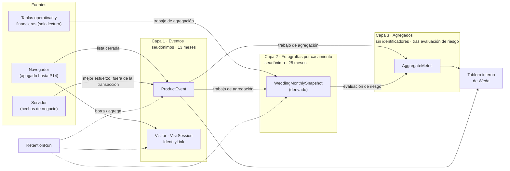
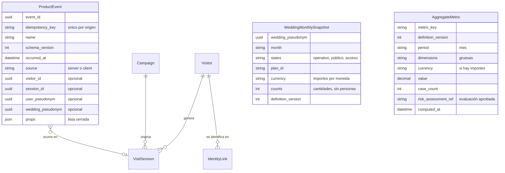

# Weda · Arquitectura de datos · Fase 3 — Arquitectura de analítica de producto

Fecha: 2026-10-30 (consolidada). Estado: **diseño aprobado en sus tres capas; no se implementó nada** (sin esquema, sin código, sin dependencias, sin commits).
Parte de la Fase 2 aprobada (`02-domain-model.md`, `02b-retention-privacy-deletion.md`, `02c-validation-report.md`) y de las condiciones que fijaste para la Fase 3.

> **Advertencia.** Esto es un diseño de producto y de datos, no asesoramiento legal. La base legal de la analítica, los plazos y la efectividad de la anonimización necesitan validación profesional (§13). Nada de este documento afirma que el diseño cumpla una norma.

---

## 0. Resumen

**Qué se propone, en una página**

1. **Tres capas con propósito y plazo distintos**, separadas de lo operativo y lo financiero:
   - **Eventos de comportamiento** (`ProductEvent`): pasaron cosas, con seudónimos aleatorios propios de la analítica. Corta vida.
   - **Fotografía mensual por boda** (`WeddingMonthlySnapshot`, derivada, interna): estado resumido de cada boda en cada mes, para cohortes y recontratación. **25 meses.**
   - **Métricas agregadas** (`AggregateMetric`): cifras de negocio sin identificadores. **Sin vencimiento automático, únicamente después de una evaluación de riesgo de privacidad aprobada**; no se confía en un número mágico.
   - Plazos de las capas 1 y 2 **aprobados**: eventos 13 meses, fotografía 25 meses (P15 cerrada); misma base SQLite con separación lógica (P17 cerrada).
2. **La analítica no es fuente de verdad del negocio.** Lo que prueba que pasó algo (pago, publicación, aporte confirmado, confirmación de asistencia) vive en las tablas operativas y financieras. La analítica **lee** de ahí en trabajos de agregación de solo lectura; nunca los modifica y nunca los reemplaza.
3. **Ningún evento lleva datos personales de invitados.** Del lado del invitado se miden solo conteos por casamiento (aperturas, confirmaciones), nunca el recorrido de una persona.
4. **Importes y cantidades por moneda**, siempre separados (ARS y USD jamás se suman). Los importes salen del libro (`GiftTransaction`) y de `Payment`, no de eventos del navegador.
5. **Los eventos del navegador siguen apagados** hasta tener política de privacidad y base legal definidas (P14).
6. **La analítica no adelanta ni complica** los diez riesgos prioritarios (§10): se agrega después de los prerrequisitos, nunca en la ruta crítica de un pago o de un cambio de alias, y sin cascadas ni claves compuestas que la acoplen a lo financiero.
7. **Ciclo de vida del evento (definitivo):** **pagar = activar + publicar** en una sola operación; **una sola vigencia de 12 meses** desde que Weda confirma el pago y activa la publicación, sin renovación, extensión, reactivación ni acceso privado adicional; la fecha de la boda no interviene. Al vencer se cierra el acceso, se bloquean escrituras y exportaciones y se calcula la fotografía final. Efecto sobre la analítica en §11; diseño completo en `02d-event-lifecycle-and-final-export.md`.
8. **Contrato de eventos** (§5.1): identificador único, idempotencia, versionado, protección contra duplicados, eliminación de vínculos identificables y consultas de solo lectura sobre lo financiero (§8).
9. **Métricas definidas con numerador, denominador, período, fuente y reglas de exclusión** en `05b-metric-definitions.md`.

**Lo que ya existe hoy** (`src/lib/analytics*.ts`, `funnel_events`): 14 nombres de evento (6 del servidor, 8 del navegador), una lista cerrada de 5 propiedades (`plan_id`, `device`, `is_upgrade`, `is_republish`, `attending`), eventos del navegador apagados salvo `VITE_ANALYTICS=on`, y una tabla sin identidad (no dice quién ni de qué sesión es cada evento). Esa base **se respeta y se extiende**; no se rehace.

---

## 1. Qué decisiones debe habilitar la analítica

La analítica se diseña **desde las preguntas**, no desde los datos disponibles. Cada métrica de §6 responde a una de estas decisiones.

| Área (tu lista) | Pregunta de producto o de negocio | Decisión que habilita |
|---|---|---|
| Embudo registro → creación → publicación | ¿Dónde se caen las parejas entre que llegan y publican? | Qué paso simplificar o reordenar primero. |
| Conversión entre planes | ¿Quién elige cada plan, quién llega a pagar y quién mejora de plan? | Estructura y mensajes de planes. |
| Uso de funcionalidades | ¿Qué partes del producto se usan y cuáles no? | Dónde invertir y qué retirar. |
| Comportamiento de las parejas | ¿Cuánto tardan, cuántas veces vuelven, qué hacen antes de publicar? | Onboarding, recordatorios, ayudas. |
| Rendimiento de la lista de regalos | ¿Las listas reciben aportes? ¿Qué categorías y qué importes? | Catálogo, sugerencias, textos. |
| RSVP y asistencia | ¿Qué porcentaje confirma, cuánto tarda, cómo cambia el cupo? | Recordatorios, flujo del invitado. |
| Importes y cantidades por moneda | ¿Cuántos regalos y de cuánto, en ARS y en USD, por separado? | Moneda de recepción, sugerencias de importes. |
| Retención y recontratación | ¿Vuelven las parejas después de publicar? ¿Cuántas finalizan antes de la boda? ¿Contratan un evento nuevo? | Vigencia (P2), precio de un plan nuevo (P3). |
| Abandono del onboarding | ¿Quién empieza y no termina, y en qué paso? | Rediseño del onboarding. |
| Métricas comerciales de Weda | Ingresos, nuevas bodas, conversión, tiempo hasta pagar. | Planificación del negocio. |

**Regla de diseño:** si una métrica no puede nombrar la decisión que habilita (columna derecha), no se captura.

---

## 2. Principios

| # | Principio | Consecuencia |
|---|---|---|
| 1 | **Separar tres mundos:** operativo (lo que hace funcionar la boda), financiero (lo que se debe conservar) y analítico (lo que se mide). | Sin claves foráneas ni cascadas entre analítica y lo demás. |
| 2 | **La analítica no es fuente de verdad.** | Los importes y los hechos de negocio salen de tablas operativas/financieras por lectura. Un evento perdido no cambia ningún dato del negocio. |
| 3 | **Minimización.** | Lista cerrada de propiedades; sin texto libre, sin correos, nombres, IP, tokens, alias ni importes exactos de invitados. |
| 4 | **Cero analítica individual del invitado.** | Los invitados no tienen identificador analítico. Solo conteos por casamiento. |
| 5 | **La analítica nunca bloquea ni demora un flujo de negocio.** | Se escribe al final, fuera de la transacción de un pago o de un cambio de alias; si falla, el flujo sigue. |
| 6 | **Seudonimizar no es anonimizar.** | Los eventos con seudónimos son datos personales y se tratan como tales (plazo, acceso, borrado). Solo los agregados evaluados pueden dejar de serlo. |
| 7 | **Todo evento y toda métrica tiene definición versionada.** | Se puede comparar en el tiempo y saber qué significaba un número. |
| 8 | **Una definición por métrica.** | Un solo cálculo para «bodas publicadas», no uno por tablero. |
| 9 | **Moneda explícita y separada.** | Ninguna métrica suma ARS con USD ni convierte. |
| 10 | **Lo que no se puede borrar no se captura.** | Si un dato analítico no puede eliminarse al eliminar la cuenta, no se guarda con seudónimo. |

---

## 3. Arquitectura en capas

| Capa | Qué guarda | Identifica | Plazo propuesto | Quién la ve |
|---|---|---|---|---|
| **0 · Operativo y financiero** (fuera de la analítica) | Lo que hace funcionar la boda y lo que debe conservarse. | Sí, según su clase (`A`, `B1`, `B2`, `B3`). | Ver `02b`. | Pareja, Weda según permisos. |
| **1 · Eventos** | Hechos de comportamiento con sobre común. | Seudónimos (de visitante, usuario, casamiento). **Dato personal.** | **13 meses** (aprobado). | Personal de Weda autorizado. |
| **1b · Visitas y vínculos** | Visitante anónimo, sesión, origen, vínculo con el registro. | Seudónimo; el vínculo vincula con un usuario. **Dato personal.** | Visita: 13 meses. Vínculo: solo con consentimiento (P16). | Personal autorizado. |
| **2 · Fotografía mensual por boda** (`WeddingMonthlySnapshot`) | Una fila por casamiento y mes con indicadores resumidos (ver §5.4). | Seudónimo de casamiento. **Dato personal (seudónimo).** | **25 meses** (aprobado): cubre los 12 meses de vigencia y 13 posteriores: permite cohortes y recontratación. | Personal autorizado. |
| **3 · Agregados** | Métricas por período y dimensiones gruesas. | Nada, **si pasa la evaluación de §7**. | **Sin vencimiento automático**, solo con evaluación aprobada. | Personal autorizado. |

**Por qué dos capas seudónimas.** Sin la capa 2 habría que conservar eventos individuales para calcular cohortes de retención y recontratación (12 meses de vigencia más el tiempo posterior al cierre). La capa 2 guarda solo indicadores resumidos por casamiento y mes, no la secuencia de acciones.

**Por qué la capa 3 no se llena en tiempo real sino por trabajos.** Calcular al vuelo desde eventos exigiría conservarlos; el trabajo mensual calcula, evalúa riesgo y recién después se pueden vencer los eventos.

**Dónde vive.** Hoy, en la misma base SQLite, **separada lógicamente** (tablas propias, sin claves foráneas hacia lo operativo). No se propone un almacén externo ni un proveedor de analítica: serían otra transferencia internacional y otro riesgo de hosting (P17). Si el volumen o el hosting lo piden, la separación lógica permite mover la capa 1 sin tocar lo demás.

---

## 4. Entidades de la analítica

Las entidades salen del catálogo de la Fase 2 (`04-data-dictionary.md`). **La consolidación agregó una entidad al catálogo: `WeddingMonthlySnapshot`** (la segunda capa no tenía entidad propia). Ajustes de la Fase 3, ya reflejados en el catálogo y en los diagramas de la Fase 2:

1. `ProductEvent` **ya no apunta por clave** a `User` ni a `Wedding`: guarda **seudónimos aleatorios propios de la analítica** (`analytics_id` del usuario y del casamiento). Al eliminar la cuenta o el casamiento se borra el seudónimo de la fila de origen y los eventos quedan **huérfanos de identidad** (no reconectables).
2. `AggregateMetric` ya no se describe con un «umbral de 10» y **guarda la referencia a la evaluación de riesgo** que autorizó conservarla: ver §7.
3. `ProductEvent` guarda **clave de idempotencia** y **versión del esquema** (§5.1).

| Entidad | Dominio | Qué representa en la analítica | Clase de retención | Estado |
|---|---|---|---|---|
| `ProductEvent` | ANL | Un hecho de comportamiento o de negocio con sobre común. | `C` seudónimo | Existe como `funnel_events`; se extiende. |
| `WeddingMonthlySnapshot` | ANL | Fotografía mensual por casamiento (capa 2). | `C` seudónimo, 25 meses | **Nueva (consolidación).** |
| `AggregateMetric` | ANL | Métrica histórica evaluada por riesgo. | `C` agregado | Nueva. |
| `OutboxEvent` | ANL | Evento crítico escrito en la misma transacción para enviarlo después. | `S` | **Solo si hay un destino externo.** No se necesita todavía. |
| `Visitor` | GRW | Navegador anónimo. | `C` seudónimo | Nueva, depende de P14. |
| `VisitSession` | GRW | Una sesión con su origen y parámetros de campaña. | `C` seudónimo | Nueva, depende de P14. |
| `IdentityLink` | GRW | Vínculo visitante ↔ usuario o lead. | `C`/`D` según consentimiento | Nueva, depende de P16. |
| `Campaign` | GRW | Campaña propia de Weda con clave. | Operativa | Nueva, sin PII. |
| `Lead` | GRW | Persona que dejó sus datos por interés comercial. | `D` | Se difiere. |
| `CommunicationConsent` | PRV | Consentimiento comercial independiente. | `D` | Existe como `marketing_consents`. |
| `RetentionRun` | PLT | Ejecución auditable de la retención y de la agregación. | `S` | Nueva. |

**Fuera de la analítica y solo leídas:** `Wedding`, `Subscription`, `Order`, `Payment`, `GiftTransaction`, `Contribution`, `ContributionItem`, `Gift`, `Guest`, `RsvpResponse`, `Invitation`, `Microsite`, `Publication`. La analítica **no tiene relación con ellas por clave**: los trabajos de agregación las consultan y escriben resultados sin identificadores.

**Qué no se crea.** No hay entidad `EventDefinition` ni `MetricDefinition` en la base: el **registro de eventos** y las **definiciones de métricas** viven en el código y en este documento, versionados con el repositorio (como `analytics-events.ts` hoy). Una tabla de definiciones sin interfaz que la mantenga sería complejidad sin uso.

**Relaciones y cardinalidades.** Un visitante genera N sesiones; una campaña origina N sesiones; un evento ocurre en una sesión (opcional: los eventos del servidor no siempre la tienen). `ProductEvent` no tiene clave hacia `User` ni `Wedding` (a propósito, §4 ajuste 1). El resto de las relaciones del dominio están en `03-entity-relationship.md`.

---

## 5. Eventos

### 5.1 Sobre común

Todo evento lleva el mismo sobre; lo que cambia es `name` y `props`.

| Campo | Contenido | Observaciones |
|---|---|---|
| `event_id` | UUID | Permite deduplicar reintentos. |
| `name` | Del registro (§5.3) | Nombres en minúsculas con guion bajo; pasado cuando algo ocurrió. |
| `schema_version` | Entero | Subir si cambia el significado o las propiedades. |
| `occurred_at` | Momento del hecho, UTC | Distinto de cuándo se recibió. |
| `source` | `server` o `client` | Lo que prueba un hecho de negocio **solo lo registra el servidor** (ya es regla hoy). |
| `visitor_id`, `session_id` | UUID opcionales | Solo si hay consentimiento (P14). |
| `user_pseudonym`, `wedding_pseudonym` | UUID aleatorio opcional | **No son las claves operativas.** Se borran al eliminar la cuenta o el casamiento. |
| `props` | JSON **de lista cerrada** | Ver 5.2. |

Prohibido en cualquier evento: correos, nombres, teléfonos, IP, tokens, alias, CBU, textos libres, mensajes de invitados, identificadores de invitación o de invitado, importes exactos de aportes individuales.

### 5.1b Contrato de eventos: identificación, idempotencia, versionado y duplicados

| Tema | Regla |
|---|---|
| **Identificador único** | Cada evento tiene un `event_id` único (UUID). Lo genera quien lo emite; el navegador lo genera antes de enviarlo. |
| **Idempotencia** | Los eventos del servidor derivan de un **hecho de negocio** y llevan una **clave de idempotencia** determinista (por ejemplo, `publication_completed:<revisión publicada>`, `payment_confirmed:<pago>`, `rsvp_submitted:<respuesta>`). La clave es **única por origen**: reintentar, reprocesar una notificación del proveedor o reanudar un trabajo **no crea un segundo evento**. Un conflicto de clave se ignora y se cuenta. |
| **Los eventos solo se agregan** | Nunca se modifican ni se corrigen en el lugar. Un error se resuelve con un evento nuevo que lo reemplaza explícitamente o se corrige al recalcular las métricas. |
| **Versionado** | `schema_version` cambia si cambia el significado o la lista de propiedades de un evento. Las definiciones de métricas tienen su propia versión; un cambio crea una versión nueva, no reescribe los agregados históricos. Un consumidor acepta versiones anteriores. |
| **Duplicados del navegador** | Deduplicación por `event_id`; los eventos del navegador son **aditivos y no autoritativos** (nunca prueban un hecho de negocio) y se consideran solo si el origen consintió (P14). Los eventos «una vez» (`trackOnce`) se recuerdan en el navegador y además se deduplican en el servidor por visitante. |
| **Tiempo** | Se guarda `occurred_at` (cuándo ocurrió, tomado del servidor para eventos del servidor) y la hora de recepción. Los eventos del navegador no se confían para ordenar: se usa la hora de recepción como cota. Plazo de aceptación de eventos tardíos: a definir en la Fase 5. |
| **Bots y pruebas** | Se marcan y se excluyen de las métricas (cuentas de personal, proveedor de pago de prueba, tráfico de prueba). |
| **Eliminación de vínculos identificables** | Los seudónimos son **aleatorios**, no derivados de la clave operativa: no se pueden recalcular. Al eliminar la cuenta o el casamiento se borra el seudónimo de la fila de origen (y el `IdentityLink`): los eventos quedan sin identidad recuperable. Retirar el consentimiento borra el vínculo visita ↔ registro. |
| **Falla de la analítica** | Nunca rompe un flujo: se escribe después del hecho, fuera de la transacción del pago o del cambio de alias (la analítica queda atrás antes que el pago). |

### 5.2 Propiedades admitidas

Hoy: `plan_id`, `device`, `is_upgrade`, `is_republish`, `attending`. Se propone ampliar **solo** con valores de categorías cerradas:

| Propiedad | Valores | Para qué |
|---|---|---|
| `plan_id` | Identificador de plan | Conversión por plan. |
| `device` | `mobile`, `desktop` | Comparar flujos. |
| `step` | Lista cerrada de pasos del onboarding | Abandono. |
| `section_type` | Tipos de bloque del sitio | Uso de funcionalidades. |
| `currency` | `ARS`, `USD` | Importes por moneda (siempre acompaña a cualquier cantidad). |
| `amount_band` | Rangos definidos por moneda | Distribución de importes **sin guardar el importe exacto**. |
| `kind` | `suggested`, `free` | Modalidad de regalo (Q1). |
| `gift_category` | Categorías cerradas del catálogo | Rendimiento de la lista. |
| `party_band` | `1`, `2`, `3-4`, `5+` | Tamaño del grupo que confirma. |
| `days_to_wedding_band` | Rangos | Cuándo actúan las parejas respecto de la fecha. |
| `date_shift` | `earlier`, `later`; `delta_band` | Cambio de fecha (§11). |
| `channel` | Categorías gruesas | Atribución, solo con consentimiento. |
| `result` | `ok`, `error_class` (lista cerrada) | Diagnóstico sin detalle personal. |
| `is_upgrade`, `is_republish`, `attending` | booleano | Ya existen. |

Una propiedad nueva requiere: nombre, valores cerrados, finalidad (de §1) y revisión de este documento.

### 5.3 Registro de eventos propuesto

**Fuente:** S = servidor (hecho verificable); N = navegador (comportamiento, apagado hasta P14). Los eventos marcados **(existe)** están hoy en `analytics-events.ts`.

| Área | Evento | Fuente | Cuándo | Propiedades |
|---|---|---|---|---|
| Embudo | `landing_viewed` (existe) | N | Se ve la landing | `device`, `channel` |
| | `signup_started` (existe) | N | Empieza el registro | `device` |
| | `signup_completed` (existe) | S | Cuenta creada | `device`, `channel` |
| Onboarding | `onboarding_step_viewed` | N | Se ve un paso | `step`, `device` |
| | `onboarding_step_completed` | S | Se guarda un paso | `step` |
| | `event_created` (existe) | N→S | Se crea el casamiento con fecha | `days_to_wedding_band` |
| | `onboarding_completed` | S | Termina el último paso | — |
| Sitio | `microsite_section_added` | N | Se agrega un bloque | `section_type` |
| | `microsite_section_edited` | N | Primera edición de un bloque en la sesión | `section_type` |
| | `preview_opened` | N | Abre la vista previa | `device` |
| | `microsite_completed` (existe) | N | El sitio llega al mínimo | — |
| | `publication_completed` (existe) | S | **Primera publicación efectiva = activación**: ocurre en la misma operación que confirma el pago; las republicaciones llevan `is_republish` | `plan_id`, `is_republish`, `days_to_wedding_band` |
| | `publication_unpublished` | S | Se retira del aire | — |
| Planes | `plan_selected` (existe) | N | Elige un plan | `plan_id` |
| | `checkout_started` (existe) | N | Entra al pago | `plan_id` |
| | `payment_confirmed` (existe) | S | Pago confirmado | `plan_id`, `is_upgrade`, `currency` |
| | `payment_failed` | S | Pago rechazado | `plan_id`, `result` |
| | `subscription_started` | S | Comienza la vigencia | `plan_id` |
| | `plan_expiry_notified` | S | Aviso de vencimiento enviado | `plan_id` |
| | `event_finalized` | S | Se cumplen los 12 meses: el evento queda finalizado y cerrado | `plan_id`, `finalized_before_wedding`, `days_to_wedding_band` |
| | `terms_accepted`, `expiry_notice_dispatched`, `data_export_requested`, `data_export_completed`, `finalized_action_blocked`, `retention_executed` | S | Ciclo de vida del evento (§11.1) | ver §11.1 |
| Regalos | `gift_list_started` / `gift_list_completed` (existen) | N | Empieza / completa la lista | — |
| | `gift_added` | N | Agrega un regalo | `gift_category`, `kind`, `currency` |
| | `payout_method_configured` | S | Se carga un destino de cobro (**sin valores**) | `currency` |
| | `payout_currency_changed` | S | Cambia la moneda de recepción | `currency` (nueva) |
| | `public_gifts_viewed` | N | Un invitado abre la lista | `device` |
| | `contribution_started` | N | Un invitado empieza un aporte | `kind`, `currency` |
| | `gift_submitted` (existe) | S | Aporte registrado como pendiente | `kind`, `currency`, `amount_band` |
| | `proof_uploaded` | S | Se cargó un comprobante (**sin contenido**) | — |
| | `contribution_confirmed` | S | La pareja confirma (asiento del libro) | `kind`, `currency`, `amount_band` |
| | `contribution_rejected` / `contribution_reversed` | S | Rechazo o reversión | `currency`, `result` |
| Invitados y RSVP | `guest_import_completed` | S | Importación de invitados | tamaño en rangos |
| | `invitation_sent` | S | Se envió una invitación | `channel` de envío |
| | `public_invitation_opened` (existe) | S | Se abre una invitación | — (**sin identificador de invitación**) |
| | `rsvp_submitted` (existe) | S | Confirma o declina | `attending`, `party_band` |
| | `rsvp_modified` | S | Cambia su respuesta | `attending`, `party_band` |
| Actividad | `wedding_active_day` | S | Primera escritura del día en el panel de un casamiento (clave de idempotencia: seudónimo del casamiento + día); **sin contenido** | `device` |
| Equipo | `member_invited`, `member_joined`, `ownership_transfer_completed` | S | Colaboradores | `role` |
| Fecha | `wedding_date_changed` | S | La pareja cambia la fecha (solo con plan vigente) | `date_shift`, `delta_band`, publicada o no |
| Privacidad | `analytics_consent_changed` | N/S | Acepta o retira | solo estado |
| | `export_requested`, `deletion_requested` | S | Solicitudes de derechos | solo conteo |

**Sobre `public_invitation_opened`.** Hoy cuenta cada recarga (R14 de la Fase 1). Se redefine como **una apertura por invitación por día**, deduplicada en el servidor, y **sin guardar qué invitación**: se almacena solo un contador por casamiento. Así no hay historial de qué invitado abrió qué.

**Eventos del navegador.** Ocho existentes más `onboarding_step_viewed`, `preview_opened`, `gift_added`, `public_gifts_viewed`, `contribution_started`, `microsite_section_*`. **Ninguno se enciende** hasta resolver P14. Mientras tanto, el embudo se arma **solo con eventos del servidor**: registro, pasos guardados, creación, publicación, pago. Alcanza para medir el abandono del onboarding por paso y toda la conversión, **salvo** lo que ocurre antes del registro (landing → inicio de registro) y la atribución de campañas.

### 5.4 Fotografía mensual por boda (capa 2, `WeddingMonthlySnapshot`)

Una fila por casamiento y mes, calculada **por lectura** de lo operativo, con indicadores y sin contenido:

| Indicador | Origen (solo lectura) |
|---|---|
| Etapa del ciclo (en armado, publicada, vencida, cerrada) | `Wedding`, `Publication`, `Subscription` |
| Plan contratado y estado de la vigencia | `Subscription` |
| Días hasta la boda, en rangos | `EventMoment` / `Wedding` |
| Bloques del sitio por tipo (cantidad) | `MicrositeBlock` |
| Cantidad de regalos en la lista, por moneda | `Gift` |
| Cantidad de aportes confirmados e importe total, **por moneda** | `GiftTransaction` |
| Invitaciones enviadas, confirmaciones, asistentes (cantidades) | `Invitation`, `RsvpResponse` |
| Cantidad de sesiones del panel en el mes | `Session` |
| Colaboradores activos (cantidad) | `WeddingMember` |

Sin nombres, sin correos, sin identificadores de invitados, sin contenidos. La clave es el **seudónimo del casamiento**. Cuando se elimina el casamiento se borra su seudónimo de origen y estas filas dejan de ser reconectables; por política se agregan (solo con evaluación de riesgo) y se eliminan a los 25 meses.

---

## 6. Métricas

Las definiciones completas —**numerador, denominador, período, fuente y reglas de exclusión**— están en [`05b-metric-definitions.md`](05b-metric-definitions.md). Cubre adquisición y conversión, activación, invitados, regalos, comercial y retención.

**Reglas generales**
1. **Una definición por métrica, versionada.** Cambiarla crea una versión nueva.
2. **Ingresos de Weda y dinero de regalos de las parejas no se mezclan nunca.** Los primeros salen de `Order`/`Payment` (clase `B1`); los segundos, del registro de aportes (`B2`), siempre por moneda y como lo que **la pareja confirmó manualmente**, no como fondos recibidos.
3. **Los importes nunca se suman entre monedas ni se convierten.**
4. **Un solo origen por cifra:** los hechos de negocio salen de tablas operativas y financieras por **consultas de solo lectura**; los eventos aportan comportamiento.
5. **Poblaciones chicas:** al principio habrá pocas bodas; una métrica con casos insuficientes no se publica ni se conserva sin plazo (§7).

## 7. Anonimización y privacidad de la analítica

### 7.1 Qué se captura, para qué, por cuánto tiempo y cómo se anonimiza

| Dato | Para qué | Plazo propuesto | Qué pasa después |
|---|---|---|---|
| `ProductEvent` (seudónimos) | Embudos, abandono, uso | 13 meses | Se agregan a `AggregateMetric` y se **eliminan**. |
| `Visitor` y `VisitSession` | Atribución y origen | 13 meses (solo con consentimiento) | Se agregan por canal y se eliminan. |
| `IdentityLink` | Unir visita con registro | Mientras haya consentimiento; **se borra al retirarlo** | Se elimina el vínculo; los eventos quedan sin identidad. |
| Fotografía por casamiento | Cohortes y recontratación | 25 meses | Se agrega y se elimina. |
| `AggregateMetric` | Historia del negocio | Sin plazo | Sigue **solo si pasa §7.2–7.4**. |
| Seudónimos en `User` y `Wedding` | Vincular eventos | Hasta la eliminación de la cuenta o del casamiento, o hasta que la política posterior al cierre depure el evento (propuesta, tras calcular sus agregados) | Se borran: los eventos dejan de ser reconectables. |

**Nada que identifique a un invitado entra a la analítica**, ni siquiera seudonimizado. Lo que sí se mide del lado del invitado son conteos por casamiento.

### 7.2 No hay un número que garantice la anonimización

Un umbral mínimo de casos por celda (por ejemplo 10) **ayuda pero no garantiza**:

- Una celda con muchos casos puede estar **dominada por uno** (una boda que aporta casi todo el importe).
- **Combinar dimensiones** acota poblaciones: «bodas de USD, plan X, mes Y, 4 regalos» puede ser una sola boda.
- **Diferencias entre consultas**: dos agregados distintos permiten restar y aislar un caso.
- **Datos externos**: quien conoce una boda pública puede reconocerla por su fecha o su ciudad.
- **Poblaciones pequeñas**: al principio habrá pocas bodas; casi toda celda es chica.

### 7.3 Medidas combinadas

| # | Medida | Qué evita |
|---|---|---|
| 1 | **Minimización en la captura** (lista cerrada, bandas en vez de valores). | Guardar de más. |
| 2 | **Dimensiones gruesas** (mes, plan, moneda, tipo de dispositivo, canal en grupos). Sin ciudad, sin fecha exacta, sin nombres de lugares. | Combinaciones únicas. |
| 3 | **Importes en bandas o percentiles**, no valores individuales, y siempre por moneda. | Reconocer un regalo. |
| 4 | **Control de celdas pequeñas:** una celda con pocos casos se agrupa u omite. El valor de «pocos» **no se fija todavía** (P8): se decide con la evaluación de riesgo. | Celdas triviales. |
| 5 | **Control de dominancia:** si un casamiento aporta más de una fracción de un total, se redondea, se agrupa o se omite. | Un caso que domina. |
| 6 | **Sin consultas libres sobre agregados** y sin publicar cifras solapadas del mismo período con distintos cortes. | Ataques por diferencia. |
| 7 | **Uso interno**: los agregados no se publican ni se entregan a terceros sin nueva evaluación. | Cruces con datos externos. |
| 8 | **Evaluación de riesgo documentada** antes de declarar que una métrica es anónima, y revisada al cambiar volumen o dimensiones. | Declarar anonimato por intuición. |
| 9 | **Vencer lo seudónimo**: borrar eventos, fotografías y vínculos al terminar su plazo. | Reconstrucción individual indefinida. |
| 10 | **Validación profesional** del criterio. | Errores de interpretación. |

### 7.4 Posición honesta

Mientras no haya evaluación de riesgo y validación profesional, los agregados deben tratarse como **datos de bajo riesgo de reidentificación pero no declarados anónimos**: acceso restringido, sin publicación y revisables. Si con pocas bodas no se puede garantizar el criterio, la alternativa es **no conservar por celda lo que identifique** (conservar solo totales gruesos) hasta que haya volumen.

### 7.5 Derechos y eliminación

- **Eliminar una cuenta o un casamiento** borra el seudónimo de origen: los eventos y fotografías dejan de ser reconectables y se eliminan en el siguiente ciclo (`RetentionRun`).
- **Retirar el consentimiento de analítica** (P14) borra el vínculo (`IdentityLink`) y deja de capturar; los eventos ya capturados siguen su plazo o se eliminan según se decida.
- **Acceso:** un usuario puede pedir los eventos asociados a su seudónimo (`DataExportJob`).
- **Invitados:** no tienen datos analíticos individuales; no hay nada que exportar o eliminar a su nombre en esta capa.

---

## 8. Separación entre analítica, operativo y financiero

| Aspecto | Operativo y financiero | Analítica |
|---|---|---|
| Para qué | Que funcione la boda y que haya registro de lo que pasó. | Decidir sobre el producto y el negocio. |
| Fuente de verdad | **Sí** | **No**: puede perderse o recalcularse. |
| Identifica | Según la clase (`A`, `B1`, `B2`, `B3`). | Solo seudónimos propios de la analítica. |
| Relación con otras tablas | Claves y restricciones. | **Ninguna clave**; solo lectura desde trabajos. |
| Borrado | Por clase (`02b`). | Por plazo y por eliminación de cuenta. |
| Importes | Libro inmutable y pagos. | Bandas o agregados **por moneda**. |
| Fallo | Detiene el flujo si es crítico. | **Nunca** detiene un flujo. |
| Acceso | Roles de la boda y del personal. | Personal autorizado de Weda. |

**Dos cosas que se parecen y no se mezclan:**
- **Estadísticas para la pareja** (cuántos confirmaron, cuánto recibieron): se calculan **desde los datos operativos** y las ve la pareja con sus permisos. No usan la analítica.
- **Analítica de Weda** (cómo se comportan las parejas): la ve solo Weda y no tiene datos de invitados.

---

### Consultas de solo lectura sobre información financiera

Los trabajos de agregación que leen lo financiero siguen estas reglas:
1. **Solo lectura:** usan una conexión o rol de **solo lectura** (en SQLite, una conexión de solo lectura); no pueden insertar, modificar ni borrar en tablas operativas ni financieras.
2. **Vistas con lista permitida de columnas:** ven importe, moneda, tipo, estado, fecha y el seudónimo del casamiento. **No ven** nombres, correos, mensajes, alias ni comprobantes.
3. **Moneda siempre explícita:** toda consulta agrupa por moneda; está prohibido sumar o promediar entre monedas.
4. **Fuente de ingresos de Weda:** `Order` y `Payment`; **fuente de aportes de las parejas:** `GiftTransaction` y `Contribution`. Nunca se cruzan.
5. **Lo recalculable no se corrige a mano:** si un agregado difiere del registro, se recalcula; no se edita.
6. **Aislamiento entre bodas:** cada fila lleva el seudónimo del casamiento; la agregación no mezcla datos de bodas distintas más que en agregados evaluados.

---

## 9. Calidad, deduplicación y gobierno

| Tema | Regla |
|---|---|
| Registro de eventos | Un solo archivo en el código (como hoy); nombre, fuente, propiedades, finalidad y versión. |
| Duplicados | `event_id` y deduplicación en el servidor. `public_invitation_opened`: una por invitación por día. |
| Orden y retrasos | Se usa `occurred_at`, no la hora de recepción. |
| Bots y tráfico de prueba | Se marcan y se excluyen de las métricas (criterio simple, a definir en la Fase 5). |
| Cambios de significado | Subir `schema_version` o `definition_version`; no se reescriben agregados históricos. |
| Zonas horarias | Todo en UTC; los meses de reporte se fijan en una zona (propuesta: `America/Argentina/Buenos_Aires`). |
| Pruebas | Cada evento nuevo tiene una prueba de que no lleva propiedades fuera de la lista. |
| Revisión | Todo evento y métrica nueva pasa por la pregunta «¿qué decisión habilita?» (§1) y por la lista de datos prohibidos (§5.1). |

---

## 10. Riesgos prioritarios y su relación con la analítica

Diez riesgos prioritarios se mantienen documentados. **La analítica nueva no se adelanta a la resolución de los tres primeros (hosting, integridad y modelo financiero).**

| # | Riesgo | Estado hoy (Fase 1) | Regla para la analítica |
|---|---|---|---|
| 1 | **Hosting sin persistencia y respaldos probados** (R1, R2) | SQLite local; en Vercel sin cuentas ni publicación real; sin respaldos ni restauración | No agrega carga ni dependencia a la base; separada lógicamente y descartable; sin almacén externo. Nada nuevo se enciende en producción hasta tener respaldos probados |
| 2 | **Pagos reales sin verificador** (R11) | Proveedor de prueba con firma HMAC; no existe verificador real | Los ingresos salen de `Payment` verificado, nunca de eventos; hasta tener verificador, los ingresos se marcan **no auditables** |
| 3 | **Integridad financiera** | Importes sin moneda; sin libro inmutable | La analítica no es contabilidad ni concilia; se agrega después del libro; antes solo conteos |
| 4 | **Borrados en cascada** | El borrado del casamiento arrastra aportes, órdenes y comprobantes | Sin claves hacia lo operativo: no añade cascadas ni complica retirarlas; eliminar la cuenta borra el seudónimo, no filas financieras |
| 5 | **Seguridad de alias bancarios** | Alias y datos de cobro dentro del JSON del borrador | Los eventos no llevan alias, CBU ni titular; `payout_method_configured` registra el hecho y la moneda |
| 6 | **Aislamiento entre bodas** | Un casamiento por cuenta, filtrado por usuario | Seudónimos por casamiento; sin tableros para la pareja basados en analítica; acceso solo de personal con rol y auditoría; pruebas de aislamiento en la agregación |
| 7 | **Migración de importes e invitados** | Importes `INTEGER` sin moneda; invitados con `name_key` | Los trabajos de agregación se escriben **después** de la migración y respetan la moneda explícita y las invitaciones nuevas; los datos migrados no se reinterpretan como eventos históricos |
| 8 | **Anonimización efectiva** | Sin evaluación; sin retención | Agregados solo tras la evaluación de riesgo (§7); eliminar es preferible a anonimizar; seudónimo ≠ anónimo |
| 9 | **Tokens expuestos en URLs** (invitación, transferencia, recuperación) | Enlaces con token en la ruta | La analítica **no registra URLs completas ni parámetros**: solo la ruta sin token ni identificadores; los eventos no incluyen `Referer` completo |
| 10 | **Concurrencia en operaciones críticas** | Un solo escritor, límites en memoria | La analítica se escribe de forma asíncrona y tolerante a fallas; la idempotencia (§5.1b) evita duplicados ante reintentos; nunca dentro de la transacción de un pago, un alias o un traspaso de propiedad |

**Condición de implementación:** la analítica **nueva** se implementa **después** de los pasos 1 a 3 del orden recomendado (hosting y respaldos, integridad, dinero y moneda). Antes solo se mantienen los 6 eventos del servidor ya existentes y se preparan definiciones.

### Otros riesgos propios de la analítica

| Riesgo | Mitigación |
|---|---|
| Reidentificación en agregados con pocas bodas | §7; no declarar anonimato sin evaluación. |
| Capturar de más «por si sirve» | Principio 3 y la pregunta del §1. |
| Métricas que se contradicen | Una definición por métrica (§9). |
| Decisiones sobre datos incompletos (navegador apagado) | Informar la cobertura de cada métrica. |
| Sesgo de seguimiento (solo se ve lo que se instrumenta) | Registro de eventos revisado. |
| Eventos del navegador bloqueados por el usuario | No se asume cobertura completa; el servidor sostiene los hechos. |
| Costo de mantener el sistema | Diseño mínimo: sin almacén ni proveedor propios, sin entidades de definición. |

---

## 11. Ciclo de vida del evento y analítica

> El diseño completo está en [`02d-event-lifecycle-and-final-export.md`](02d-event-lifecycle-and-final-export.md): **pagar = activar + publicar**; **una sola vigencia de 12 meses** desde que Weda confirma el pago y activa la publicación; al cumplirse el evento se cierra de forma definitiva. Acá solo el efecto sobre la analítica.

### 11.1 Eventos analíticos del ciclo de vida

Todos del servidor, con lista cerrada de propiedades, sin datos personales y con clave de idempotencia derivada del hecho (por ejemplo, `event_finalized:<suscripción>`):

| Evento | Cuándo | Propiedades |
|---|---|---|
| `event_finalized` | Se cumplen los 12 meses | `plan_id`, `finalized_before_wedding`, `days_to_wedding_band` |
| `terms_accepted` | La pareja acepta las condiciones de vigencia al contratar (P33) | `terms_kind` (vigencia o general); **sin texto ni datos personales** |
| `expiry_notice_dispatched` | Se entrega al proveedor un aviso de vencimiento (30, 7 o 1 día antes) | `days_before_band`, `result` (aceptado por el proveedor o fallido). **No equivale a entregado**: la entrega se lee de `MessageDeliveryEvent` (P23) |
| `data_export_requested`, `data_export_completed` | Descarga durante la vigencia | `scope` (invitados, aportes, comprobantes, resumen financiero), `result` |
| `finalized_action_blocked` | Escritura o acceso rechazado por estar finalizado | `action_category` |
| `retention_executed` | Corre la política posterior al cierre | `result` |
| `new_event_started_after_finalization` | La misma cuenta crea otro evento | — |
| `wedding_date_changed` (evento activo) | Cambio de fecha | `date_shift`, `delta_band`, `published` |

**Propuestos (P19, adoptada; los avisos son recomendaciones asociadas):** `draft_inactivity_notice_dispatched` (`case`, `days_before_band`, `result`) y `draft_deleted_by_inactivity` (`case`). Mismas reglas: lista cerrada, idempotencia derivada del hecho, sin datos personales.

**Desaparecen** los eventos del modelo anterior: `plan_expired` como hecho distinto del cierre, `publication_deadline_notice_dispatched` y `subscription_cancelled` por no publicar (P18 eliminada), `memorial_started`, `public_permanence_ended`, `private_access_window_started` y `private_access_closed`.

### 11.2 Reglas para no perder métricas válidas

1. **El vencimiento no borra** eventos con seudónimo que cumplen su plazo ni agregados. Los eventos siguen su plazo (13 meses; cubre la vigencia completa y un mes más) y la fotografía mensual el suyo (25 meses; cubre los 12 meses de vigencia y 13 posteriores). La eliminación de la cuenta o del casamiento borra el seudónimo (§7.5).
2. **Orden obligatorio:** la fotografía final y las métricas del evento se calculan **al vencer**, antes de cualquier depuración de datos personales. La retención lo verifica; si falla, alerta y reintenta con un plazo máximo (a definir) para que un fallo de analítica no retenga datos personales de manera indefinida.
3. Las transiciones de estado se guardan con su fecha: permiten medir tiempo hasta vencer, vencimientos con la boda posterior y bloqueos intentados.
4. La analítica **lee** el estado; **nunca lo decide ni lo modifica**.
5. Los números de la analítica **no son** un resumen financiero: el que descarga la pareja sale del registro operativo (`02d` §5.3).
6. **Métricas que sobreviven:** al vencer, las cantidades del evento ya están en la fotografía y en los agregados; las históricas solo se conservan si superaron la evaluación de riesgo.
7. **Sin vista pública posterior:** no hay analítica de visitantes sobre un evento cerrado.

### 11.3 Qué cambia respecto de versiones anteriores

Se eliminaron el vencimiento del plan a los 6 meses, la permanencia pública con recuerdo estático, la ventana de 90 días y las métricas asociadas. «Renovación» se reemplaza por **recontratación** (un evento nuevo de la misma cuenta). La fecha del casamiento **no mueve ningún reloj**: la métrica «vencimientos con la boda posterior» mide cuántas parejas quedan en esa situación para alimentar la explicación previa a la compra.

---

## 12. Decisiones y su efecto en la analítica

La lista completa y vigente (cerradas y abiertas) está en `02-domain-model.md` §8 y resumida en `06-consolidation-report.md`. **Cerradas:** P2, P11, P13, P15 (plazos 13 y 25 meses), P17 (misma base SQLite), P20, P22, P23, P24, P29, P31, P32, P33. **Retiradas por obsoletas:** P1, P21, P27, P28. **Antes de la Fase 5 deben resolverse especialmente P5 y P6**, y definirse P30 antes de implementar la retención.

| # | Pendiente | Efecto en la analítica |
|---|---|---|
| **P5** | Seguridad del alias | Define los eventos `payout_*` y qué se audita |
| **P6** | Clasificación contable y plazos de B1/B2 | Define qué se conserva para ingresos históricos |
| **P30** | Tratamiento posterior al cierre por clase de dato | Cuándo se depura y se borra el seudónimo |
| P3, P4 | Precio de un plan nuevo; planes en USD | Recontratación e ingresos por moneda |
| P7, P9, P10 | Contenido de la pareja, gracia, propietario ausente | Fotografía mensual y definición de «evento activo» |
| P35 | Requisitos mínimos de publicación | Definición de «evento activado» y de errores de activación |
| P8 | Política de celdas pequeñas y evaluación de riesgo | §7 |
| P12 | Cupo | Asistencia |
| **P14**, **P16** | Base y consentimiento de la analítica del navegador; unir visita con registro | Mantiene apagados los eventos del navegador |
| P25, P26, P34 | Formatos de exportación, cancelaciones, qué se muestra de un evento cerrado en la cuenta | Eventos de §11 y métricas de `05b` |
| P23, P31, P32, P33 (cerradas) | Avisos, URL no disponible, cuenta tras el cierre, aceptación de la vigencia | Eventos `expiry_notice_dispatched`, `terms_accepted`, `finalized_action_blocked`; métricas F3b, F7 y F8 |

---

## 13. Qué requiere validación profesional

1. Base legal del tratamiento de la analítica de comportamiento (consentimiento o interés legítimo) y avisos al usuario (P14).
2. Si los seudónimos aleatorios con vínculo borrable cuentan como datos personales de baja identificabilidad o requieren un tratamiento equivalente al de datos identificados.
3. Efectividad de la anonimización de los agregados y criterio de celdas pequeñas (§7).
4. Plazos de 13 y 25 meses (aprobados por la dueña; validar su proporcionalidad).
5. Transferencias internacionales si la analítica llegara a usar un proveedor externo (hoy no).
6. Unión de visita y registro con fines de atribución (P16).
7. Informar en la política de privacidad qué se mide y para qué.
8. Tratamiento posterior al cierre de los datos de invitados y proporcionalidad de conservarlos durante los 12 meses de vigencia (P30).
9. Derechos de acceso y supresión sobre un evento cerrado con las exportaciones bloqueadas (P32), y evidencia de aceptación de la vigencia (P33, `02d` §1.4).

---

## 14. Estructura que implicaría la implementación

(No se implementa. Es lo que se aprobaría más adelante.)

1. **Ampliar el sobre de eventos** con identificadores y versión; el registro de eventos y la lista cerrada de propiedades en el código existente.
2. **Seudónimos de analítica** en `User` y `Wedding` (columna aleatoria, borrable), sin clave foránea desde los eventos.
3. **Cobertura de pruebas** de que ningún evento acepta propiedades fuera de lista, ni datos de invitados, ni alias.
4. **Trabajos de agregación** mensuales (conexión de solo lectura sobre lo operativo y lo financiero, vistas con lista permitida de columnas): `WeddingMonthlySnapshot` y cálculo de `AggregateMetric`, con evaluación de riesgo.
4b. **Contrato de eventos:** identificador único, clave de idempotencia, versión de esquema y deduplicación (§5.1b).
5. **Trabajo de retención** para eventos, fotografías y vínculos (comparte `RetentionRun` con las demás clases).
6. **Tablero interno** de solo lectura para personal de Weda, con rol y auditoría.
7. **Consentimiento de analítica** (cuando se resuelva P14) y política de privacidad actualizada.
8. **Redefinir `public_invitation_opened`** (contador por casamiento, una por invitación por día).
9. **Estados, guardia de estado y trabajo de materialización** del vencimiento (`02d`), con los eventos de §11.1.

**Orden recomendado dentro de la analítica:**
1. Registro de eventos, propiedades y definiciones de métricas (documental).
2. Seudónimos y sobre ampliado **solo con eventos del servidor**.
3. Fotografía mensual y primeros agregados (conteos, sin importes).
4. Importes por moneda, **después** del libro y de la moneda explícita.
5. Eventos del navegador, **después** de P14 y la política de privacidad.
6. Atribución de campañas, **después** de P16.

---

## 15. Contradicciones y ajustes encontrados

| # | Hallazgo | Tratamiento |
|---|---|---|
| 1 | La Fase 2 hacía que `ProductEvent` apuntara por relación a `User` y `Wedding`; eso acopla la analítica a lo operativo y complica el borrado. | **Corregido:** seudónimos aleatorios y sin clave (catálogo y diagramas actualizados). |
| 2 | La Fase 2 proponía «umbral de 10» para los agregados. | **Corregido:** se retira como garantía (§7); P8 reformulada. |
| 3 | `public_invitation_opened` cuenta cada recarga y la nueva definición evita conservar quién abrió qué. | Se redefine (§5.3). |
| 4 | Hoy el embudo no tiene identidad; sin ella no se puede medir abandono por paso. | La solución inicial es **solo con eventos del servidor** (`onboarding_step_completed`). |
| 5 | Los eventos del navegador existentes no cubren el abandono antes del registro. | Queda como limitación hasta resolver P14. |
| 6 | `payment_confirmed` hoy lo emite el proveedor de prueba. | Los ingresos se marcan «no auditables» hasta que exista verificador real (§10, riesgo 2). |
| 7 | `attending` en `rsvp_submitted` es una propiedad por respuesta; combinado con otros datos podría reidentificar. | Se mantiene a nivel de casamiento y se evalúa en §7; no se asocia a invitación ni invitado. |
| 8 | Versiones anteriores de §11 trataban el cambio de fecha con el plan vencido, la renovación, el vencimiento del plan a los 6 meses, el recuerdo y la ventana de 90 días. | **Reemplazadas** por la vigencia única de 12 meses: sin renovación, extensión ni acceso posterior (§11, `02d`). |
| 9 | «Retención y renovación» (pedido de la Fase 3) | Se redefine como retención durante la vigencia, finalización y **recontratación** (`05b`). |
| 10 | La segunda capa («fotografía mensual») no tenía entidad en el catálogo. | **Agregada** `WeddingMonthlySnapshot`. |
| 11 | `AggregateMetric` decía «sin plazo» sin condición. | **Corregido**: sin vencimiento automático **solo tras evaluación de riesgo**; guarda la referencia a la evaluación. |

---

## 16. Qué NO se hace

- No se modifica el esquema, no se implementan eventos nuevos, no se agregan dependencias, no se encienden los eventos del navegador, no se crea ningún tablero.
- La única entidad agregada al catálogo en la consolidación es `WeddingMonthlySnapshot`; el resto son ajustes de descripción.
- No hay commits, push ni deploy.

**Próximo paso:** revisá esta propuesta. **No avanzo a ninguna implementación ni a la Fase 4 sin tu aprobación explícita.**
