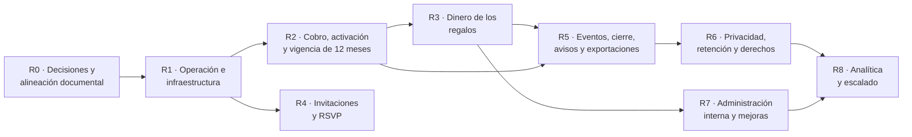

# Weda · Roadmap de implementación propuesto (anexo 05)

Anexo del [Product Blueprint](00-product-blueprint.md). Ver también: [inventario](01-feature-inventory.md) · [reglas](02-business-rules-catalog.md) · [decisiones y riesgos](03-open-decisions-and-risks.md) · [preparación comercial](04-mvp-readiness.md).

> **Esto es una propuesta para tu revisión. No se implementó nada ni se inició ninguna fase.** Cada fase necesita tu aprobación explícita. El orden sale de dos criterios: **dependencias** (qué no puede existir sin otra cosa) y **riesgo** (qué hace más daño si falla). No se estiman plazos: no hay base para hacerlo.

## 0. Cómo se ordenó

**Tres ideas de orden**
1. **Nada se cobra antes de R1 y R2.** Sin hosting persistente, respaldos y proveedor verificado, cobrar es el mayor riesgo del producto.
2. **El reloj del primer vencimiento.** La vigencia dura 12 meses desde la confirmación del pago. Lo que solo importa al cerrar un evento (R5 y R6) debe estar listo **antes** de que el primer evento cumpla 12 meses, pero no necesita estar para la primera venta; el contrato de R2 sí debe explicarlo desde el primer día.
3. **Primero el dinero, después el resto.** El libro y el control del alias (R3) preceden a cualquier función de eliminación o exportación financiera (R5, R6), para no destruir registros que deben conservarse.

R4 y R7 pueden avanzar en paralelo con R3 una vez resueltos R1 y R2, si hay capacidad.

---

## R0 · Decisiones y alineación documental (sin código)

| | |
|---|---|
| **Objetivo** | Cerrar lo que bloquea el diseño de las fases siguientes y dejar la documentación leíble |
| **Alcance** | Aprobar la redacción de las cláusulas 1 y 2 de la aceptación (DP-06); definir los mínimos de publicación (DP-05); elegir hosting y base (DP-14) y proveedor de pagos (DP-15); iniciar la política de cancelación y reembolso (DP-03), la revisión de términos y privacidad (MV-17) y la clasificación contable (DP-02); confirmar precios definitivos (DP-17); autorizar la actualización de los documentos originales (DP-21); reejecutar y registrar las E2E |
| **Dependencias** | Asesores legal y contable; cuenta del proveedor de pagos |
| **Entregables** | Decisiones registradas; `README.md`, `PRODUCT.md`, `ux-flows.md` y `backend-readiness.md` actualizados; informe de una corrida E2E |
| **Criterios de aceptación** | DP-05, DP-06, DP-14, DP-15 cerradas; ningún documento vigente afirma que el producto es una demo sin backend ni un precio o plazo distinto del decidido |
| **Pruebas necesarias** | Corrida completa de `npm run test:e2e` registrada con fecha |
| **Riesgos** | Que las decisiones legales demoren R2 y R6 |
| **Fuera de alcance** | Cualquier cambio de código |

## R1 · Operación e infraestructura

| | |
|---|---|
| **Objetivo** | Un entorno donde guardar datos reales sin perderlos |
| **Alcance** | Hosting con disco persistente y HTTPS; Node con la versión fijada; proxy de confianza para `X-Forwarded-For`; variables de producción (`WEDA_SECRET`, cookie `Secure`, proveedor de pagos nunca `test`); respaldo diario de `weda.db`, `receipts/` y `media/`; **restauración probada**; correo transaccional (Resend con dominio verificado); registro de errores y alertas mínimas |
| **Dependencias** | DP-14, cuenta de correo y DNS |
| **Entregables** | Entorno de producción y de prueba; procedimiento de respaldo y restauración; evidencia de un correo real entregado |
| **Criterios de aceptación** | Se restaura una copia en un entorno limpio y la aplicación abre con los datos; un correo de recuperación de clave llega a una casilla real; un reinicio del servidor no pierde datos |
| **Pruebas necesarias** | Prueba de restauración; recuperación de clave de punta a punta; `/api/health` monitoreado; verificación de la cookie `Secure` en el dominio real |
| **Riesgos** | RK-01, RK-09, RK-10, RK-14 |
| **Fuera de alcance** | Alta disponibilidad, múltiples instancias, almacenamiento de objetos |

## R2 · Cobro, activación y vigencia de 12 meses

| | |
|---|---|
| **Objetivo** | Que pagar active y publique el evento, con una vigencia de 12 meses aplicada por el servidor y explicada a la pareja |
| **Alcance** | Proveedor de pagos real con verificación de firma, idempotencia y conciliación; **operación atómica e idempotente «pago confirmado → contratación activa → evento activo → micrositio publicado»** con un único instante de inicio (el de Weda); vigencia de 12 meses y su vencimiento exclusivo; mínimos de publicación (P35); compuerta de pago siempre encendida; aceptación expresa y versionada de las seis condiciones; fecha exacta de vencimiento visible y en el resumen de contratación; alineación de **todos** los textos (landing, planes, términos, privacidad, FAQ); factura o comprobante de compra según lo que defina el contador; cancelación y reembolso según la política (P26) |
| **Dependencias** | R1; DP-03, DP-05, DP-06, DP-15, DP-02 |
| **Entregables** | Flujo de contratación completo; registro de la aceptación; textos corregidos |
| **Criterios de aceptación** | Un pago real de prueba (sandbox del proveedor) deja el sitio publicado y con la fecha de vencimiento a 12 meses de la confirmación; un pago sin confirmar no publica; una notificación repetida no duplica nada; si la publicación falla, la operación se reintenta sin dejar un estado «pagado sin publicar»; sin aceptación válida no se confirma la contratación; republicar, bajar, mejorar el plan o cambiar la fecha de la boda no mueven el vencimiento |
| **Pruebas necesarias** | Actualizar `payments-flow` y `expiry` a la regla nueva (hoy prueban 6 meses y pago separado); pruebas de concurrencia sobre la activación; pruebas de que ninguna ruta acepta «pagado» desde el cliente; E2E con el sandbox del proveedor |
| **Riesgos** | RK-02, RK-03, RK-04; migración de lo ya publicado (IC-16) |
| **Fuera de alcance** | Planes en USD, cupones, renovación o extensión (no existen), cierre del panel (R5) |

## R3 · Dinero de los regalos

| | |
|---|---|
| **Objetivo** | Que la lista de regalos —el diferencial— sea correcta, segura y honesta |
| **Alcance** | Botones para **confirmar, rechazar y revisar** aportes en el panel; vocabulario «pendiente / confirmado manualmente» (sin «recibido»); **regalos repetibles** y aporte de importe libre; moneda explícita (ARS) y base para USD; **libro inmutable** de confirmaciones y correcciones; control del alias y de los datos bancarios (reautenticación, confirmación, auditoría, aviso, versiones) |
| **Dependencias** | R1; DP-01 (P5) para los extras de seguridad |
| **Entregables** | Panel de aportes completo; libro; flujo de cambio de alias; migración de importes |
| **Criterios de aceptación** | Un regalo se puede aportar varias veces; un aporte confirmado no se edita, se corrige con un movimiento relacionado; cambiar el alias exige contraseña reciente, queda auditado y avisa al propietario; ninguna pantalla dice «recibido» o «acreditado» |
| **Pruebas necesarias** | Reescribir la prueba «un regalo ya tomado no se puede tomar de nuevo»; pruebas del libro (solo agrega); pruebas de reautenticación; E2E de revisión manual |
| **Riesgos** | RK-05, RK-06, RK-11 |
| **Fuera de alcance** | Tarjeta como medio de regalo, verificación bancaria, USD completo |

## R4 · Invitaciones y RSVP

| | |
|---|---|
| **Objetivo** | Respuestas confiables y sin suplantación |
| **Alcance** | Invitación individual o familiar con enlace personal, token hasheado, revocable y renovable; cupo fijado por la pareja y acompañantes hasta el cupo; respuestas modificables con historial y sin sobrescribir por nombre; formulario abierto opcional que nunca pisa respuestas |
| **Dependencias** | R1; DP-12 (P12) |
| **Entregables** | Invitaciones; migración de invitados; panel con autorizados, confirmados y asistentes |
| **Criterios de aceptación** | Dos personas con el mismo nombre no se funden; el invitado no puede superar su cupo; revocar un enlace lo invalida de inmediato |
| **Pruebas necesarias** | Aislamiento (A no toca invitados de B); cupos; revocación; tokens solo como hash |
| **Riesgos** | RK-07, RK-11, RK-18 |
| **Fuera de alcance** | Envío de invitaciones por correo o WhatsApp (DP-22) |

## R5 · Eventos, cierre, avisos y exportaciones

| | |
|---|---|
| **Objetivo** | Cumplir lo prometido en el contrato antes del primer vencimiento |
| **Alcance** | Varios eventos por usuario; estados del evento (en armado, activo, finalizado) con una **guardia de estado en el servidor** para todos los roles; cierre definitivo al cumplirse los 12 meses (sin edición, publicación, gestión, descargas ni panel); URL «evento no disponible» y no reutilizable; avisos a 30, 7 y 1 día (panel y correo, idempotentes, sin asumir entrega) con recordatorio de descargar; **cuatro exportaciones** (invitados y RSVP, regalos y aportes, ZIP de comprobantes, resumen financiero) con el vocabulario correcto; historial «Finalizado» en la cuenta (P34); evento nuevo independiente |
| **Dependencias** | R2, R3; DP-09 (P25), DP-04 (P34) |
| **Entregables** | Guardia de estado; exportaciones; avisos; vista de la cuenta |
| **Criterios de aceptación** | Al vencer, **ninguna** escritura del propietario es aceptada; la URL responde «no disponible»; cada aviso sale una sola vez y se registra su entrega; las exportaciones no dicen «recibido»; un evento nuevo no hereda nada |
| **Pruebas necesarias** | Pruebas de todos los endpoints de escritura contra un evento finalizado; el instante de vencimiento exclusivo; idempotencia de avisos; aislamiento con eventos múltiples |
| **Riesgos** | RK-12, RK-13 |
| **Fuera de alcance** | Roles y membresías (R7), borrado de datos (R6) |

## R6 · Privacidad, retención y derechos

| | |
|---|---|
| **Objetivo** | Tratar los datos tras el cierre y atender a los titulares |
| **Alcance** | Política posterior al cierre por clase de dato (P30), versionada y sin plazos fijos en el código; ejecución auditable (`RetentionRun`); eliminación de borradores por inactividad (P19: 12, 6, 6 y 12 meses, con avisos); eliminación de cuenta que resuelve primero la propiedad; **procedimiento separado** de derechos (identidad verificada, informe puntual, sin reactivar el evento); anonimización efectiva; inscripción en la AAIP; términos y privacidad definitivos |
| **Dependencias** | R5; DP-04, DP-07, DP-02; asesoramiento legal y contable |
| **Entregables** | Política aprobada; trabajos de retención; procedimiento de derechos; textos legales |
| **Criterios de aceptación** | Ningún registro financiero se elimina por cascada; una solicitud de derechos pendiente suspende la eliminación automática de esos datos; lo anonimizado no permite reidentificar |
| **Pruebas necesarias** | Eliminación de un casamiento con registros financieros; anonimización; aislamiento; el procedimiento de derechos no reabre eventos |
| **Riesgos** | RK-08, RK-17 |
| **Fuera de alcance** | Cualquier plazo no validado por los asesores |

## R7 · Administración interna y mejoras de producto

| | |
|---|---|
| **Objetivo** | Operar y soportar el producto, y pulir la experiencia |
| **Alcance** | Administración interna mínima (ver órdenes, pagos, aportes y estados de un evento; precios y planes; registro de acciones; rol de personal con segundo factor); subida directa de fotos; aviso «hay cambios sin publicar»; verificación y cambio de correo; ingreso con Google; roles y membresías (administrador, colaborador) y transferencia de propiedad, si se decide lanzarlos |
| **Dependencias** | R2, R3 |
| **Entregables** | Administración; mejoras |
| **Criterios de aceptación** | Soporte resuelve un reclamo de cobro sin consultar la base a mano; todo cambio de precio queda registrado y no afecta lo ya contratado |
| **Pruebas necesarias** | Autorización del personal; con membresías, repetir todas las pruebas de aislamiento |
| **Riesgos** | RK-13, RK-15 |
| **Fuera de alcance** | Marketplace |

## R8 · Analítica y escalado

| | |
|---|---|
| **Objetivo** | Medir el negocio sin comprometer la privacidad ni retrasar lo anterior |
| **Alcance** | Contrato de eventos (identificador único, idempotencia, versión); tres capas con seudónimos y plazos (13 y 25 meses); métricas de [`05b`](../data-architecture/05b-metric-definitions.md) con evaluación de riesgo antes de conservarlas; consultas de solo lectura sobre lo financiero; límites de uso persistentes; eventos del navegador solo tras la política de consentimiento |
| **Dependencias** | R2 a R6; DP-11, DP-13 |
| **Entregables** | Eventos, instantáneas mensuales, métricas |
| **Criterios de aceptación** | Ningún evento contiene datos de invitados; los ingresos de Weda y el dinero de los regalos nunca se mezclan; cada métrica tiene numerador, denominador y exclusiones |
| **Pruebas necesarias** | Deduplicación; moneda separada; eliminación de vínculos al borrar una cuenta |
| **Riesgos** | RK-17 |
| **Fuera de alcance** | Almacén analítico externo |

---

## Qué puede empezar ya sin riesgo

Sin tocar código: R0 completo. Con tu aprobación, lo primero que desbloquea el resto es **R1** y, en paralelo, la **decisión de proveedor de pagos y de la política de cancelación y reembolso**, porque de ellas depende R2.
